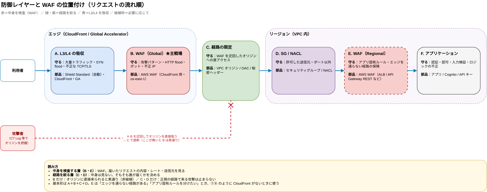
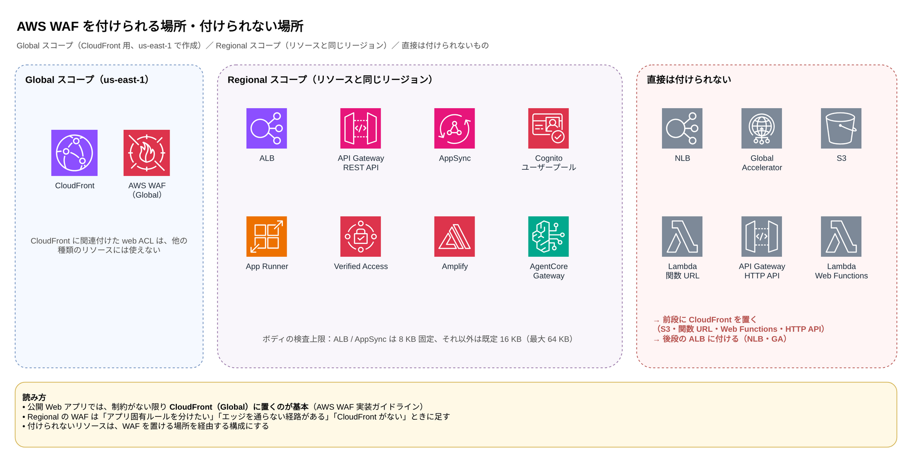
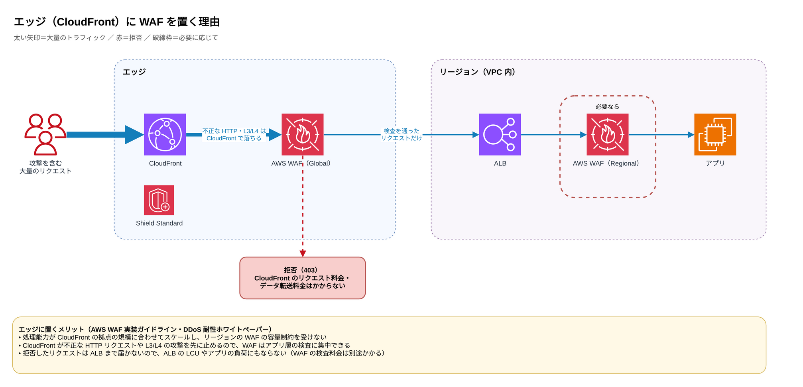
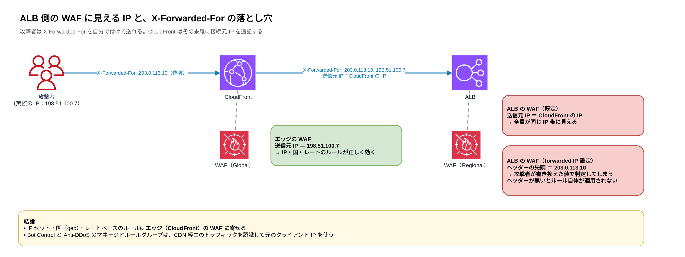
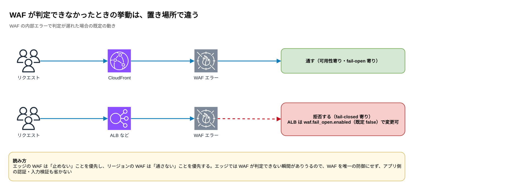
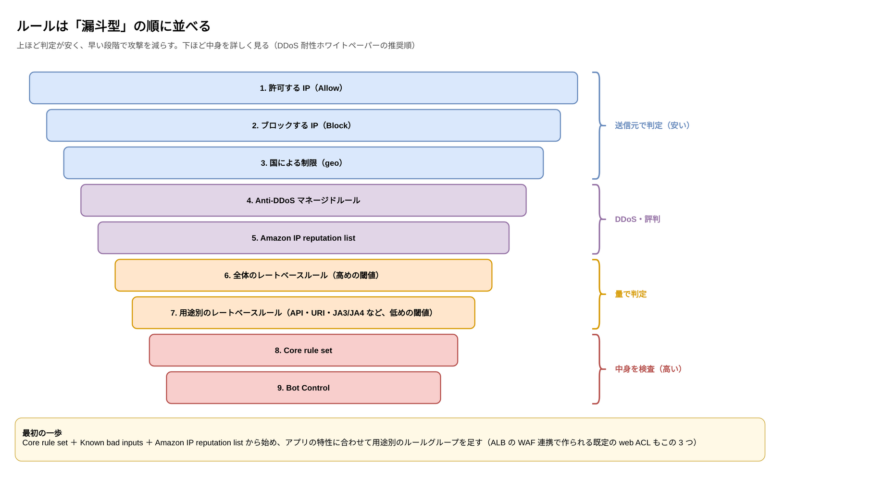
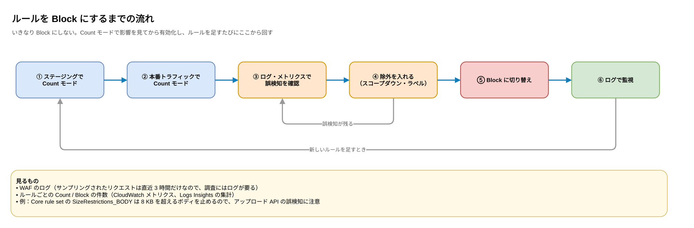

:::message
この記事は、Claude と一緒に AWS 公式ドキュメントやホワイトペーパーを調べ、構成図を作りながら整理した内容をまとめたものです。各記述の根拠は、記事中のリンク先で確認できます。
:::

## はじめに

AWS で Web リクエストを受ける構成を整理していたら、WAF の話だけで 1 本分のボリュームになったので、記事を分けました。構成パターンの話はこちらです。

https://zenn.dev/anfangd/articles/aws-web-ingress-origin-protection

この記事では、WAF を**どこに置くか**（位置付け・置き場所）と、**置いたあとにどう組むか**（注意点・ルール・運用）を、公式ドキュメントの根拠付きでまとめます。

## TL;DR

- WAF は「届いたリクエストの中身を検査する層」で、VPC オリジン・OAC・SG のような「届く経路を絞る層」とは役割が違います。**どちらか一方では足りません**
- 公開 Web アプリでは、**制約がない限り CloudFront（エッジ）に WAF を置く**のが AWS の推奨です。リージョンの WAF（ALB など）は必要なときに足します
- ALB 側の WAF には CloudFront の IP が見えるので、**IP ベースのルールはエッジに寄せる**のが安全です
- ボディを検査できるサイズは **ALB が 8 KB 固定、CloudFront は既定 16 KB（最大 64 KB）** です
- ルールは「早い段階で攻撃を減らす漏斗型」の順に並べ、**Count モードで確かめてから Block** にします

## WAF の歩み

AWS WAF は 2015 年 10 月に、**CloudFront 専用のサービスとして**登場しました。ALB に付けられるようになったのは 2016 年 12 月です。古くから動いている環境で「WAF は CloudFront にだけ付いている」構成を見かけるのは、こうした経緯もあります。

| 時期 | 出来事 |
|---|---|
| 2015 年 10 月 | AWS WAF が登場。対応は CloudFront のみ |
| 2016 年 12 月 | ALB に対応 |
| 2017 年 6 月 | レートベースルールが使えるように |
| 2018 年 11 月 | API Gateway に対応。それまでは自前の CloudFront を前段に置く必要があった |
| 2019 年 11 月 | 新しい AWS WAF（wafv2 API）と AWS Managed Rules が登場。WCU の考え方が入り、旧版は「AWS WAF Classic」に |
| 2020 年 11 月 | ALB で WAF が使えないときの挙動（`waf.fail_open.enabled`）を設定できるように |
| 2021 年 4 月 | Bot Control、ラベル、スコープダウンが登場 |
| 2024 年 2 月 | ALB のコンソールからワンクリックで WAF を有効にできるように |
| 2025 年 6 月 | Anti-DDoS マネージドルールグループが登場 |
| 2025 年 9 月 | AWS WAF Classic のサポートが終了 |

- [Introducing AWS WAF (2015)](https://aws.amazon.com/about-aws/whats-new/2015/10/introducing-aws-waf/)
- [AWS WAF is now available on the Application Load Balancer (2016)](https://aws.amazon.com/about-aws/whats-new/2016/12/AWS-WAF-now-available-on-Application-Load-Balancer/)
- [Updates before 2018 - AWS WAF Developer Guide](https://docs.aws.amazon.com/waf/latest/developerguide/doc-history-early-changes.html)
- [Amazon API Gateway adds support for AWS WAF (2018)](https://aws.amazon.com/blogs/compute/amazon-api-gateway-adds-support-for-aws-waf/)
- [Introducing AWS Managed Rules for AWS WAF (2019)](https://aws.amazon.com/about-aws/whats-new/2019/11/introducing-aws-managed-rules-for-aws-waf/)
- [Document history for Application Load Balancers](https://docs.aws.amazon.com/elasticloadbalancing/latest/application/doc-history.html)
- [Announcing AWS WAF Bot Control (2021)](https://aws.amazon.com/about-aws/whats-new/2021/04/announcing-aws-waf-bot-control/)
- [AWS Application Load Balancer announces one-click WAF integrations (2024)](https://aws.amazon.com/about-aws/whats-new/2024/02/aws-application-load-balancer-one-click-waf-integrations/)
- [AWS WAF now supports automatic application layer DDoS protection (2025)](https://aws.amazon.com/about-aws/whats-new/2025/06/aws-waf-automatic-application-layer-ddos-protection/)
- [Migrating your rules from AWS WAF Classic to the new AWS WAF](https://aws.amazon.com/blogs/security/migrating-rules-from-aws-waf-classic-to-new-aws-waf/)

## WAF の位置付け

VPC オリジン・OAC・セキュリティグループは「誰がオリジンに届くか（経路）」を決めるものです。WAF は層が違い、「届いたリクエストの中身を検査する」ものです。



- **B だけ（WAF だけ）の場合**：オリジンに直接来られると素通りです。「第三者の CloudFront 経由で WAF を迂回される」と言われるのはこれです
- **C・D だけ（経路の限定だけ）の場合**：正規の CloudFront を通って来る SQL インジェクションや HTTP flood は止まりません
- **基本形は A＋B＋C＋D** です（A の Shield Standard は CloudFront や GA を使えば自動で効きます）。E（リージョンの WAF）は、必要なときに足します

### WAF を付けられる場所・付けられない場所

WAF の web ACL を関連付けられるのは、CloudFront、ALB、API Gateway の REST API、AppSync、Cognito ユーザープール、App Runner、Verified Access、Amplify、Bedrock AgentCore Gateway です。CloudFront 用は **Global スコープ（us-east-1 で作成）**、ALB や API Gateway などは **リソースと同じリージョンの Regional スコープ** になります。CloudFront に関連付けた web ACL は、他の種類のリソースには関連付けられません。

逆に、**NLB、Global Accelerator、S3、Lambda 関数 URL、API Gateway の HTTP API には直接付けられません**。これらを WAF で守るなら、前段に CloudFront を置くか、後段の ALB に付けます。



- [Associating or disassociating protection with an AWS resource - AWS WAF](https://docs.aws.amazon.com/waf/latest/developerguide/web-acl-associating-aws-resource.html)

### エッジ（CloudFront）に置くのが基本

AWS の WAF 実装ガイドラインでは、インターネットに公開する Web アプリケーションには、制約がない限り **CloudFront と組み合わせて WAF を置く** ことを推奨しています。理由は次のとおりです。



- CloudFront の WAF の処理能力は CloudFront の拠点の規模に合わせてスケールし、リージョンの WAF の容量制約を受けません
- CloudFront 自体が不正な HTTP リクエストや L3/L4 の攻撃を止めるので、WAF はアプリ層の検査に集中できます
- CloudFront や WAF が拒否したリクエストには、CloudFront の HTTP リクエスト料金やデータ転送料金がかかりません（WAF の検査料金は別途かかります）

リージョンの WAF（E）を足すのは、次のような場合です。

- 1 つのドメインの裏に複数のアプリがあり、エッジでは IP・国による共通のブロック、各 ALB ではアプリ固有のルール、と分けたい場合（ガイドラインに例があります）
- ②（公開 ALB）のように、エッジを通らない経路が論理的に残っている場合の保険
- ⑦（Global Accelerator）や ⑧（公開 ALB 直受け）のように、そもそも CloudFront がない場合（ALB 側が唯一の WAF になります）

- [Guidelines for Implementing AWS WAF (Whitepaper)](https://docs.aws.amazon.com/whitepapers/latest/guidelines-for-implementing-aws-waf/guidelines-for-implementing-aws-waf.html)
- [Amazon CloudFront - AWS Best Practices for DDoS Resiliency](https://docs.aws.amazon.com/whitepapers/latest/aws-best-practices-ddos-resiliency/cloudfront.html)

### 構成パターンごとの置き場所

| パターン | WAF の置き場所 | 補足 |
|---|---|---|
| ① VPC オリジン | CloudFront（Global） | 経路が閉じているので ALB 側は基本不要。アプリ固有ルールを分けたいときだけ ALB にも |
| ② 公開 ALB＋秘密ヘッダー | CloudFront（Global）＋必要に応じて ALB（Regional） | 秘密ヘッダーが漏れたときの保険として ALB 側も検討 |
| ③ S3（OAC） | CloudFront（Global） | S3 には付けられない |
| ④ Lambda 関数 URL（OAC） | CloudFront（Global） | 関数 URL には付けられない |
| ⑤ Regional API Gateway | CloudFront（Global）＋必要に応じて REST API ステージ（Regional） | HTTP API には付けられない |
| ⑥ Private API | CloudFront（Global） | 経路は①と同じ |
| ⑦ Global Accelerator | ALB（Regional） | GA には付けられない。クライアント IP が保持されるので、IP ベースのルールがそのまま効く |
| ⑧ 公開 ALB 直受け | ALB（Regional）※必須 | 唯一の L7 防御。Shield Advanced も検討 |


パターン①〜⑧ の構成そのものは、こちらの記事で解説しています。

https://zenn.dev/anfangd/articles/aws-web-ingress-origin-protection

## 組み合わせるときの注意点

**1. ALB 側の WAF には、クライアントの IP ではなく CloudFront の IP が見える**

CloudFront の後ろにいる ALB から見ると、通信してくる相手は利用者ではなく CloudFront です。WAF も既定ではこの接続元の IP で判定するので、何もしないと全員が CloudFront の IP に見えてしまいます。そのため ALB の WAF で、IP セット、国（geo）、レートベースのルールを使うには、`X-Forwarded-For` などを使う forwarded IP の設定が必要です。

ここで注意したいのが次の 2 点です。

- 指定したヘッダーがリクエストにない場合、WAF は**そのルールをまったく適用しません**
- WAF は**ヘッダーの先頭の IP** を使います。一方 CloudFront は、クライアントが `X-Forwarded-For` を付けて送ってきた場合、その**末尾**に接続元の IP を追記してオリジンに転送します。つまり ALB 側で見る先頭の値は、クライアントが自由に書き換えられます（[Request and response behavior for custom origins](https://docs.aws.amazon.com/AmazonCloudFront/latest/DeveloperGuide/RequestAndResponseBehaviorCustomOrigin.html)）

なお、Bot Control と Anti-DDoS のマネージドルールグループは、CloudFront などの CDN 経由のトラフィックを自動で認識し、元のクライアント IP を使ってくれます。

結論として、**IP ベースのルールはエッジ（CloudFront）の WAF に寄せる** のが安全です。



- [Using forwarded IP addresses in AWS WAF](https://docs.aws.amazon.com/waf/latest/developerguide/waf-rule-statement-forwarded-ip-address.html)

**2. ボディを検査できるサイズが置き場所で違う**

| 置き場所 | ボディの検査上限 |
|---|---|
| ALB / AppSync | **8 KB 固定** |
| CloudFront / API Gateway / Cognito / App Runner / Verified Access | 既定 16 KB、最大 64 KB まで拡張可（追加料金） |

上限を超えた部分は WAF に渡されず、検査されません。また、Core rule set の `SizeRestrictions_BODY` は 8 KB を超えるボディをブロックするので、ファイルアップロードなどの API では誤検知の原因になります。ラベルを使って例外を作りましょう。

- [AWS WAF quotas](https://docs.aws.amazon.com/waf/latest/developerguide/limits.html)
- [Baseline rule groups - Core rule set](https://docs.aws.amazon.com/waf/latest/developerguide/aws-managed-rule-groups-baseline.html)

**3. WAF が内部エラーになったときの挙動が違う**

WAF の内部エラーで判定が遅れた場合、**CloudFront は通常リクエストを通し、リージョンのサービスは通常拒否します**。エッジの WAF は可用性寄り（fail-open 寄り）、ALB の WAF は fail-closed 寄りです。ALB には `waf.fail_open.enabled`（既定 false）の属性もあります。



- [Configuring protection in AWS WAF](https://docs.aws.amazon.com/waf/latest/developerguide/web-acl.html)

## ルールの組み方

DDoS 耐性のホワイトペーパーは、**早い段階で攻撃を減らす「漏斗型」** の順番を推奨しています。上ほど判定が安く、下ほど中身を詳しく見るルールです。



レートベースルールについては、全体に高めの閾値をかけたうえで、キャッシュできない動的なエンドポイントやログインなどの重い処理には、より低い閾値のルールを別に足すのが推奨です。

最初の一歩としては、**ベースラインのルールグループ（Core rule set、Known bad inputs）と Amazon IP reputation list から始め、アプリの特性に合わせて用途別のルールグループを足す** のが勧められています。ALB の WAF 連携で作られる既定の web ACL も、この 3 つの組み合わせです。

- [AWS WAF - AWS Best Practices for DDoS Resiliency](https://docs.aws.amazon.com/whitepapers/latest/aws-best-practices-ddos-resiliency/aws-waf.html)
- [AWS WAF – Rate-based rules](https://docs.aws.amazon.com/whitepapers/latest/aws-best-practices-ddos-resiliency/aws-waf-rate-based-rules.html)
- [Integrations for your Application Load Balancer](https://docs.aws.amazon.com/elasticloadbalancing/latest/application/load-balancer-integrations.html)

## 運用



- **Count モードで試してから Block にする**：ステージングで調整したあと、本番トラフィックでも Count モードで影響を確認してから有効化します（[Testing and tuning your AWS WAF protections](https://docs.aws.amazon.com/waf/latest/developerguide/web-acl-testing.html)）
- **ログを有効にする**：誤検知の調査や攻撃の分析には WAF のログが欠かせません。サンプリングされたリクエスト（直近 3 時間）だけでは足りないことが多いです
- **組織で統一する**：AWS Firewall Manager を使うと、組織全体のアカウントに WAF のポリシーを一括で配布・是正できます
- **Shield Advanced を使う場合**：レートベースルールを含む web ACL の関連付けが前提です。2026年3月26日から、HTTP flood 対策の既定は Anti-DDoS マネージドルールグループになり、従来の L7 自動緩和機能を置き換えています（[Automating application layer DDoS mitigation](https://docs.aws.amazon.com/waf/latest/developerguide/ddos-automatic-app-layer-response.html)）

## 確認・テスト用のコマンド

### 設定の確認

```bash
# CloudFront 用の web ACL は us-east-1 / CLOUDFRONT スコープ
aws wafv2 list-web-acls --scope CLOUDFRONT --region us-east-1 \
  --query 'WebACLs[].[Name,Id]' --output table

# ALB などリージョンのリソースに付いている web ACL
aws wafv2 get-web-acl-for-resource --resource-arn <alb-arn> --region ap-northeast-1 \
  --query 'WebACL.Name' --output text

# ログの出力先が設定されているか
aws wafv2 get-logging-configuration --resource-arn <web-acl-arn> --region us-east-1
```

### ルールが効いているかのテスト

自分が管理するサイトに対してだけ実行してください。最初は Count モードで、メトリクスやログに記録されるかを見るのが安全です。

```bash
URL=https://www.example.com

# XSS のような文字列を含むクエリ → Core rule set で 403
curl -s -o /dev/null -w '%{http_code}\n' "$URL/?q=%3Cscript%3Ealert(1)%3C%2Fscript%3E"

# Log4j の攻撃パターンを含むヘッダー → Known bad inputs で 403
curl -s -o /dev/null -w '%{http_code}\n' -H 'User-Agent: ${jndi:ldap://example.com/a}' "$URL/"

# 8 KB を超えるボディ → Core rule set の SizeRestrictions_BODY で 403（アップロード API の誤検知チェック）
head -c 9000 /dev/zero | tr '\0' 'a' \
  | curl -s -o /dev/null -w '%{http_code}\n' -X POST --data-binary @- "$URL/api/upload"

# 同じ URL に連続アクセス → レートベースルールの閾値を超えると 403 が混ざり始める
# （WAF はレートを約 10 秒ごとに評価するので、すぐには切り替わらない）
for i in $(seq 1 300); do curl -s -o /dev/null -w '%{http_code}\n' "$URL/login"; done | sort | uniq -c
```

### 運用中の調査

```bash
# レートベースルールで現在制限中の IP（IP / forwarded IP で集約しているルールのみ）
aws wafv2 get-rate-based-statement-managed-keys --scope CLOUDFRONT --region us-east-1 \
  --web-acl-name my-acl --web-acl-id <web-acl-id> --rule-name rate-limit-all

# 直近にルールにマッチしたリクエストのサンプル（最大 3 時間前まで）
# date -d は GNU date の書き方（macOS では gdate などを使う）
aws wafv2 get-sampled-requests --web-acl-arn <web-acl-arn> \
  --rule-metric-name AWS-AWSManagedRulesCommonRuleSet \
  --scope CLOUDFRONT --region us-east-1 --max-items 100 \
  --time-window StartTime=$(date -u -d '-1 hour' +%Y-%m-%dT%H:%M:%SZ),EndTime=$(date -u +%Y-%m-%dT%H:%M:%SZ) \
  --query 'SampledRequests[].[Request.ClientIP,Request.URI,Action,RuleNameWithinRuleGroup]' \
  --output table
```

WAF のログを CloudWatch Logs に出している場合は、Logs Insights で「どのルールが何件ブロックしたか」を集計できます。

```sql
fields @timestamp, httpRequest.clientIp, httpRequest.uri, terminatingRuleId, action
| filter action = "BLOCK"
| stats count(*) as blocked by terminatingRuleId
| sort blocked desc
```

## おわりに

Terraform でインフラを管理していると、WAF のルールを少し変えただけで全部変わったように見えるのが、いつも面倒だなと思っています。
