:::message
この記事は、Claude と一緒に AWS 公式ドキュメントを調べ、構成図を作りながら整理した内容をまとめたものです。各設定の根拠は、記事中のリンク先の公式ドキュメントで確認できます。

2026年11月に、⑨ Lambda Web Functions、VPC オリジンが止まったときの備え、9 パターン以外の入口の一覧を追記しました。
:::

## はじめに

先日、X（旧Twitter）でこんな趣旨の話題が流れてきました。

- CloudFront + WAF → ALB の構成では、ALB の SG に CloudFront のプレフィックスリストを入れて直接アクセスを防ぐ
- ただし ALB のドメインが知られると、**第三者が作った CloudFront 経由で WAF を迂回される**。そのため秘密ヘッダーでの照合が必要
- さらに、**CT Log が知られるようになってから、Host ヘッダー付きの攻撃が増えた**

元の投稿はこちらです。

@[tweet](https://twitter.com/nasub7373/status/2117957893232451709)

3 つ目の「Host ヘッダー付きの攻撃」は、CloudFront を通らずに ALB へ直接リクエストを送る攻撃のことです。まず DNS で ALB の IP アドレスを引き、その IP アドレスに TCP / TLS で直接つなぎます。そのうえで、HTTP リクエストの Host ヘッダーに本来のドメイン名を入れます。ALB は Host ヘッダーを見てどのサイトに振り分けるかを決めているので、リクエストは CloudFront に置いた WAF を通らずに、本物のサイトへ届きます。CT Log は、その入り口になるホスト名を探すのに使われます（詳しくは[CT Log の記事](https://zenn.dev/anfangd/articles/ct-log-hostname-exposure-ca-ct)）。

@[tweet](https://twitter.com/___nix___/status/2117996284783300621)

どちらも重要な指摘です。一方で、2024年11月に **CloudFront VPC オリジン** が登場してから、選べる構成はかなり変わっています。

この記事では、AWS で Web リクエストを受ける代表的な 9 パターンを、**公式ドキュメントの根拠付き**で、構成図と設定プラクティスにまとめます。

## TL;DR

- 公式ドキュメントから読み取れる優先順位は **「VPC オリジン / OAC（マネージド）→ 使えない場合のみ プレフィックスリスト＋秘密ヘッダー」**
- **プレフィックスリストだけでは不十分**です。他人の CloudFront も同じ IP 帯から来るため、本体は秘密ヘッダーの照合です
- **CT Log** にはオリジン用に取った証明書のホスト名が載るので、「ホスト名は知られる前提」で設計します
- 新規構築なら **VPC オリジン＋`CloudFront-VPCOrigins-Service-SG` 限定** が第一候補です。名前を知られても、そもそも到達できません
- VPC オリジンも止まることはあります（2026年7月）。接続できないときは、それだけで既定で最大 30 秒待つので、**切り替えるまでの待ち時間と切り替え先**は先に決めておきます
- **WAF は「中身を検査する層」、VPC オリジン / OAC / SG は「届く経路を絞る層」** です。役割が違うので両方必要で、WAF の主戦場はエッジ（CloudFront）です

## 以前のプラクティスと、いまのプラクティス

私自身、2015〜2017 年頃から「ELB（のちに ALB）をインターネットに公開し、その前に CloudFront を置く」構成を何度も作ってきました。当時はそれが一般的な作り方で、**SG で CloudFront の IP に絞る**、**秘密ヘッダーで照合する**、といった対策をプラクティスとして実装していました。

ALB をインターネットに公開する構成は今もよく見かけますし、それ自体が間違いというわけではありません。ただ、ここ数年でオリジンを閉じるためのマネージドな仕組みがそろい、**同じ要件をよりセキュアに、しかも運用負荷を下げて作れる**ようになっています。

| 時期 | 出来事 | 何が変わったか |
|---|---|---|
| 2015年12月 | CloudFront がオリジンへのカスタムヘッダー追加に対応 | 秘密ヘッダーで「CloudFront 経由か」を照合できるように |
| 2016年頃 | AWS Security Blog で、CloudFront の IP 範囲を Lambda で SG に自動反映する方法が紹介される | SG で CloudFront の IP に絞る方式が広まる |
| 2016年8月 | ALB 登場 | CloudFront → ALB の構成が定番に |
| 2020年10月 | AWS Security Blog で、WAF＋Secrets Manager による秘密ヘッダーのローテーションが紹介される | 秘密ヘッダー方式の運用（ローテーション）が整う |
| 2022年2月 | CloudFront のマネージドプレフィックスリスト | IP 範囲を Lambda で更新する仕組みが不要に |
| 2022年8月 | OAC（S3 向け） | OAI の制約（SSE-KMS など）が解消 |
| 2024年4月 | OAC が Lambda 関数 URL に対応 | 関数 URL も CloudFront 専用にできるように |
| 2024年11月 | **VPC オリジン** | ALB / NLB / EC2 をプライベートサブネットに置いたまま CloudFront から使えるように |
| 2025年9月 | CloudFront が IPv6 のオリジンに対応（S3 と VPC オリジンを除く） | CloudFront からオリジンまで IPv6 で届けられるように |
| 2025年11月 | VPC オリジンのクロスアカウント対応 | CloudFront とオリジンを別アカウントに分けた構成でも使えるように |
| 2026年10月 | VPC オリジンのデュアルスタック対応 | VPC オリジンでも、オリジンまで IPv6 で届けられるように |
| 2026年10月 | **Lambda Web Functions**（CloudFront の OAC にも対応） | Node.js の Web サーバーをそのまま Lambda で動かし、CloudFront 専用にできるように（⑨） |

AWS 自身も、VPC オリジンの発表で「これまで VPC 内のオリジンはパブリックサブネットに置く必要があった」と書いています。つまり、10 年近く定番だった「ALB を公開して IP 制限と秘密ヘッダーで守る」方式は、今では**VPC オリジンが使えない場合のフォールバック**という位置付けになりました。

この記事は、そうした変化を踏まえて「いま新しく作るなら、あるいは見直すなら、どう作るか」を整理したものです。

- [Now Add or Modify Request Headers Forwarded From Amazon CloudFront to Origin (2015)](https://aws.amazon.com/about-aws/whats-new/2015/12/now-add-or-modify-request-headers-forwarded-from-amazon-cloudfront-to-origin/)
- [How to Automatically Update Your Security Groups for Amazon CloudFront and AWS WAF by Using AWS Lambda (AWS Security Blog)](https://aws.amazon.com/blogs/security/how-to-automatically-update-your-security-groups-for-amazon-cloudfront-and-aws-waf-by-using-aws-lambda/)
- [Announcing Application Load Balancer for Elastic Load Balancing (2016)](https://aws.amazon.com/about-aws/whats-new/2016/08/announcing-application-load-balancer-for-elastic-load-balancing/)
- [How to enhance Amazon CloudFront origin security with AWS WAF and AWS Secrets Manager (AWS Security Blog, 2020)](https://aws.amazon.com/blogs/security/how-to-enhance-amazon-cloudfront-origin-security-with-aws-waf-and-aws-secrets-manager/)
- [Amazon VPC now supports an AWS-managed prefix list for Amazon CloudFront (2022)](https://aws.amazon.com/about-aws/whats-new/2022/02/amazon-cloudfront-managed-prefix-list/)
- [Amazon CloudFront launches Origin Access Control (OAC) (2022)](https://aws.amazon.com/about-aws/whats-new/2022/08/amazon-cloudfront-origin-access-control/)
- [Amazon CloudFront now supports OAC for Lambda function URL origins (2024)](https://aws.amazon.com/about-aws/whats-new/2024/04/amazon-cloudfront-oac-lambda-function-url-origins/)
- [Amazon CloudFront announces VPC origins (2024)](https://aws.amazon.com/about-aws/whats-new/2024/11/amazon-cloudfront-vpc-origins/)
- [Introducing cross-account support for Amazon CloudFront VPC origins](https://aws.amazon.com/blogs/networking-and-content-delivery/introducing-cross-account-support-for-amazon-cloudfront-virtual-private-cloud-vpc-origins/)
- [Amazon CloudFront announces support for IPv6 origins (2025)](https://aws.amazon.com/about-aws/whats-new/2025/09/amazon-cloudfront-ipv6-origins/)
- [Amazon CloudFront announces dual-stack support for VPC origins (2026)](https://aws.amazon.com/about-aws/whats-new/2026/10/cloudfront-vpc-origin-dualstack/)
- [Amazon CloudFront now supports AWS Lambda Web Functions as an origin (2026)](https://aws.amazon.com/about-aws/whats-new/2026/10/cloudfront-lambda-web-functions-origin/)

## 前提知識

### プレフィックスリストだけではダメな理由

`com.amazonaws.global.cloudfront.origin-facing` は「CloudFront 全体」の IP 帯です。自社のディストリビューションに限った IP 帯ではありません。攻撃者が自分の AWS アカウントで CloudFront を作り、オリジンにあなたの ALB を指定すれば、SG は素通りします。WAF は「あなたの CloudFront」に付いているので、当然かかりません。

そのため公式ドキュメントでも、プレフィックスリストは **Optional（追加の防御層）** という位置付けです。本体は、カスタムヘッダーを ALB のリスナールールで照合する仕組みです。

- [Restrict access to Application Load Balancers - Amazon CloudFront](https://docs.aws.amazon.com/AmazonCloudFront/latest/DeveloperGuide/restrict-access-to-load-balancer.html)

### CT Log（Certificate Transparency：証明書の透明性）とは

CT は、公的な CA（Certificate Authority：認証局）が発行した TLS 証明書を、誰でも検索できる公開ログにすべて記録する仕組みです。ブラウザが CT を必須にしているため、**ACM で発行した証明書も必ず記録され、オプトアウトできません**。

そのため `crt.sh` などで検索すれば、`origin.example.com` のように証明書を取ったホスト名を誰でも一覧できます。攻撃者はこれを偵察に使い、証明書の発行から数分でスキャンが来ることも観測されています。

**DNS を公開していなくても、公的な証明書を取った時点でホスト名は知られる** と考えておきましょう。ワイルドカード証明書で個別のホスト名を隠すことはできますが、それは推測しにくくするだけの隠蔽策です。本筋は「名前を知られても届かない」構成にすることです。

CA と CT の仕組み（構成・発行・検証・監視）は、図解付きで別の記事にまとめました。

https://zenn.dev/anfangd/articles/ct-log-hostname-exposure-ca-ct

- [AWS Certificate Manager concepts - Certificate Transparency Logging](https://docs.aws.amazon.com/acm/latest/userguide/acm-concepts.html)

## 選定フロー

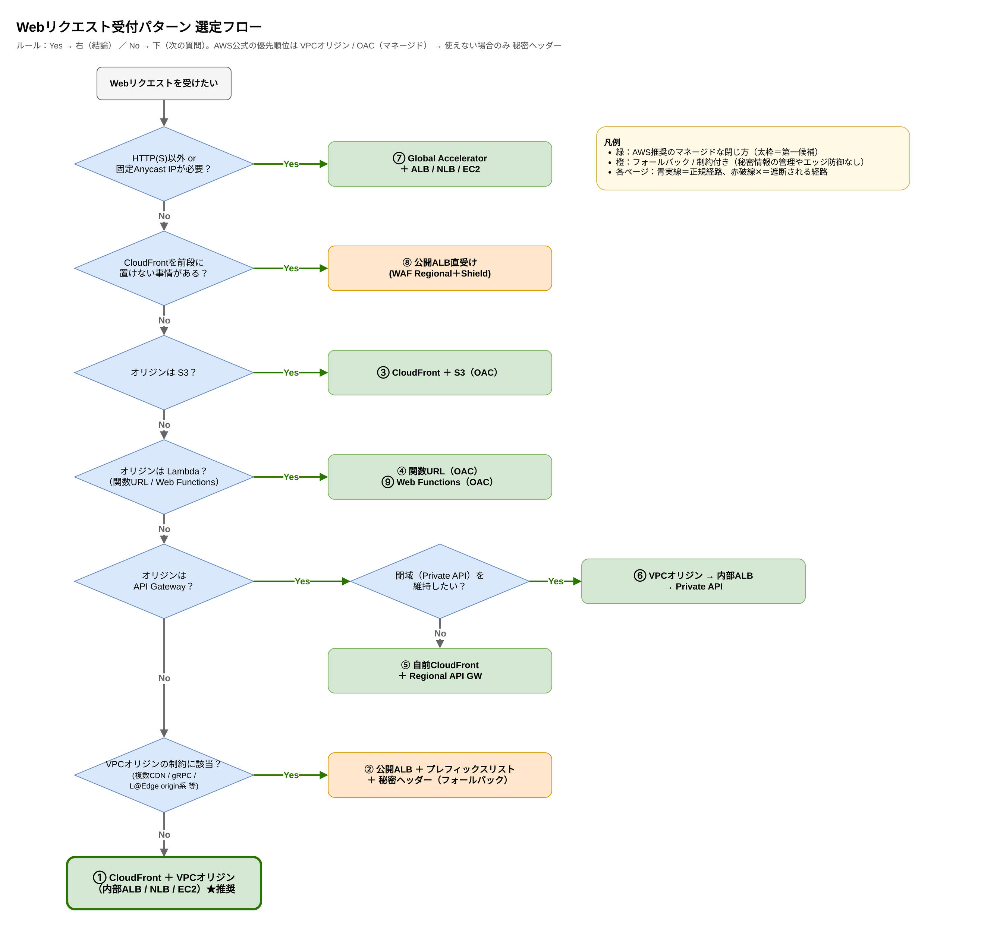

DDoS 耐性のホワイトペーパーでは、CloudFront の背後に VPC 内のオリジンを置く場合、**VPC オリジンが最新かつ推奨の方法** とされています。S3・AWS Elemental・Lambda 関数 URL については、引き続き **OAC が推奨** です。

- [Protecting your origin (BP1, BP5) - AWS Best Practices for DDoS Resiliency](https://docs.aws.amazon.com/whitepapers/latest/aws-best-practices-ddos-resiliency/protecting-your-origin-bp1-bp5.html)

CloudFront の FAQ でも、マネージドな仕組みで要件を満たせない場合の代替として、カスタムオリジンヘッダーが挙げられています。

- [Amazon CloudFront FAQs](https://aws.amazon.com/cloudfront/faqs/)

---

## ① CloudFront + VPC オリジン（内部 ALB）★第一候補

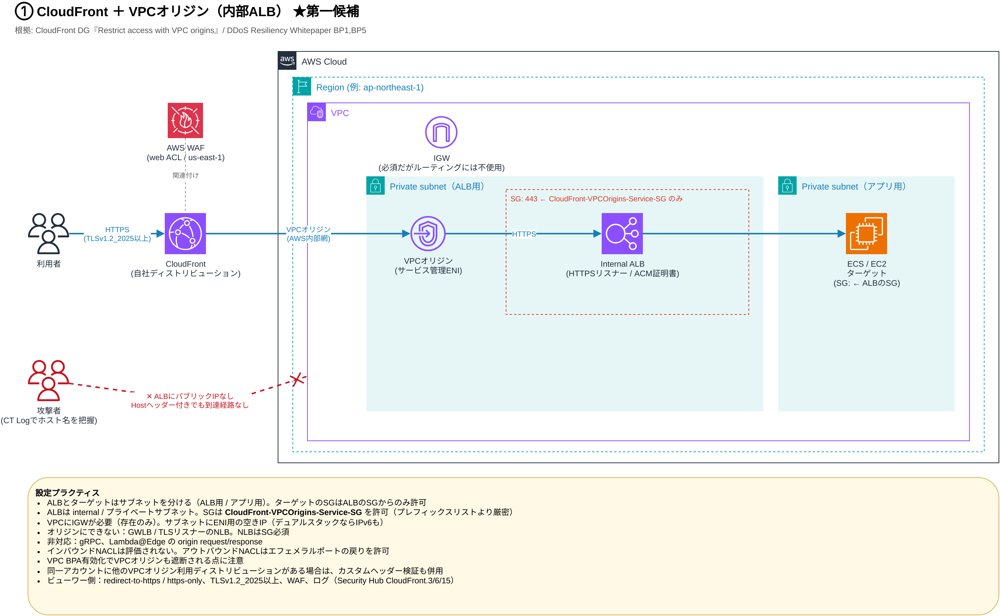

プライベートサブネットにある ALB / NLB / EC2 を、CloudFront のオリジンとして直接使えます。ALB にパブリック IP がないため、**CT Log でホスト名を知られても、ALB の IP アドレスに直接つないで HTTP の Host ヘッダーに本来のドメイン名を入れても、インターネットから届く経路自体がありません**。VPC オリジンの利用に追加料金はかかりません。

### 設定プラクティス

| 項目 | 推奨 |
|---|---|
| ALB | `internal`、プライベートサブネット、HTTPS リスナー（ACM 証明書） |
| ALB の SG | **`CloudFront-VPCOrigins-Service-SG` を許可**（プレフィックスリストより厳密で、自アカウントの CloudFront に限定できる） |
| VPC | **IGW が必要**（存在さえすればよく、ルーティングには使われない） |
| サブネット | サービス管理 ENI 用の空き IP（デュアルスタックなら IPv6 も） |
| NACL | インバウンドは評価されない。アウトバウンドは戻りのエフェメラルポートを許可 |

### 制約・注意点

- オリジンにできないもの：GWLB、TLS リスナーを持つ NLB。NLB には SG の付与が必須です
- 非対応の機能：gRPC、Lambda@Edge の origin request / origin response トリガー
- **VPC Block Public Access** を有効にすると、VPC オリジンの通信も止まります
- VPC オリジンで絞れるのは「自アカウント内で VPC オリジンを設定したディストリビューション」までです。同じアカウントに複数のディストリビューションがあり、特定のディストリビューションだけに限定したい場合は、カスタムヘッダーの検証も併用します（[Origin cloaking](https://aws.amazon.com/developer/application-security-performance/articles/origin-cloaking)）

:::details Terraform 例：VPC オリジンとサービス管理 SG の参照

```hcl:vpc_origin.tf
resource "aws_cloudfront_vpc_origin" "alb" {
  vpc_origin_endpoint_config {
    name                   = "internal-alb"
    arn                    = aws_lb.internal.arn
    http_port              = 80
    https_port             = 443
    origin_protocol_policy = "https-only"

    origin_ssl_protocols {
      items    = ["TLSv1.2"]
      quantity = 1
    }
  }
}

# ディストリビューション側
# origin {
#   domain_name = aws_lb.internal.dns_name
#   origin_id   = "internal-alb"
#   vpc_origin_config {
#     vpc_origin_id = aws_cloudfront_vpc_origin.alb.id
#   }
# }

# VPC オリジン作成後に、AWS が自動作成するサービス管理 SG を参照する
data "aws_security_group" "cf_vpc_origins" {
  vpc_id = aws_vpc.main.id
  filter {
    name   = "group-name"
    values = ["CloudFront-VPCOrigins-Service-SG"]
  }
  depends_on = [aws_cloudfront_vpc_origin.alb]
}

resource "aws_vpc_security_group_ingress_rule" "alb_from_cf_vpc_origins" {
  security_group_id            = aws_security_group.alb.id
  referenced_security_group_id = data.aws_security_group.cf_vpc_origins.id
  ip_protocol                  = "tcp"
  from_port                    = 443
  to_port                      = 443
}
```
:::

:::message alert
`CloudFront-VPCOrigins-Service-SG` は AWS が管理するため、編集してはいけません。参照するだけにしてください。
:::

:::details 確認コマンド
```bash
# ALB が internal になっているか（internet-facing なら見直し）
aws elbv2 describe-load-balancers --names my-alb \
  --query 'LoadBalancers[].[LoadBalancerName,Scheme,DNSName]' --output table

# VPC オリジンの一覧と状態（Deployed になっているか）
aws cloudfront list-vpc-origins \
  --query 'VpcOriginList.Items[].[Id,Name,Status]' --output table

# サービス管理 SG の ID（ALB の SG のインバウンド許可元にする）
aws ec2 describe-security-groups \
  --filters Name=group-name,Values=CloudFront-VPCOrigins-Service-SG \
  --query 'SecurityGroups[].[GroupId,VpcId]' --output table

# インターネットから ALB に直接届かないこと（タイムアウトすれば OK）
curl -sS -m 5 -o /dev/null -w '%{http_code}\n' \
  https://internal-my-alb-123456789.ap-northeast-1.elb.amazonaws.com/

# CloudFront 経由では届くこと（200 など）
curl -s -o /dev/null -w '%{http_code}\n' https://www.example.com/
```
:::

根拠：
- [Restrict access with VPC origins - Amazon CloudFront](https://docs.aws.amazon.com/AmazonCloudFront/latest/DeveloperGuide/private-content-vpc-origins.html)
- [VPC BPA basics - Amazon VPC](https://docs.aws.amazon.com/vpc/latest/userguide/security-vpc-bpa-basics.html)
- [Introducing CloudFront VPC Origins (AWS Blog)](https://aws.amazon.com/blogs/networking-and-content-delivery/introducing-cloudfront-virtual-private-cloud-vpc-origins-shield-your-web-applications-from-public-internet/)

### VPC オリジンが止まったときの備え

2026年7月16日の 16:45〜20:18（日本時間）に、VPC オリジンを使うディストリビューションで 5xx エラーが増える障害がありました。S3 や公開 ALB など、ほかの種類のオリジンには影響がありませんでした。AWS は当日、VPC オリジンが必須でなければオリジンの種類を変えるよう案内しています。経緯や当日の迂回の手順は、DevelopersIO に詳しい記事があります（末尾の関連する記事を参照）。

障害そのものは防げないので、ここでは前もって決めておけることを並べます。

| 決めておくこと | 内容 |
|---|---|
| 切り替えるまでの待ち時間 | 接続タイムアウトは既定で 10 秒、試行は 3 回です。接続できない場合、オリジングループのセカンダリに切り替わるまで既定で**最大 30 秒**待ちます。タイムアウト（1〜10 秒）や試行回数（1〜3 回）を下げると短くできますが、接続の確立が遅いだけのときにも切り替わりやすくなります。接続できたあとに応答が返らない場合は、応答タイムアウト（既定 30 秒）が別にかかり、GET と HEAD は試行回数ぶんやり直すので、待ちはさらに長くなりえます |
| 切り替え先 | オリジングループのセカンダリに、S3 のメンテナンスページや、VPC オリジンを使わない経路を置きます。切り替わるのは GET、HEAD、OPTIONS だけで、POST などは切り替わりません。OPTIONS は、キャッシュ対象のメソッドに入れている場合だけです |
| キャッシュで持たせる | `Cache-Control` に `stale-if-error` を付けておくと、オリジンがエラーのときに有効期限切れのキャッシュを返せます |
| 迂回路 | VPC オリジンを使わない経路（②など）を、障害が起きてから作るのか、閉じた状態で用意しておくのかを決めます |
| 検知 | VPC オリジンが作る ENI について、ドキュメントにはメトリクスの記載がありません（鈴木さんの発表資料でも、提供されない点が指摘されています）。CloudFront の 5xx エラー率やオリジンのレイテンシーで異常を見ます |

根拠：
- [Origin settings（Connection attempts / Connection timeout） - Amazon CloudFront](https://docs.aws.amazon.com/AmazonCloudFront/latest/DeveloperGuide/DownloadDistValuesOrigin.html)
- [Optimize high availability with CloudFront origin failover](https://docs.aws.amazon.com/AmazonCloudFront/latest/DeveloperGuide/high_availability_origin_failover.html)
- [Manage how long content stays in the cache (expiration) - Amazon CloudFront](https://docs.aws.amazon.com/AmazonCloudFront/latest/DeveloperGuide/Expiration.html)

---

## ② CloudFront + 公開 ALB（プレフィックスリスト＋秘密ヘッダー）※フォールバック

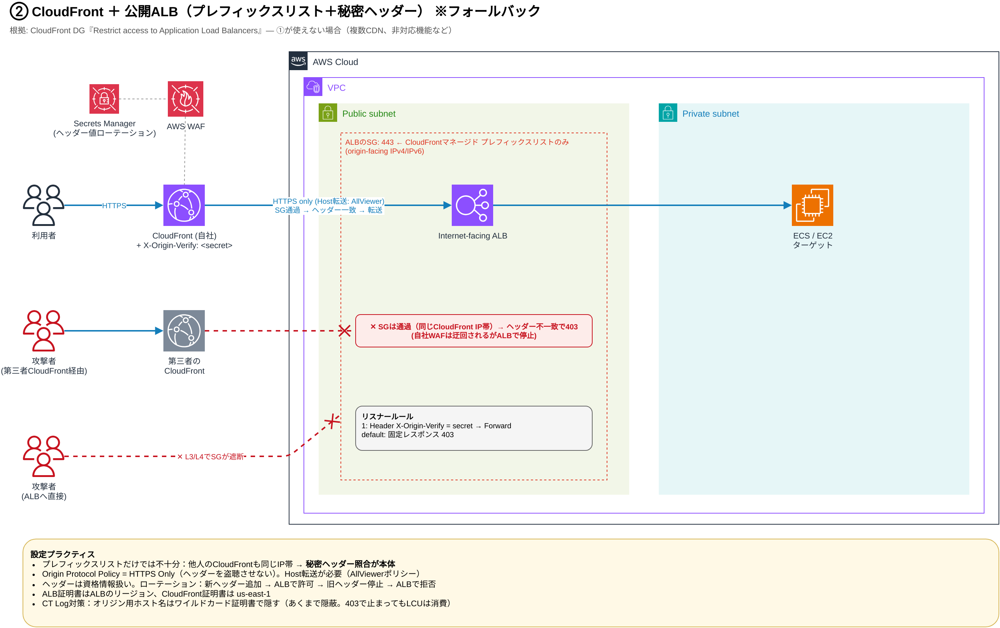

この構成を選ぶのは、ALB を複数の CDN から使う場合や、VPC オリジンが使えない機能に依存している場合です。冒頭の X の話題はこの構成のことです。

図の 2 つの攻撃経路がポイントです。

- **ALB へ直接**：SG（L3/L4）で遮断されます
- **第三者の CloudFront 経由**：SG は**通過します**（同じ CloudFront の IP 帯なので）。ただしヘッダーが一致しないため、ALB のデフォルトルールで 403 になります

### 設定プラクティス

- CloudFront のオリジンカスタムヘッダーに秘密の値（例：`X-Origin-Verify`）を設定します
- ALB リスナーのルールは「ヘッダー一致なら転送」、**デフォルトアクションは固定レスポンス 403**（fail-closed）にします
- **Origin Protocol Policy は HTTPS Only** にします（ヘッダーの盗聴を防ぐため）。この場合、オリジンリクエストポリシーで Host ヘッダーを転送する必要があります（AllViewer が使えます）
- 証明書は、CloudFront 用を `us-east-1`、ALB 用を ALB のリージョンで用意します
- ヘッダーは**資格情報として扱い、定期的にローテーション**します（Secrets Manager＋Lambda で自動化するのが定番）

ローテーションは、公式ドキュメントにある次の 4 段階で行うと無停止で切り替えられます。

1. CloudFront に**新しい**ヘッダーを追加する
2. ALB のルールで新しいヘッダーを許可する
3. CloudFront で**古い**ヘッダーの付与をやめる
4. ALB のルールで古いヘッダーを拒否する

:::details Terraform 例：プレフィックスリストと秘密ヘッダー照合（fail-closed）

```hcl:alb_secret_header.tf
data "aws_ec2_managed_prefix_list" "cloudfront" {
  name = "com.amazonaws.global.cloudfront.origin-facing"
}

resource "aws_vpc_security_group_ingress_rule" "alb_from_cloudfront" {
  security_group_id = aws_security_group.alb.id
  prefix_list_id    = data.aws_ec2_managed_prefix_list.cloudfront.id
  ip_protocol       = "tcp"
  from_port         = 443
  to_port           = 443
}

resource "aws_lb_listener" "https" {
  load_balancer_arn = aws_lb.public.arn
  port              = 443
  protocol          = "HTTPS"
  certificate_arn   = aws_acm_certificate.origin.arn
  ssl_policy        = "ELBSecurityPolicy-TLS13-1-2-2021-06"

  # fail-closed: ヘッダーが一致しなければ 403
  default_action {
    type = "fixed-response"
    fixed_response {
      content_type = "text/plain"
      message_body = "Access denied"
      status_code  = "403"
    }
  }
}

resource "aws_lb_listener_rule" "from_cloudfront" {
  listener_arn = aws_lb_listener.https.arn
  priority     = 1

  action {
    type             = "forward"
    target_group_arn = aws_lb_target_group.app.arn
  }

  condition {
    http_header {
      http_header_name = "X-Origin-Verify"
      values           = [var.origin_verify_secret] # ローテーション時は新旧2値を並べる
    }
  }
}
```
:::

:::message
秘密の値は Terraform の state に平文で残ります。state の保管場所の暗号化とアクセス制御もセットで考えてください。
:::

:::message alert
公式ドキュメントのサンプル（CloudFormation）は `ViewerProtocolPolicy: allow-all` になっています。そのまま使うと Security Hub の CloudFront.3 に引っかかるので、`redirect-to-https` か `https-only` にしましょう。
:::

:::details 確認コマンド
```bash
# CloudFront のプレフィックスリスト ID（SG のインバウンド許可元にする）
# MaxEntries は SG のルール数として数えられるので、SG のクォータに注意
aws ec2 describe-managed-prefix-lists \
  --filters Name=prefix-list-name,Values=com.amazonaws.global.cloudfront.origin-facing \
  --query 'PrefixLists[].[PrefixListId,PrefixListName,MaxEntries]' --output table

# リスナールールが「ヘッダー一致なら forward、デフォルトは fixed-response」になっているか
aws elbv2 describe-rules --listener-arn <listener-arn> \
  --query 'Rules[].[Priority,Conditions[0].HttpHeaderConfig.HttpHeaderName,Actions[0].Type]' \
  --output table

# ALB に直接：SG で遮断されてタイムアウトになること
curl -sS -m 5 -o /dev/null -w '%{http_code}\n' \
  https://my-alb-123456789.ap-northeast-1.elb.amazonaws.com/

# 正規の CloudFront 経由：200 になること
curl -s -o /dev/null -w '%{http_code}\n' https://www.example.com/
```
:::

根拠：
- [Restrict access to Application Load Balancers - Amazon CloudFront](https://docs.aws.amazon.com/AmazonCloudFront/latest/DeveloperGuide/restrict-access-to-load-balancer.html)
- [Optimizing application performance: CloudFront with ALB (AWS Blog)](https://aws.amazon.com/blogs/networking-and-content-delivery/optimizing-application-performance-the-strategic-benefits-of-combining-amazon-cloudfront-with-application-load-balancers/)

---

## ③ CloudFront + S3（OAC）

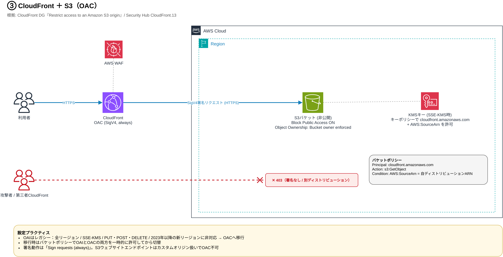

S3 なら OAC（Origin Access Control）一択です。OAI はレガシー扱いで、次の点に対応していません。

- 全リージョンの S3 バケット（オプトインリージョンや、2023年1月以降の新リージョンなど）
- SSE-KMS
- 動的リクエスト（PUT / POST / DELETE）

### 設定プラクティス

- バケットは非公開にし、Block Public Access を ON、Object Ownership は **Bucket owner enforced** にします
- バケットポリシーのプリンシパルは `cloudfront.amazonaws.com` にし、`AWS:SourceArn` で**自社のディストリビューションに限定**します
- 署名動作は **Sign requests（always）** にします。この設定のときだけ、CloudFront → S3 の通信が常に HTTPS になります
- SSE-KMS を使う場合は、キーポリシーでも CloudFront を許可します
- S3 のウェブサイトエンドポイントはカスタムオリジン扱いになるため、OAC は使えません
- OAI からの移行では、まずバケットポリシーで OAI と OAC の両方を一時的に許可してから切り替えます

:::details 確認コマンド
```bash
# OAC の署名動作が always になっているか
aws cloudfront list-origin-access-controls \
  --query 'OriginAccessControlList.Items[].[Id,Name,OriginAccessControlOriginType,SigningBehavior]' \
  --output table

# バケットポリシー：Principal が cloudfront.amazonaws.com、AWS:SourceArn が自分のディストリビューションか
aws s3api get-bucket-policy --bucket my-bucket --query Policy --output text | jq .

# S3 に直接アクセスすると 403、CloudFront 経由なら 200
curl -s -o /dev/null -w '%{http_code}\n' https://my-bucket.s3.ap-northeast-1.amazonaws.com/index.html
curl -s -o /dev/null -w '%{http_code}\n' https://www.example.com/index.html
```
:::

根拠：
- [Restrict access to an Amazon S3 origin - Amazon CloudFront](https://docs.aws.amazon.com/AmazonCloudFront/latest/DeveloperGuide/private-content-restricting-access-to-s3.html)
- [Security Hub CSPM controls for CloudFront（CloudFront.13）](https://docs.aws.amazon.com/securityhub/latest/userguide/cloudfront-controls.html)

---

## ④ CloudFront + Lambda 関数 URL（OAC）

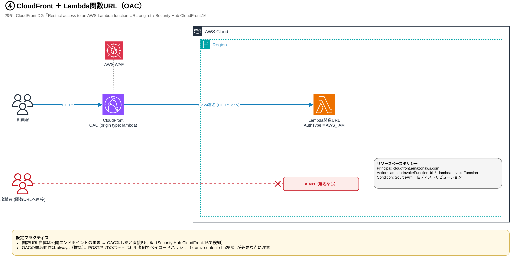

関数 URL 自体は公開エンドポイントのままです。そのため **OAC を付けないと直接叩けてしまいます**。Security Hub でも CloudFront.16 として検知対象になっています。

### 設定プラクティス

- 関数 URL の `AuthType` は **`AWS_IAM`** にします
- リソースベースポリシーでは、`cloudfront.amazonaws.com` に **`lambda:InvokeFunctionUrl` と `lambda:InvokeFunction` の両方**を許可し、`SourceArn` で自社のディストリビューションに限定します
- OAC の署名動作は always にします
- オリジンリクエストポリシーは `AllViewerExceptHostHeader` にします（関数 URL も Host ヘッダーに自分のドメイン名を期待するため）
- POST / PUT でボディを送る場合は、利用者側でペイロードのハッシュ（`x-amz-content-sha256`）を計算する必要がある点に注意してください

:::details 確認コマンド
```bash
# AuthType が AWS_IAM になっているか
aws lambda get-function-url-config --function-name my-fn \
  --query '[FunctionUrl,AuthType]' --output text

# リソースベースポリシーに InvokeFunctionUrl と InvokeFunction の両方があるか
aws lambda get-policy --function-name my-fn --query Policy --output text | jq .

# 関数 URL に直接アクセスすると 403
curl -s -o /dev/null -w '%{http_code}\n' https://abcdefghij.lambda-url.ap-northeast-1.on.aws/
```
:::

根拠：
- [Restrict access to an AWS Lambda function URL origin - Amazon CloudFront](https://docs.aws.amazon.com/AmazonCloudFront/latest/DeveloperGuide/private-content-restricting-access-to-lambda.html)
- [Use various origins with CloudFront distributions](https://docs.aws.amazon.com/AmazonCloudFront/latest/DeveloperGuide/DownloadDistS3AndCustomOrigins.html)

---

## ⑤ 自社の CloudFront + Regional API Gateway（公開 API）

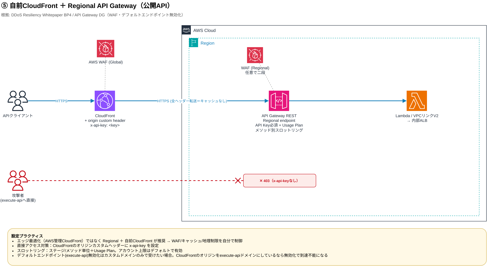

REST API にはエッジ最適化エンドポイント（AWS が管理する CloudFront）もありますが、DDoS 耐性のホワイトペーパーでは **Regional エンドポイント＋自社で管理する CloudFront** が推奨されています。WAF、キャッシュ、地理制限を自分でコントロールできるからです。

### 設定プラクティス

- オリジンリクエストポリシーは **`AllViewerExceptHostHeader`**、キャッシュポリシーは `CachingDisabled` にします。API Gateway は Host ヘッダーに自分のドメイン名を期待するため、ビューワーの Host を転送すると 403 になります（[Use managed origin request policies](https://docs.aws.amazon.com/AmazonCloudFront/latest/DeveloperGuide/using-managed-origin-request-policies.html)）
- **直接アクセス対策**として、CloudFront のオリジンカスタムヘッダーに `x-api-key` を設定し、API Gateway 側で API キーを必須にします
- メソッド単位のスロットリングと Usage Plan で、バックエンドを過剰なトラフィックから守ります
- WAF は、同じリージョンの Regional web ACL をステージに関連付けることもできます（CloudFront の WAF との二段構え）
- カスタムドメインだけで受けたい場合は、デフォルトの `execute-api` エンドポイントを無効化できます。ただし **CloudFront のオリジンを `execute-api` ドメインにしているなら、無効化した時点で到達できなくなる**ので、オリジン側もカスタムドメインにしておく必要があります

:::details 確認コマンド
```bash
# エンドポイントの種類（REGIONAL）と、デフォルトエンドポイントの無効化状態
aws apigateway get-rest-api --rest-api-id abc123 \
  --query '[name,endpointConfiguration.types,disableExecuteApiEndpoint]'

# execute-api に API キーなしで直接アクセスすると 403
curl -s -o /dev/null -w '%{http_code}\n' \
  https://abc123.execute-api.ap-northeast-1.amazonaws.com/prod/items
```
:::

根拠：
- [Protecting API endpoints (BP4) - AWS Best Practices for DDoS Resiliency](https://docs.aws.amazon.com/whitepapers/latest/aws-best-practices-ddos-resiliency/protecting-api-endpoints-bp4.html)
- [Use AWS WAF to protect your REST APIs in API Gateway](https://docs.aws.amazon.com/apigateway/latest/developerguide/apigateway-control-access-aws-waf.html)
- [Disable the default endpoint for REST APIs](https://docs.aws.amazon.com/apigateway/latest/developerguide/rest-api-disable-default-endpoint.html)

---

## ⑥ CloudFront → VPC オリジン → 内部 ALB → Private API（閉域を維持）

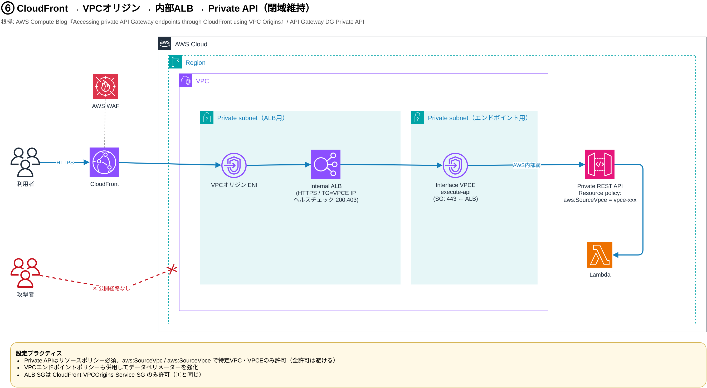

API Gateway を Private API のまま CloudFront から公開したい場合の構成です。VPC オリジンで内部 ALB に入り、ALB のターゲットに `execute-api` インターフェイス VPC エンドポイントの IP を登録します。

### 設定プラクティス

- Private API は**リソースポリシーが必須**です。`aws:SourceVpc` / `aws:SourceVpce` で特定の VPC・VPC エンドポイントだけを許可し、全許可にはしません
- VPC エンドポイントポリシーも併用して、データペリメーターを強化します
- ALB のターゲットグループのヘルスチェックは `200,403` を成功扱いにします（VPC エンドポイントはヘッダーなしの呼び出しに 403 を返すため）
- ALB の SG は①と同じく、`CloudFront-VPCOrigins-Service-SG` だけを許可します

:::details 確認コマンド
```bash
# PRIVATE になっているか、リソースポリシーに aws:SourceVpce の条件があるか
aws apigateway get-rest-api --rest-api-id abc123 \
  --query '[endpointConfiguration.types,endpointConfiguration.vpcEndpointIds,policy]'
```
:::

根拠：
- [Accessing private Amazon API Gateway endpoints through custom Amazon CloudFront distribution using VPC Origins (AWS Blog)](https://aws.amazon.com/blogs/compute/accessing-private-amazon-api-gateway-endpoints-through-custom-amazon-cloudfront-distribution-using-vpc-origins/)
- [Private REST APIs in API Gateway](https://docs.aws.amazon.com/apigateway/latest/developerguide/apigateway-private-apis.html)
- [Create a private API](https://docs.aws.amazon.com/apigateway/latest/developerguide/apigateway-private-api-create.html)

---

## ⑦ Global Accelerator + 内部 ALB（固定 Anycast IP / HTTP 以外も可）

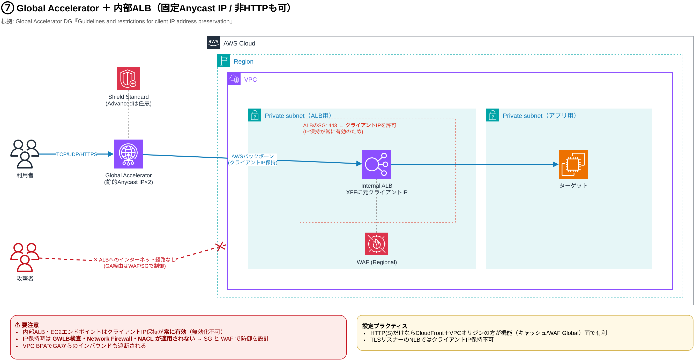

固定 IP が必要な場合や、TCP / UDP を受けたい場合の選択肢です。内部 ALB もエンドポイントにできます。

### ⚠ 要注意ポイント

- 内部 ALB と EC2 のエンドポイントでは、クライアント IP の保持が**常に有効**で、無効化できません
- クライアント IP を保持する場合、**GWLB での検査、AWS Network Firewall、NACL が適用されません**。防御は SG と WAF で設計する必要があります
- SG の許可リストには、Global Accelerator の IP ではなく**クライアント IP** を入れる必要があります
- VPC Block Public Access を有効にすると、Global Accelerator からのインバウンドも止まります

HTTP(S) だけを受けるなら、キャッシュや WAF（Global）の面で CloudFront＋VPC オリジンのほうが有利です。

:::details 確認コマンド
```bash
# Global Accelerator の API は us-west-2 で呼び出す
aws globalaccelerator list-accelerators --region us-west-2 \
  --query 'Accelerators[].[Name,Status,IpSets[0].IpAddresses]'

# エンドポイントごとにクライアント IP 保持が有効か（内部 ALB は常に true）
aws globalaccelerator list-endpoint-groups --listener-arn <listener-arn> --region us-west-2 \
  --query 'EndpointGroups[].EndpointDescriptions[].[EndpointId,ClientIPPreservationEnabled]' \
  --output table
```
:::

根拠：
- [Guidelines and restrictions for client IP address preservation - AWS Global Accelerator](https://docs.aws.amazon.com/global-accelerator/latest/dg/preserve-client-ip-address.how-to-enable-preservation.html)
- [How the client IP address is preserved - AWS Global Accelerator](https://docs.aws.amazon.com/global-accelerator/latest/dg/preserve-client-ip-address.headers.html)

---

## ⑧ 公開 ALB で直接受ける（CloudFront なし）

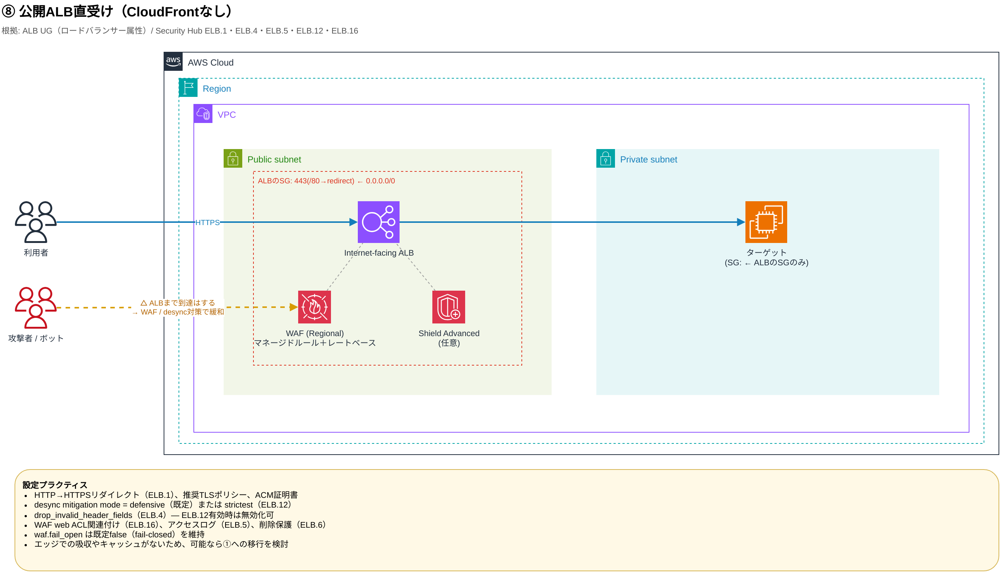

攻撃者のリクエストも ALB までは届く前提で、ALB 自体を固める構成です。

### 設定プラクティス（Security Hub の ELB コントロールに対応）

| コントロール | 内容 |
|---|---|
| ELB.1 | HTTP → HTTPS リダイレクト |
| ELB.4 | `routing.http.drop_invalid_header_fields.enabled = true`（ELB.12 を有効にしているなら無効化してよい） |
| ELB.5 | アクセスログの有効化 |
| ELB.6 | 削除保護 |
| ELB.12 | desync mitigation mode を **defensive（既定）または strictest** にする |
| ELB.16 | WAF web ACL の関連付け |

- `waf.fail_open.enabled` は既定の false（fail-closed）のままにします
- ターゲットの SG は ALB の SG からだけ許可します
- エッジでの吸収やキャッシュがないため、可能なら①への移行を検討しましょう

:::details 確認コマンド
```bash
# desync 対策・不正ヘッダー破棄・WAF fail open・ログ・削除保護の設定値
aws elbv2 describe-load-balancer-attributes --load-balancer-arn <alb-arn> \
  --query "Attributes[?Key=='routing.http.desync_mitigation_mode' || Key=='routing.http.drop_invalid_header_fields.enabled' || Key=='waf.fail_open.enabled' || Key=='access_logs.s3.enabled' || Key=='deletion_protection.enabled']" \
  --output table

# WAF の web ACL が関連付いているか
aws wafv2 get-web-acl-for-resource --resource-arn <alb-arn> \
  --query 'WebACL.Name' --output text

# HTTP が HTTPS にリダイレクトされるか（301 と Location）
curl -sI http://www.example.com/ | grep -iE '^(HTTP|location)'
```
:::

根拠：
- [Edit attributes for your Application Load Balancer](https://docs.aws.amazon.com/elasticloadbalancing/latest/application/edit-load-balancer-attributes.html)
- [Security Hub CSPM controls for Elastic Load Balancing](https://docs.aws.amazon.com/securityhub/latest/userguide/elb-controls.html)

---

## ⑨ CloudFront + Lambda Web Functions（OAC）

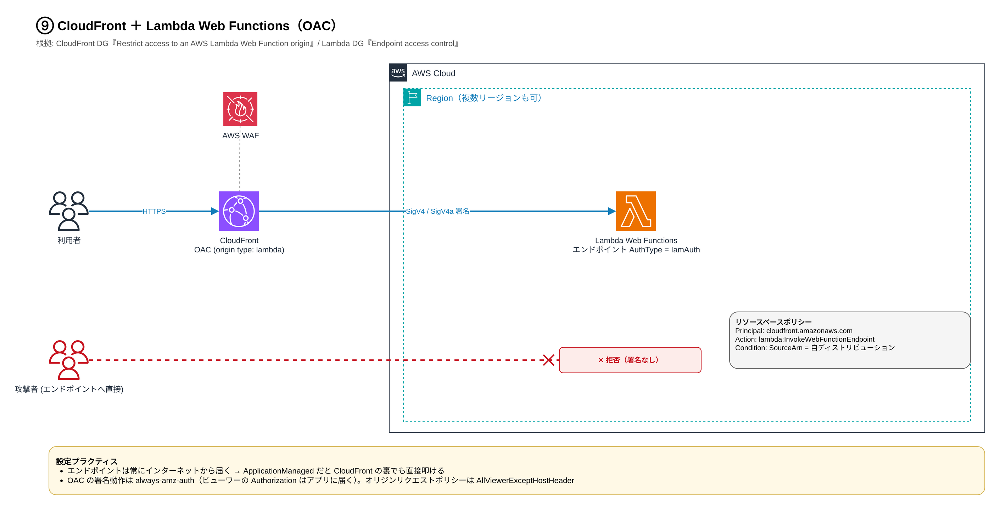

2026年10月に登場した、Node.js の Web サーバー（Express や Hono など）をそのまま Lambda で動かす仕組みです。HTTPS のエンドポイントが付いてきて、複数リージョンにまたがるエンドポイントにすると、レイテンシーで近いリージョンに振り分けます。CloudFront の OAC で CloudFront 専用にする考え方は④の関数 URL と同じですが、IAM のアクション名や OAC の署名動作が違うので、④の手順はそのまま使えません。

エンドポイントは、認証の種類にかかわらず**常にインターネットから届きます**。`IamAuth` にすると「誰が呼べるか」を IAM で絞れますが、ネットワークとして閉じるわけではありません。`ApplicationManaged` のまま CloudFront を前に置いても、エンドポイントのドメインを直接叩けば CloudFront と WAF を迂回できます。

Web Functions 自体は Lambda が管理する基盤で動き、自分の VPC の中には置けません。VPC との関係は、受ける側と出ていく側で分けると分かりやすいです。

| 方向 | どうなっているか |
|---|---|
| 受ける側 | エンドポイントは常にインターネットから届きます。PrivateLink のエンドポイントもありません。呼べる相手を絞る手段は `IamAuth` と CloudFront の OAC です |
| 出ていく側（connector なし、既定） | VPC を通らずにインターネットへ出ます。送信元 IP は固定されず、VPC の中のリソースには届きません |
| 出ていく側（connector あり） | egress network connector のサブネットにある ENI から出るので、ルートテーブルやセキュリティグループが効きます。インターネットに出るには、そのサブネットから NAT GW（IPv6 なら egress-only IGW）へのルートが必要です。使えるのは `HomeRegion` タイプのエンドポイントだけです |

connector を付けても、受ける側は公開のままです。「VPC につないだから閉じた」とはならない点に注意してください。

### 設定プラクティス

- エンドポイントの認証の種類は **`IamAuth`** にします
- リソースベースポリシーで、`cloudfront.amazonaws.com` に `lambda:InvokeWebFunctionEndpoint` を許可し、`aws:SourceArn` で自社のディストリビューションに限定します
- OAC はオリジンの種類を `lambda`、署名動作を `always-amz-auth` にします。この署名動作では、ビューワーの `Authorization` ヘッダーを上書きしないので、アプリ側の認証（JWT など）も使えます。ただし GET と HEAD では、キャッシュポリシーに `Authorization` を含めないと CloudFront がこのヘッダーを外して転送します。署名は、リージョンのエンドポイントなら SigV4、グローバルのエンドポイントなら SigV4a です
- オリジンリクエストポリシーは `AllViewerExceptHostHeader` にします（Host ヘッダーがディストリビューションのドメインのままだと 404 になります）
- 組織で公開エンドポイントを禁止したいなら、SCP で条件キー `lambda:Request/WebFunctionAuthType` を使えます

### 制約・注意点

- エンドポイントには、カスタムドメインも WAF も直接は付けられません。どちらも CloudFront を前に置いて使います
- OAC を使うキャッシュビヘイビアでは、Lambda@Edge の origin request / origin response トリガーが使えません
- グローバルのエンドポイントにオプトインリージョンが含まれると、OAC の署名ができず 403 になります
- egress network connector は `HomeRegion` タイプのエンドポイントでしか使えません（`PerRegion` と `MultiRegion` では使えません）。**複数リージョンへの分散と、VPC 内のリソースへの接続は両立しません**
- ランタイムは今のところ Node.js だけです

:::details 確認コマンド
```bash
# Lambda のドメインに署名なしで直接アクセスすると拒否される（403 など）
curl -s -o /dev/null -w '%{http_code}\n' https://<domain-id>.<shard-id>.lambda-web.ap-northeast-1.on.aws/

# CloudFront 経由では届く（200 など）
curl -s -o /dev/null -w '%{http_code}\n' https://www.example.com/
```
:::

根拠：
- [AWS Lambda Web Functions - AWS Lambda](https://docs.aws.amazon.com/lambda/latest/dg/web-functions.html)
- [Lambda Web Function endpoint access control - AWS Lambda](https://docs.aws.amazon.com/lambda/latest/dg/web-functions-endpoint-access-control.html)
- [Configuring networking for AWS Lambda Web Functions - AWS Lambda](https://docs.aws.amazon.com/lambda/latest/dg/web-functions-networking.html)
- [Restrict access to an AWS Lambda Web Function origin - Amazon CloudFront](https://docs.aws.amazon.com/AmazonCloudFront/latest/DeveloperGuide/private-content-restricting-access-to-lambda-web.html)

---

## 9 パターン以外の入口

ここまでの 9 パターンは、CloudFront、ALB、API Gateway の REST API を中心にした受け方です。AWS には、ほかにも自分でエンドポイントを持つサービスや、リソースを直接公開する方法があります。多くは既定のままだとインターネットから届くので、棚卸しのときに見落とさないよう一覧にしておきます。

### 自分でエンドポイントを持つサービス

| サービス | 既定の状態 | 閉じ方と WAF |
|---|---|---|
| API Gateway の HTTP API | `execute-api` のドメインで誰でも呼べる | 既定のエンドポイントを無効にして、カスタムドメインだけで受けられる（カスタムドメインは公開のまま）。Private のエンドポイントやリソースポリシーはなく、WAF も直接付けられない。API キーもないので、⑤の API キーで直接アクセスを防ぐ方法は使えない |
| AppSync（GraphQL） | 公開（`GLOBAL`）。作成後に変えられない | 作るときに `PRIVATE` にすると、VPC エンドポイント経由でしか届かない。Regional の WAF を直接付けられる |
| Amplify Hosting | `amplifyapp.com` の既定ドメインで公開 | WAF（Global）を直接付けられる（2025年3月 GA）。既定ドメインへのアクセスを制限する設定もある |
| App Runner | インターネットから届く | VPC からだけ届くプライベートエンドポイントにできる。WAF も付けられる。2026年4月30日から新規の利用者は受け付けていない（[What's New](https://aws.amazon.com/about-aws/whats-new/2026/03/aws-service-availability/)）ので、既存環境の棚卸し対象として見る |
| Bedrock AgentCore の Gateway と Runtime | AWS のドメインのエンドポイントで受ける | Gateway は Regional の WAF を直接付けられ、受ける側の認証は IAM、JWT などから選ぶ（認証なしも選べるが、本番では非推奨）。Runtime には WAF を直接付けられない。前に ALB と WAF を置く場合は、リソースポリシーで VPC エンドポイント経由以外を拒否しておかないと、認証情報を持つ呼び出し元が WAF を通らずに直接呼べる |

### リソースを直接公開する

| 入口 | 何が問題か | 見直し先 |
|---|---|---|
| public IP を持つ EC2 | CloudFront のカスタムオリジンにしていても、IP やホスト名を知られると直接届く | ①（EC2 を VPC オリジンにする） |
| internet-facing の NLB で直接受ける | エッジでの吸収も WAF もない | HTTP なら①（ただし TLS リスナーの NLB は VPC オリジンにできない）。固定 IP や TCP / UDP が必要なら⑦の形で、エンドポイントを NLB や EC2 にする |
| S3 の静的ウェブサイトホスティングのエンドポイント | 公開読み取りと HTTP だけ。CloudFront を前に置いても OAC は使えない | ③（通常のバケットと OAC）か Amplify Hosting |
| Lightsail のインスタンスやロードバランサー | EC2 とは別のコンソールと API で管理されるので、EC2 の棚卸しから漏れやすい | 棚卸しの対象に入れる |

### AWS が代わりに ALB を作るもの

構成としては①か⑧ですが、ALB を自分では作らないので、気づかないうちに公開の入口ができていることがあります。Terraform の plan にも `aws_lb` として出てきません。

- **ECS Express Mode**：public サブネットを渡すと、internet-facing の ALB を作ります。サブネットを指定しないと、デフォルト VPC の public サブネットを使うので、やはり internet-facing になります
- **ECS Gateway**：ALB を作り、最大 25 のサービスで共有します
- **EKS の AWS Load Balancer Controller**：既定は internal で、`alb.ingress.kubernetes.io/scheme: internet-facing` を付けると公開されます
- **Elastic Beanstalk**：ロードバランサー付きの環境では、ロードバランサーを作ります。スキームは既定で public です

根拠：
- [Disable the default endpoint for HTTP APIs - Amazon API Gateway](https://docs.aws.amazon.com/apigateway/latest/developerguide/http-api-disable-default-endpoint.html)
- [Choose between REST APIs and HTTP APIs - Amazon API Gateway](https://docs.aws.amazon.com/apigateway/latest/developerguide/http-api-vs-rest.html)
- [AssociateWebACL（WAF を関連付けられるリソースの一覧） - AWS WAF API Reference](https://docs.aws.amazon.com/waf/latest/APIReference/API_AssociateWebACL.html)
- [Using AWS AppSync Private APIs](https://docs.aws.amazon.com/appsync/latest/devguide/using-private-apis.html)
- [AWS Amplify Hosting announces Web Application Firewall Protection in general availability (2025)](https://aws.amazon.com/about-aws/whats-new/2025/03/aws-amplify-hosting-web-application-firewall-protection/)
- [Enabling Private endpoint for incoming traffic - AWS App Runner](https://docs.aws.amazon.com/apprunner/latest/dg/network-pl.html)
- [Protecting your gateway with AWS WAF - Amazon Bedrock AgentCore](https://docs.aws.amazon.com/bedrock-agentcore/latest/devguide/gateway-waf.html)
- [Set up inbound authorization for your gateway - Amazon Bedrock AgentCore](https://docs.aws.amazon.com/bedrock-agentcore/latest/devguide/gateway-inbound-auth.html)
- [Securing Amazon Bedrock AgentCore Runtime with AWS WAF (AWS Blog)](https://aws.amazon.com/blogs/machine-learning/securing-amazon-bedrock-agentcore-runtime-with-aws-waf/)
- [Restrict access to an Amazon S3 origin（ウェブサイトエンドポイントでは OAC を使えない）](https://docs.aws.amazon.com/AmazonCloudFront/latest/DeveloperGuide/private-content-restricting-access-to-s3.html)
- [Resources created by Amazon ECS Express Mode services](https://docs.aws.amazon.com/AmazonECS/latest/developerguide/express-service-work.html)
- [Amazon ECS Gateway](https://docs.aws.amazon.com/AmazonECS/latest/developerguide/gateway-overview.html)
- [AWS Load Balancer Controller: Ingress annotations（GitHub）](https://github.com/kubernetes-sigs/aws-load-balancer-controller/blob/master/docs/guide/ingress/annotation.md)

---

## WAF の位置付け

ここまでの①〜⑨は「誰がオリジンに届くか（経路）」の話でした。WAF は層が違い、「届いたリクエストの中身を検査する」ものです。

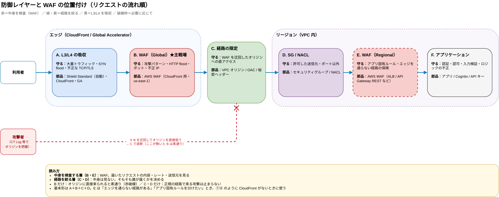

- **B だけ（WAF だけ）の場合**：オリジンに直接来られると素通りです。冒頭の「第三者の CloudFront 経由で WAF を迂回される」話はこれです
- **C・D だけ（経路の限定だけ）の場合**：正規の CloudFront を通って来る SQL インジェクションや HTTP flood は止まりません
- **基本形は A＋B＋C＋D** です（A の Shield Standard は CloudFront や GA を使えば自動で効きます）。E（リージョンの WAF）は、必要なときに足します

WAF の web ACL は CloudFront（Global）と ALB・API Gateway の REST API など（Regional）に付けられますが、**NLB・Global Accelerator・S3・Lambda 関数 URL・Lambda Web Functions・API Gateway の HTTP API には直接付けられません**。また AWS は、公開 Web アプリでは**制約がない限り CloudFront と組み合わせて WAF を置く**ことを推奨しています。

### パターンごとの WAF の置き場所

| パターン | WAF の置き場所 | 補足 |
|---|---|---|
| ① VPC オリジン | CloudFront（Global） | 経路が閉じているので ALB 側は基本不要。アプリ固有ルールを分けたいときだけ ALB にも |
| ② 公開 ALB＋秘密ヘッダー | CloudFront（Global）＋必要に応じて ALB（Regional） | 秘密ヘッダーが漏れたときの保険として ALB 側も検討 |
| ③ S3（OAC） | CloudFront（Global） | S3 には付けられない |
| ④ Lambda 関数 URL（OAC） | CloudFront（Global） | 関数 URL には付けられない |
| ⑤ Regional API Gateway | CloudFront（Global）＋必要に応じて REST API ステージ（Regional） | HTTP API には付けられない |
| ⑥ Private API | CloudFront（Global） | 経路は①と同じ |
| ⑦ Global Accelerator | ALB（Regional） | GA には付けられない。クライアント IP が保持されるので、IP ベースのルールをそのまま使える |
| ⑧ 公開 ALB 直受け | ALB（Regional）※必須 | 唯一の L7 防御。Shield Advanced も検討 |
| ⑨ Lambda Web Functions（OAC） | CloudFront（Global） | エンドポイントには付けられない |

WAF の置き場所ごとの注意点（ALB 側では CloudFront の IP が見える、ボディを検査できるサイズの違い、内部エラー時の挙動）や、ルールの組み方・運用は、別の記事にまとめました。

https://zenn.dev/anfangd/articles/aws-waf-placement

---

## 共通：CloudFront のビューワー側チェックリスト

どのパターンでも CloudFront を前段に置くなら、次の Security Hub（AWS Foundational Security Best Practices）コントロールが目安になります。

| コントロール | 内容 |
|---|---|
| CloudFront.3 | ビューワーの HTTPS を必須にする（`allow-all` は NG） |
| CloudFront.5 | ログの有効化 |
| CloudFront.6 | WAF の関連付け |
| CloudFront.9 | カスタムオリジンへの通信を暗号化する |
| CloudFront.13 | S3 オリジンに OAC を使う |
| CloudFront.15 | 推奨 TLS ポリシー（`TLSv1.2_2025` / `TLSv1.3_2025`）を使う |
| CloudFront.16 | Lambda 関数 URL オリジンに OAC を使う |

:::details 確認コマンド
```bash
# ビューワープロトコル・TLS ポリシー・WAF・各オリジンの閉じ方（VPC オリジン / OAC）を一覧
aws cloudfront get-distribution-config --id E123EXAMPLE \
  --query 'DistributionConfig.{Viewer:DefaultCacheBehavior.ViewerProtocolPolicy,TLS:ViewerCertificate.MinimumProtocolVersion,WebACL:WebACLId,Origins:Origins.Items[].{Id:Id,Domain:DomainName,VpcOrigin:VpcOriginConfig.VpcOriginId,OAC:OriginAccessControlId}}'
```
:::

- [Security Hub CSPM controls for Amazon CloudFront](https://docs.aws.amazon.com/securityhub/latest/userguide/cloudfront-controls.html)

## まとめ

- 「ドメインが知られたら迂回される」問題は、**秘密ヘッダーで照合すれば防げます**。ただしそれはフォールバックで、ローテーションなど運用の負担が残ります
- CT Log によってホスト名は知られる前提です。**「隠す」より「届かない」構成**を選びましょう
- 新規構築なら、まず **VPC オリジン（ALB / NLB / EC2）と OAC（S3 / Lambda 関数 URL / Lambda Web Functions）** を検討します。fail-closed で決定論的な、運用しやすい構成になります
- VPC オリジンも止まることはあります。切り替えるまでの待ち時間と切り替え先は、先に決めておきます
- 既存の公開 ALB 構成は、ステージングディストリビューションで検証しながら VPC オリジンへ段階的に移行できます

## 関連する記事

既存の構成を VPC オリジンへ移行する手順は、次の記事が参考になります。

- [Amazon CloudFront のパブリックオリジンからプライベート VPC オリジンへの移行（AWS ブログ）](https://aws.amazon.com/jp/blogs/news/migrate-amazon-cloudfront-public-origins-to-private-vpc-origins)
- [カスタムヘッダー方式の CloudFront + ALB 構成を VPC オリジンに移行してみた（DevelopersIO）](https://dev.classmethod.jp/articles/cloudfront-alb-vpc/)

2026年7月の VPC オリジンの障害と、その後の構成の変化は、次の記事と発表資料が参考になります。

- [CloudFront VPCオリジン障害をInter-Region VPCピアリングで迂回してみた（DevelopersIO）](https://dev.classmethod.jp/articles/cloudfront-vpc-origin-failure-inter-region-vpc-peering-bypass/)
- [CloudFront VPCオリジン障害(2026-07-16)で約30秒のタイムアウト待ちが発生していたことをログから確認してみた（DevelopersIO）](https://dev.classmethod.jp/ja/articles/cloudfront-vpc-origin-incident-20260716-log-analysis/)
- [パブリックサブネットを持たない Web配信基盤の現在地（鈴木 亮さん、JAWS festa 2026）](https://www.docswell.com/s/suzryo/KDMX88-2026-11-07-160134)

