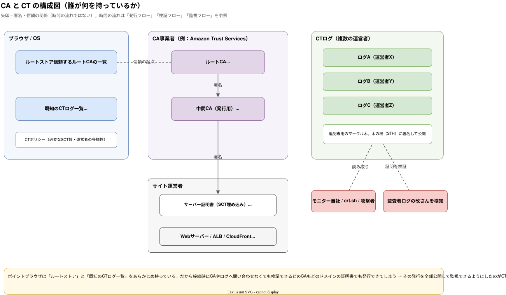
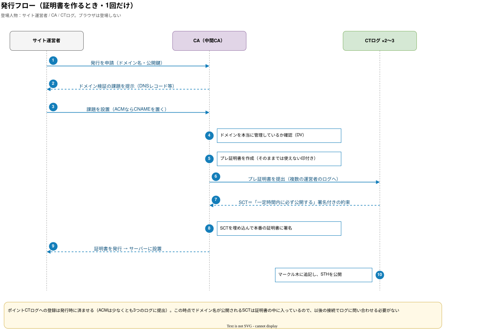
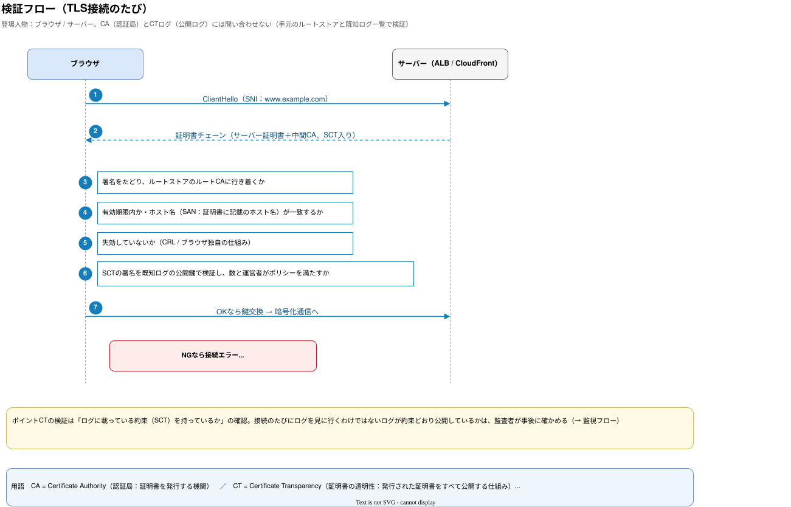
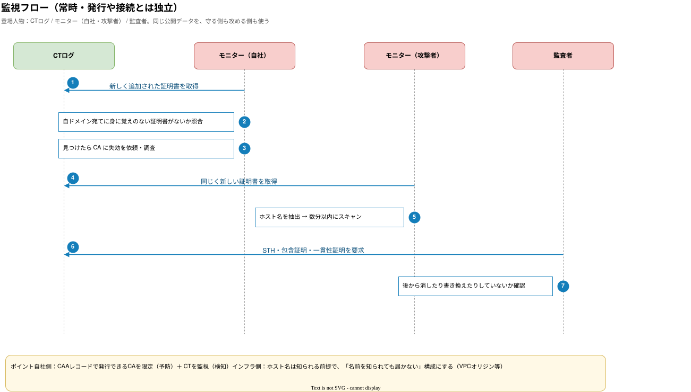

:::message
この記事は、Claude と一緒に AWS 公式ドキュメントを調べ、構成図を作りながら整理した内容をまとめたものです。各設定の根拠は、記事中のリンク先の公式ドキュメントで確認できます。
:::

## はじめに

先日、X（旧Twitter）でこんな趣旨の話題が流れてきました。

- CloudFront + WAF → ALB の構成では、ALB の SG に CloudFront のプレフィックスリストを入れて直接アクセスを防ぐ
- ただし ALB のドメインが知られると、**第三者が作った CloudFront 経由で WAF を迂回される**。そのため秘密ヘッダーでの照合が必要
- さらに、**CT Log が知られるようになってから、Host ヘッダー付きの攻撃が増えた**

元の投稿はこちらです。

@[tweet](https://x.com/nasub7373/status/2117957893232451709)

@[tweet](https://x.com/___nix___/status/2117996284783300621)

どれもその通りです。一方で、2024年11月に **CloudFront VPC オリジン** が登場してから、公式ドキュメントの推奨はかなり整理されています。

この記事では、AWS で Web リクエストを受ける代表的な 8 パターンを、**公式ドキュメントの根拠付き**で、構成図と設定プラクティスにまとめます。

## TL;DR

- AWS 公式の優先順位は **「VPC オリジン / OAC（マネージド）→ 使えない場合のみ プレフィックスリスト＋秘密ヘッダー」**
- **プレフィックスリストだけでは不十分**です。他人の CloudFront も同じ IP 帯から来るため、本体は秘密ヘッダーの照合です
- **CT Log** にはオリジン用に取った証明書のホスト名が載るので、「ホスト名は知られる前提」で設計します
- 新規構築なら **VPC オリジン＋`CloudFront-VPCOrigins-Service-SG` 限定** が第一候補です。名前を知られても、そもそも到達できません
- **WAF は「中身を検査する層」、VPC オリジン / OAC / SG は「届く経路を絞る層」** です。役割が違うので両方必要で、WAF の主戦場はエッジ（CloudFront）です

## 前提知識

### プレフィックスリストだけではダメな理由

`com.amazonaws.global.cloudfront.origin-facing` は「CloudFront 全体」の IP 帯です。自社のディストリビューションに限った IP 帯ではありません。攻撃者が自分の AWS アカウントで CloudFront を作り、オリジンにあなたの ALB を指定すれば、SG は素通りします。WAF は「あなたの CloudFront」に付いているので、当然かかりません。

そのため公式ドキュメントでも、プレフィックスリストは **Optional（追加の防御層）** という位置付けです。本体は、カスタムヘッダーを ALB のリスナールールで照合する仕組みです。

- [Restrict access to Application Load Balancers - Amazon CloudFront](https://docs.aws.amazon.com/AmazonCloudFront/latest/DeveloperGuide/restrict-access-to-load-balancer.html)

### CT Log（Certificate Transparency：証明書の透明性）とは

CT（Certificate Transparency：証明書の透明性）は、公的な CA（Certificate Authority：認証局。証明書を発行する機関）が発行した TLS 証明書を、**誰でも監査できる追記専用のログ**に記録する仕組みです。誤発行や不正発行の証明書を検知することが目的で、RFC 6962 で定義されています（後継は RFC 9162）。

- [RFC 6962: Certificate Transparency](https://www.rfc-editor.org/rfc/rfc6962)

ポイントは次の 3 つです。

**1. ブラウザが CT を必須にしている**

Chrome と Apple のプラットフォーム（Safari を含む）は、CT のポリシーを満たさない公的な証明書を信頼しません。証明書には、CT ログに登録した証拠である SCT（Signed Certificate Timestamp）が複数必要です。

- [Chrome Certificate Transparency Policy](https://googlechrome.github.io/CertificateTransparency/ct_policy.html)
- [Apple's Certificate Transparency policy](https://support.apple.com/en-us/103214)

**2. ACM の公開証明書も必ず記録され、オプトアウトできない**

ACM の公開証明書は、自動的に CT ログに記録されます。ブラウザのポリシー上の要件なので、オプトアウトはできません。以前あった `CertificateTransparencyLoggingPreference` は非推奨になっています。記録されるのは**ドメイン名**で、秘密鍵は記録されません。

- [AWS Certificate Manager concepts - Certificate Transparency Logging](https://docs.aws.amazon.com/acm/latest/userguide/acm-concepts.html)

**3. ログは誰でも検索でき、攻撃者の偵察にも使われる**

`crt.sh` などの検索サービスを使えば、`origin.example.com` や `stg-admin.example.com` のように、証明書を取ったホスト名を誰でも一覧できます。本来は、自ドメインで身に覚えのない証明書が発行されていないかを監視するための仕組みです（ACM のドキュメントでも、この用途でログの監視を勧めています）。

一方で攻撃者もこれを偵察に使います。IMC 2018 の論文では、CT ログを監視するハニーポットを置いたところ、**証明書の発行から数分でスキャンの標的にされた**ことが観測されています。

- [The Rise of Certificate Transparency and Its Implications on the Internet Ecosystem (IMC 2018)](https://arxiv.org/abs/1809.08325)

つまり、**DNS を公開していなくても、公的な証明書を取った時点でホスト名は知られる** と考えておく必要があります。冒頭の投稿にあった「Host ヘッダー付きの攻撃が増えた」という話は、このことを指しています。

対策としては、オリジン用の証明書をワイルドカード（`*.example.com`）にすれば、ログに載るのは `*.example.com` だけになり、個別のホスト名は出ません。ただし、これはホスト名を推測しにくくするだけの隠蔽策です。本筋は「名前を知られても届かない」構成にすることです。

### CA と CT の仕組み（図解）

:::message
**用語**
- **CA**（Certificate Authority）：認証局。TLS 証明書を発行する機関。ACM の裏側では Amazon Trust Services が CA です
- **CT**（Certificate Transparency）：証明書の透明性。発行された証明書をすべて公開ログに記録する仕組み
- **SCT**（Signed Certificate Timestamp）：CT ログへの登録の受領証。「一定時間内に必ず公開する」というログの署名付きの約束
- **STH**（Signed Tree Head）：ログ全体（マークル木の根）のハッシュに対するログの署名
- **DV**（Domain Validation）：ドメイン検証。申請者がドメインを管理しているかの確認
- **SAN**（Subject Alternative Name）：証明書に書かれた、その証明書が有効なホスト名
:::

CT Log の話は、「構成（誰が何を持っているか）」と「フロー（いつ何が流れるか）」を分けると理解しやすくなります。フローはさらに、**発行（1回だけ）**、**検証（TLS 接続のたび）**、**監視（常時）** の 3 つに分かれていて、それぞれ登場人物が違います。

#### 構成図



- ブラウザや OS は、信頼する**ルートストア**と、**既知の CT ログ一覧**（各ログの公開鍵）を、あらかじめ持っています
- CA は、オフラインで保管するルート CA の下に**中間 CA** を置き、日々の証明書は中間 CA が署名します
- CT ログは複数の事業者が運営する追記専用のマークル木で、木の根への署名（STH）を公開します
- ルートストアに入っている CA なら、どのドメインの証明書でも発行できてしまいます。その発行をすべて公開して監視できるようにしたのが CT です

#### 発行フロー（証明書を作るとき）



登場人物は、サイト運営者、CA、CT ログの 3 者です。ブラウザは出てきません。

1. CA はドメインの管理を確認（DV）したあと、そのままでは使えない印を付けた**プレ証明書**を作り、複数の運営者の CT ログに提出します
2. ログは、一定時間内に必ず公開するという署名付きの約束（**SCT**）を返します
3. CA は SCT を埋め込んでから、本番の証明書に署名して発行します。ACM の場合は、少なくとも 3 つのログに提出してから発行します

**ドメイン名が公開されるのは、このタイミング**です。

#### 検証フロー（TLS 接続のたび）



登場人物はブラウザとサーバーだけで、**CA にも CT ログにも問い合わせません**。ブラウザは、手元のルートストアと既知ログ一覧を使って、次の点を確認します。

- チェーン：署名をたどってルートストアのルート CA に行き着くか
- 有効期限とホスト名（SAN：証明書に書かれたホスト名）
- 失効していないか
- SCT：ログの署名が正しいか。数と運営者の多様性がポリシーを満たすか

Chrome の場合、有効期間が 180 日以下の証明書では 2 個、それを超える証明書では 3 個、別々のログからの SCT が必要です。

#### 監視フロー（常時）



ログに載った証明書を、モニターが常に読み取っています。

- **自社**：身に覚えのない証明書が発行されていないかを監視します（検知）。あわせて DNS の CAA レコードで、発行できる CA を限定します（予防）
- **攻撃者**：同じデータからホスト名を抜き出し、発行から数分でスキャンを始めます
- **監査者**：包含証明と一貫性証明を使い、ログが後から消したり書き換えたりしていないかを確認します

上で書いた「ホスト名は知られる前提」は、この監視フローから来ています。

参考（CA と CT の仕組み）：
- [RFC 6962: Certificate Transparency](https://www.rfc-editor.org/rfc/rfc6962)
- [AWS Certificate Manager concepts - Certificate Transparency Logging](https://docs.aws.amazon.com/acm/latest/userguide/acm-concepts.html)
- [Chrome Certificate Transparency Policy](https://googlechrome.github.io/CertificateTransparency/ct_policy.html)
- [Apple's Certificate Transparency policy](https://support.apple.com/en-us/103214)

## WAF の位置付けと組み合わせ方

ここまでの話は「誰がオリジンに届くか（経路）」の話でした。WAF は層が違い、「届いたリクエストの中身を検査する」ものです。


- **B だけ（WAF だけ）の場合**：オリジンに直接来られると素通りです。冒頭の「第三者の CloudFront 経由で WAF を迂回される」話はこれです
- **C・D だけ（経路の限定だけ）の場合**：正規の CloudFront を通って来る SQL インジェクションや HTTP flood は止まりません
- **基本形は B＋C＋D** です。E（リージョンの WAF）は、必要なときに足します

### WAF を付けられる場所・付けられない場所

WAF の web ACL を関連付けられるのは、CloudFront、ALB、API Gateway の REST API、AppSync、Cognito ユーザープール、App Runner、Verified Access、Amplify、Bedrock AgentCore Gateway です。CloudFront 用は **Global スコープ（us-east-1 で作成）**、それ以外は **リソースと同じリージョンの Regional スコープ** になります。CloudFront に関連付けた web ACL は、他の種類のリソースには関連付けられません。

逆に、**NLB、Global Accelerator、S3、Lambda 関数 URL、API Gateway の HTTP API には直接付けられません**。これらを WAF で守るなら、前段に CloudFront を置くか、後段の ALB に付けます。

- [Associating or disassociating protection with an AWS resource - AWS WAF](https://docs.aws.amazon.com/waf/latest/developerguide/web-acl-associating-aws-resource.html)

### エッジ（CloudFront）に置くのが基本

AWS の WAF 実装ガイドラインでは、インターネットに公開する Web アプリケーションには、制約がない限り **CloudFront と組み合わせて WAF を置く** ことを推奨しています。理由は次のとおりです。

- CloudFront の WAF の処理能力は CloudFront の拠点の規模に合わせてスケールし、リージョンの WAF の容量制約を受けません
- CloudFront 自体が不正な HTTP リクエストや L3/L4 の攻撃を止めるので、WAF はアプリ層の検査に集中できます
- CloudFront や WAF が拒否したリクエストには、HTTP リクエスト料金やデータ転送料金がかかりません

リージョンの WAF（E）を足すのは、次のような場合です。

- 1 つのドメインの裏に複数のアプリがあり、エッジでは IP・国による共通のブロック、各 ALB ではアプリ固有のルール、と分けたい場合（ガイドラインに例があります）
- ②（公開 ALB）のように、エッジを通らない経路が論理的に残っている場合の保険
- ⑦（Global Accelerator）や ⑧（公開 ALB 直受け）のように、そもそも CloudFront がない場合（ALB 側が唯一の WAF になります）

- [Guidelines for Implementing AWS WAF (Whitepaper)](https://docs.aws.amazon.com/whitepapers/latest/guidelines-for-implementing-aws-waf/guidelines-for-implementing-aws-waf.html)
- [Amazon CloudFront - AWS Best Practices for DDoS Resiliency](https://docs.aws.amazon.com/whitepapers/latest/aws-best-practices-ddos-resiliency/cloudfront.html)

### パターンごとの WAF の置き場所

| パターン | WAF の置き場所 | 補足 |
|---|---|---|
| ① VPC オリジン | CloudFront（Global） | 経路が閉じているので ALB 側は基本不要。アプリ固有ルールを分けたいときだけ ALB にも |
| ② 公開 ALB＋秘密ヘッダー | CloudFront（Global）＋必要に応じて ALB（Regional） | 秘密ヘッダーが漏れたときの保険として ALB 側も検討 |
| ③ S3（OAC） | CloudFront（Global） | S3 には付けられない |
| ④ Lambda 関数 URL（OAC） | CloudFront（Global） | 関数 URL には付けられない |
| ⑤ Regional API Gateway | CloudFront（Global）＋必要に応じて REST API ステージ（Regional） | HTTP API には付けられない |
| ⑥ Private API | CloudFront（Global） | 経路は①と同じ |
| ⑦ Global Accelerator | ALB（Regional） | GA には付けられない。クライアント IP が保持されるので、IP ベースのルールがそのまま効く |
| ⑧ 公開 ALB 直受け | ALB（Regional）※必須 | 唯一の L7 防御。Shield Advanced も検討 |

### 組み合わせるときの注意点

**1. ALB 側の WAF には、クライアントの IP ではなく CloudFront の IP が見える**

WAF は既定で、リクエストの送信元 IP を使います。プロキシやロードバランサーを経由すると、それは最後のプロキシのアドレスになります。そのため CloudFront の背後にある ALB の WAF で、IP セット、国（geo）、レートベースのルールを使うには、`X-Forwarded-For` などを使う forwarded IP の設定が必要です。

ここで注意したいのが次の 2 点です。

- 指定したヘッダーがリクエストにない場合、WAF は**そのルールをまったく適用しません**
- WAF は**ヘッダーの先頭の IP** を使います。`X-Forwarded-For` はクライアントが自分で付けて送れるので、先頭は偽装できてしまいます（これは私の補足です）

なお、Bot Control と Anti-DDoS のマネージドルールグループは、CloudFront などの CDN 経由のトラフィックを自動で認識し、元のクライアント IP を使ってくれます。

結論として、**IP ベースのルールはエッジ（CloudFront）の WAF に寄せる** のが安全です。

- [Using forwarded IP addresses in AWS WAF](https://docs.aws.amazon.com/waf/latest/developerguide/waf-rule-statement-forwarded-ip-address.html)

**2. ボディを検査できるサイズが置き場所で違う**

| 置き場所 | ボディの検査上限 |
|---|---|
| ALB / AppSync | **8 KB 固定** |
| CloudFront / API Gateway / Cognito / App Runner / Verified Access | 既定 16 KB、最大 64 KB まで拡張可（追加料金） |

上限を超えた部分は WAF に渡されず、検査されません。また、Core rule set の `SizeRestrictions_BODY` は 8 KB を超えるボディをブロックするので、ファイルアップロードなどの API では誤検知の原因になります。ラベルを使って例外を作りましょう。

- [AWS WAF quotas](https://docs.aws.amazon.com/waf/latest/developerguide/limits.html)
- [Baseline rule groups - Core rule set](https://docs.aws.amazon.com/waf/latest/developerguide/aws-managed-rule-groups-baseline.html)

**3. WAF が内部エラーになったときの挙動が違う**

WAF の内部エラーで判定が遅れた場合、**CloudFront は通常リクエストを通し、リージョンのサービスは通常拒否します**。エッジの WAF は可用性寄り（fail-open 寄り）、ALB の WAF は fail-closed 寄りです。ALB には `waf.fail_open.enabled`（既定 false）の属性もあります。

- [Configuring protection in AWS WAF](https://docs.aws.amazon.com/waf/latest/developerguide/web-acl.html)

### ルールの組み方

DDoS 耐性のホワイトペーパーは、**早い段階で攻撃を減らす「漏斗型」** の順番を推奨しています。

1. 許可する IP（Allow）
2. ブロックする IP（Block）
3. 国による制限（geo）
4. Anti-DDoS マネージドルール
5. Amazon IP reputation list
6. 全体にかけるレートベースルール（高めの閾値）
7. 用途別のレートベースルール（API・URI・JA3/JA4 など、低めの閾値）
8. Core rule set
9. Bot Control

レートベースルールについては、全体に高めの閾値をかけたうえで、キャッシュできない動的なエンドポイントやログインなどの重い処理には、より低い閾値のルールを別に足すのが推奨です。

最初の一歩としては、**ベースラインのルールグループ（Core rule set、Known bad inputs）と Amazon IP reputation list から始め、アプリの特性に合わせて用途別のルールグループを足す** のが勧められています。ALB の WAF 連携で作られる既定の web ACL も、この 3 つの組み合わせです。

- [AWS WAF - AWS Best Practices for DDoS Resiliency](https://docs.aws.amazon.com/whitepapers/latest/aws-best-practices-ddos-resiliency/aws-waf.html)
- [AWS WAF – Rate-based rules](https://docs.aws.amazon.com/whitepapers/latest/aws-best-practices-ddos-resiliency/aws-waf-rate-based-rules.html)
- [Integrations for your Application Load Balancer](https://docs.aws.amazon.com/elasticloadbalancing/latest/application/load-balancer-integrations.html)

### 運用

- **Count モードで試してから Block にする**：ステージングで調整したあと、本番トラフィックでも Count モードで影響を確認してから有効化します（[Testing and tuning your AWS WAF protections](https://docs.aws.amazon.com/waf/latest/developerguide/web-acl-testing.html)）
- **ログを有効にする**：誤検知の調査や攻撃の分析には WAF のログが欠かせません。サンプリングされたリクエスト（直近 3 時間）だけでは足りないことが多いです
- **組織で統一する**：AWS Firewall Manager を使うと、組織全体のアカウントに WAF のポリシーを一括で配布・是正できます
- **Shield Advanced を使う場合**：レートベースルールを含む web ACL の関連付けが前提です。2026年3月26日から、HTTP flood 対策の既定は Anti-DDoS マネージドルールグループになり、従来の L7 自動緩和機能を置き換えています（[Automating application layer DDoS mitigation](https://docs.aws.amazon.com/waf/latest/developerguide/ddos-automatic-app-layer-response.html)）

---

## 選定フロー


DDoS 耐性のホワイトペーパーでは、CloudFront の背後に VPC 内のオリジンを置く場合、**VPC オリジンが最新かつ推奨の方法** とされています。S3・AWS Elemental・Lambda 関数 URL については、引き続き **OAC が推奨** です。

- [Protecting your origin (BP1, BP5) - AWS Best Practices for DDoS Resiliency](https://docs.aws.amazon.com/whitepapers/latest/aws-best-practices-ddos-resiliency/protecting-your-origin-bp1-bp5.html)

CloudFront の FAQ でも、マネージドな仕組みで要件を満たせない場合の代替として、カスタムオリジンヘッダーが挙げられています。

- [Amazon CloudFront FAQs](https://aws.amazon.com/cloudfront/faqs/)

---

## ① CloudFront + VPC オリジン（内部 ALB）★第一候補


プライベートサブネットにある ALB / NLB / EC2 を、CloudFront のオリジンとして直接使えます。ALB にパブリック IP がないため、**CT Log でホスト名を知られても、Host ヘッダーを付けても、インターネットから届く経路自体がありません**。VPC オリジンの利用に追加料金はかかりません。

### 設定プラクティス

| 項目 | 推奨 |
|---|---|
| ALB | `internal`、プライベートサブネット、HTTPS リスナー（ACM 証明書） |
| ALB の SG | **`CloudFront-VPCOrigins-Service-SG` を許可**（プレフィックスリストより厳密で、自アカウントの CloudFront に限定できる） |
| VPC | **IGW が必要**（存在さえすればよく、ルーティングには使われない） |
| サブネット | サービス管理 ENI 用の空き IP（デュアルスタックなら IPv6 も） |
| NACL | インバウンドは評価されない。アウトバウンドは戻りのエフェメラルポートを許可 |

### 制約・注意点

- オリジンにできないもの：GWLB、TLS リスナーを持つ NLB。NLB には SG の付与が必須です
- 非対応の機能：gRPC、Lambda@Edge の origin request / origin response トリガー
- **VPC Block Public Access** を有効にすると、VPC オリジンの通信も止まります
- VPC オリジンで絞れるのは「自アカウント内で VPC オリジンを設定したディストリビューション」までです。同じアカウントに複数のディストリビューションがあり、特定のディストリビューションだけに限定したい場合は、カスタムヘッダーの検証も併用します（[Origin cloaking](https://aws.amazon.com/developer/application-security-performance/articles/origin-cloaking)）

:::details Terraform 例：VPC オリジンとサービス管理 SG の参照

```hcl:vpc_origin.tf
resource "aws_cloudfront_vpc_origin" "alb" {
  vpc_origin_endpoint_config {
    name                   = "internal-alb"
    arn                    = aws_lb.internal.arn
    http_port              = 80
    https_port             = 443
    origin_protocol_policy = "https-only"

    origin_ssl_protocols {
      items    = ["TLSv1.2"]
      quantity = 1
    }
  }
}

# ディストリビューション側
# origin {
#   domain_name = aws_lb.internal.dns_name
#   origin_id   = "internal-alb"
#   vpc_origin_config {
#     vpc_origin_id = aws_cloudfront_vpc_origin.alb.id
#   }
# }

# VPC オリジン作成後に、AWS が自動作成するサービス管理 SG を参照する
data "aws_security_group" "cf_vpc_origins" {
  vpc_id = aws_vpc.main.id
  filter {
    name   = "group-name"
    values = ["CloudFront-VPCOrigins-Service-SG"]
  }
  depends_on = [aws_cloudfront_vpc_origin.alb]
}

resource "aws_vpc_security_group_ingress_rule" "alb_from_cf_vpc_origins" {
  security_group_id            = aws_security_group.alb.id
  referenced_security_group_id = data.aws_security_group.cf_vpc_origins.id
  ip_protocol                  = "tcp"
  from_port                    = 443
  to_port                      = 443
}
```
:::

:::message alert
`CloudFront-VPCOrigins-Service-SG` は AWS が管理するため、編集してはいけません。参照するだけにしてください。
:::

根拠：
- [Restrict access with VPC origins - Amazon CloudFront](https://docs.aws.amazon.com/AmazonCloudFront/latest/DeveloperGuide/private-content-vpc-origins.html)
- [VPC BPA basics - Amazon VPC](https://docs.aws.amazon.com/vpc/latest/userguide/security-vpc-bpa-basics.html)
- [Introducing CloudFront VPC Origins (AWS Blog)](https://aws.amazon.com/blogs/networking-and-content-delivery/introducing-cloudfront-virtual-private-cloud-vpc-origins-shield-your-web-applications-from-public-internet/)

---

## ② CloudFront + 公開 ALB（プレフィックスリスト＋秘密ヘッダー）※フォールバック


この構成を選ぶのは、ALB を複数の CDN から使う場合や、VPC オリジンが使えない機能に依存している場合です。冒頭の X の話題はこの構成のことです。

図の 2 つの攻撃経路がポイントです。

- **ALB へ直接**：SG（L3/L4）で遮断されます
- **第三者の CloudFront 経由**：SG は**通過します**（同じ CloudFront の IP 帯なので）。ただしヘッダーが一致しないため、ALB のデフォルトルールで 403 になります

### 設定プラクティス

- CloudFront のオリジンカスタムヘッダーに秘密の値（例：`X-Origin-Verify`）を設定します
- ALB リスナーのルールは「ヘッダー一致なら転送」、**デフォルトアクションは固定レスポンス 403**（fail-closed）にします
- **Origin Protocol Policy は HTTPS Only** にします（ヘッダーの盗聴を防ぐため）。この場合、オリジンリクエストポリシーで Host ヘッダーを転送する必要があります（AllViewer が使えます）
- 証明書は、CloudFront 用を `us-east-1`、ALB 用を ALB のリージョンで用意します
- ヘッダーは**資格情報として扱い、定期的にローテーション**します（Secrets Manager＋Lambda で自動化するのが定番）

ローテーションは、公式ドキュメントにある次の 4 段階で行うと無停止で切り替えられます。

1. CloudFront に**新しい**ヘッダーを追加する
2. ALB のルールで新しいヘッダーを許可する
3. CloudFront で**古い**ヘッダーの付与をやめる
4. ALB のルールで古いヘッダーを拒否する

:::details Terraform 例：プレフィックスリストと秘密ヘッダー照合（fail-closed）

```hcl:alb_secret_header.tf
data "aws_ec2_managed_prefix_list" "cloudfront" {
  name = "com.amazonaws.global.cloudfront.origin-facing"
}

resource "aws_vpc_security_group_ingress_rule" "alb_from_cloudfront" {
  security_group_id = aws_security_group.alb.id
  prefix_list_id    = data.aws_ec2_managed_prefix_list.cloudfront.id
  ip_protocol       = "tcp"
  from_port         = 443
  to_port           = 443
}

resource "aws_lb_listener" "https" {
  load_balancer_arn = aws_lb.public.arn
  port              = 443
  protocol          = "HTTPS"
  certificate_arn   = aws_acm_certificate.origin.arn
  ssl_policy        = "ELBSecurityPolicy-TLS13-1-2-2021-06"

  # fail-closed: ヘッダーが一致しなければ 403
  default_action {
    type = "fixed-response"
    fixed_response {
      content_type = "text/plain"
      message_body = "Access denied"
      status_code  = "403"
    }
  }
}

resource "aws_lb_listener_rule" "from_cloudfront" {
  listener_arn = aws_lb_listener.https.arn
  priority     = 1

  action {
    type             = "forward"
    target_group_arn = aws_lb_target_group.app.arn
  }

  condition {
    http_header {
      http_header_name = "X-Origin-Verify"
      values           = [var.origin_verify_secret] # ローテーション時は新旧2値を並べる
    }
  }
}
```
:::

:::message
秘密の値は Terraform の state に平文で残ります。state の保管場所の暗号化とアクセス制御もセットで考えてください。
:::

:::message alert
公式ドキュメントのサンプル（CloudFormation）は `ViewerProtocolPolicy: allow-all` になっています。そのまま使うと Security Hub の CloudFront.3 に引っかかるので、`redirect-to-https` か `https-only` にしましょう。
:::

根拠：
- [Restrict access to Application Load Balancers - Amazon CloudFront](https://docs.aws.amazon.com/AmazonCloudFront/latest/DeveloperGuide/restrict-access-to-load-balancer.html)
- [Optimizing application performance: CloudFront with ALB (AWS Blog)](https://aws.amazon.com/blogs/networking-and-content-delivery/optimizing-application-performance-the-strategic-benefits-of-combining-amazon-cloudfront-with-application-load-balancers/)

---

## ③ CloudFront + S3（OAC）


S3 なら OAC（Origin Access Control）一択です。OAI はレガシー扱いで、次の点に対応していません。

- 全リージョンの S3 バケット（オプトインリージョンや、2023年1月以降の新リージョンなど）
- SSE-KMS
- 動的リクエスト（PUT / POST / DELETE）

### 設定プラクティス

- バケットは非公開にし、Block Public Access を ON、Object Ownership は **Bucket owner enforced** にします
- バケットポリシーのプリンシパルは `cloudfront.amazonaws.com` にし、`AWS:SourceArn` で**自社のディストリビューションに限定**します
- 署名動作は **Sign requests（always）** にします。この設定のときだけ、CloudFront → S3 の通信が常に HTTPS になります
- SSE-KMS を使う場合は、キーポリシーでも CloudFront を許可します
- S3 のウェブサイトエンドポイントはカスタムオリジン扱いになるため、OAC は使えません
- OAI からの移行では、まずバケットポリシーで OAI と OAC の両方を一時的に許可してから切り替えます

根拠：
- [Restrict access to an Amazon S3 origin - Amazon CloudFront](https://docs.aws.amazon.com/AmazonCloudFront/latest/DeveloperGuide/private-content-restricting-access-to-s3.html)
- [Security Hub CSPM controls for CloudFront（CloudFront.13）](https://docs.aws.amazon.com/securityhub/latest/userguide/cloudfront-controls.html)

---

## ④ CloudFront + Lambda 関数 URL（OAC）


関数 URL 自体は公開エンドポイントのままです。そのため **OAC を付けないと直接叩けてしまいます**。Security Hub でも CloudFront.16 として検知対象になっています。

### 設定プラクティス

- 関数 URL の `AuthType` は **`AWS_IAM`** にします
- リソースベースポリシーでは、`cloudfront.amazonaws.com` に **`lambda:InvokeFunctionUrl` と `lambda:InvokeFunction` の両方**を許可し、`SourceArn` で自社のディストリビューションに限定します
- OAC の署名動作は always にします
- POST / PUT でボディを送る場合は、利用者側でペイロードのハッシュ（`x-amz-content-sha256`）を計算する必要がある点に注意してください

根拠：
- [Restrict access to an AWS Lambda function URL origin - Amazon CloudFront](https://docs.aws.amazon.com/AmazonCloudFront/latest/DeveloperGuide/private-content-restricting-access-to-lambda.html)
- [Use various origins with CloudFront distributions](https://docs.aws.amazon.com/AmazonCloudFront/latest/DeveloperGuide/DownloadDistS3AndCustomOrigins.html)

---

## ⑤ 自社の CloudFront + Regional API Gateway（公開 API）


REST API の既定はエッジ最適化（AWS が管理する CloudFront）ですが、DDoS 耐性のホワイトペーパーでは **Regional エンドポイント＋自社で管理する CloudFront** が推奨されています。WAF、キャッシュ、地理制限を自分でコントロールできるからです。

### 設定プラクティス

- CloudFront のキャッシュ動作で全ヘッダーを転送します（動的コンテンツとして扱い、キャッシュしない）
- **直接アクセス対策**として、CloudFront のオリジンカスタムヘッダーに `x-api-key` を設定し、API Gateway 側で API キーを必須にします
- メソッド単位のスロットリングと Usage Plan で、バックエンドを過剰なトラフィックから守ります
- WAF は、同じリージョンの Regional web ACL をステージに関連付けることもできます（CloudFront の WAF との二段構え）
- カスタムドメインだけで受けたい場合は、デフォルトの `execute-api` エンドポイントを無効化できます。ただし **CloudFront のオリジンを `execute-api` ドメインにしているなら、無効化した時点で到達できなくなる**ので、オリジン側もカスタムドメインにしておく必要があります

根拠：
- [Protecting API endpoints (BP4) - AWS Best Practices for DDoS Resiliency](https://docs.aws.amazon.com/whitepapers/latest/aws-best-practices-ddos-resiliency/protecting-api-endpoints-bp4.html)
- [Use AWS WAF to protect your REST APIs in API Gateway](https://docs.aws.amazon.com/apigateway/latest/developerguide/apigateway-control-access-aws-waf.html)
- [Disable the default endpoint for REST APIs](https://docs.aws.amazon.com/apigateway/latest/developerguide/rest-api-disable-default-endpoint.html)

---

## ⑥ CloudFront → VPC オリジン → 内部 ALB → Private API（閉域を維持）


API Gateway を Private API のまま CloudFront から公開したい場合の構成です。VPC オリジンで内部 ALB に入り、ALB のターゲットに `execute-api` インターフェイス VPC エンドポイントの IP を登録します。

### 設定プラクティス

- Private API は**リソースポリシーが必須**です。`aws:SourceVpc` / `aws:SourceVpce` で特定の VPC・VPC エンドポイントだけを許可し、全許可にはしません
- VPC エンドポイントポリシーも併用して、データペリメーターを強化します
- ALB のターゲットグループのヘルスチェックは `200,403` を成功扱いにします（VPC エンドポイントはヘッダーなしの呼び出しに 403 を返すため）
- ALB の SG は①と同じく、`CloudFront-VPCOrigins-Service-SG` だけを許可します

根拠：
- [Accessing private Amazon API Gateway endpoints through custom Amazon CloudFront distribution using VPC Origins (AWS Blog)](https://aws.amazon.com/blogs/compute/accessing-private-amazon-api-gateway-endpoints-through-custom-amazon-cloudfront-distribution-using-vpc-origins/)
- [Private REST APIs in API Gateway](https://docs.aws.amazon.com/apigateway/latest/developerguide/apigateway-private-apis.html)
- [Create a private API](https://docs.aws.amazon.com/apigateway/latest/developerguide/apigateway-private-api-create.html)

---

## ⑦ Global Accelerator + 内部 ALB（固定 Anycast IP / HTTP 以外も可）


固定 IP が必要な場合や、TCP / UDP を受けたい場合の選択肢です。内部 ALB もエンドポイントにできます。

### ⚠ 要注意ポイント

- 内部 ALB と EC2 のエンドポイントでは、クライアント IP の保持が**常に有効**で、無効化できません
- クライアント IP を保持する場合、**GWLB での検査、AWS Network Firewall、NACL が適用されません**。防御は SG と WAF で設計する必要があります
- SG の許可リストには、Global Accelerator の IP ではなく**クライアント IP** を入れる必要があります
- VPC Block Public Access を有効にすると、Global Accelerator からのインバウンドも止まります

HTTP(S) だけを受けるなら、キャッシュや WAF（Global）の面で CloudFront＋VPC オリジンのほうが有利です。

根拠：
- [Guidelines and restrictions for client IP address preservation - AWS Global Accelerator](https://docs.aws.amazon.com/global-accelerator/latest/dg/preserve-client-ip-address.how-to-enable-preservation.html)
- [How the client IP address is preserved - AWS Global Accelerator](https://docs.aws.amazon.com/global-accelerator/latest/dg/preserve-client-ip-address.headers.html)

---

## ⑧ 公開 ALB で直接受ける（CloudFront なし）


攻撃者のリクエストも ALB までは届く前提で、ALB 自体を固める構成です。

### 設定プラクティス（Security Hub の ELB コントロールに対応）

| コントロール | 内容 |
|---|---|
| ELB.1 | HTTP → HTTPS リダイレクト |
| ELB.4 | `routing.http.drop_invalid_header_fields.enabled = true`（ELB.12 を有効にしているなら無効化してよい） |
| ELB.5 | アクセスログの有効化 |
| ELB.6 | 削除保護 |
| ELB.12 | desync mitigation mode を **defensive（既定）または strictest** にする |
| ELB.16 | WAF web ACL の関連付け |

- `waf.fail_open.enabled` は既定の false（fail-closed）のままにします
- ターゲットの SG は ALB の SG からだけ許可します
- エッジでの吸収やキャッシュがないため、可能なら①への移行を検討しましょう

根拠：
- [Edit attributes for your Application Load Balancer](https://docs.aws.amazon.com/elasticloadbalancing/latest/application/edit-load-balancer-attributes.html)
- [Security Hub CSPM controls for Elastic Load Balancing](https://docs.aws.amazon.com/securityhub/latest/userguide/elb-controls.html)

---

## 共通：CloudFront のビューワー側チェックリスト

どのパターンでも CloudFront を前段に置くなら、次の Security Hub（AWS Foundational Security Best Practices）コントロールが目安になります。

| コントロール | 内容 |
|---|---|
| CloudFront.3 | ビューワーの HTTPS を必須にする（`allow-all` は NG） |
| CloudFront.5 | ログの有効化 |
| CloudFront.6 | WAF の関連付け |
| CloudFront.9 | カスタムオリジンへの通信を暗号化する |
| CloudFront.13 | S3 オリジンに OAC を使う |
| CloudFront.15 | 推奨 TLS ポリシー（`TLSv1.2_2025` / `TLSv1.3_2025`）を使う |
| CloudFront.16 | Lambda 関数 URL オリジンに OAC を使う |

- [Security Hub CSPM controls for Amazon CloudFront](https://docs.aws.amazon.com/securityhub/latest/userguide/cloudfront-controls.html)

## まとめ

- 「ドメインが知られたら迂回される」問題は、**秘密ヘッダーで照合すれば防げます**。ただしそれはフォールバックで、ローテーションなど運用の負担が残ります
- CT Log によってホスト名は知られる前提です。**「隠す」より「届かない」構成**を選びましょう
- 新規構築なら、まず **VPC オリジン（ALB / NLB / EC2）と OAC（S3 / Lambda 関数 URL）** を検討します。fail-closed で決定論的な、運用しやすい構成になります
- 既存の公開 ALB 構成は、ステージングディストリビューションで検証しながら VPC オリジンへ段階的に移行できます

構成図は draw.io 形式（`.drawio.svg`）でリポジトリに置いているので、自由に改変して使ってください。
