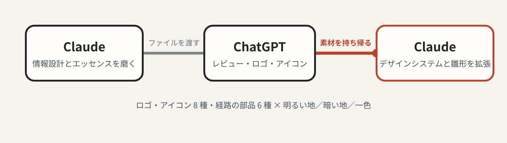
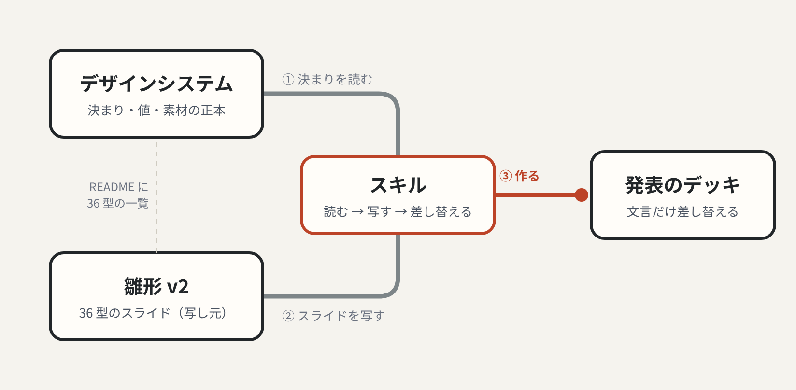

:::message
この記事は、Claude と一緒にスライドの型を作り直した経緯を、Claude と一緒に振り返って書いています。
:::

## はじめに

2026 年 9 月、Claude にスライドを作る機能（[Claude Slides](https://claude.com/resources/articles/cowork-is-now-claude)）が加わり、[10 月にはベータも外れました](https://claude.com/resources/articles/dashboards-and-motion)。それまでは Claude に PowerPoint を作らせては直す、をがんばって繰り返していました。今は Slides の方が PowerPoint を編集するよりずっと扱いやすく、これからはこちらが主になりそうです。

デザインはよく磨かれていて、テーマ色も変えられます。ただ、使う人が増えるにつれて、型が見えてきました。色が違っても、文字の位置や大きさで「あ、Claude のテンプレだ」と分かってしまいます。自分も同僚も同じ型を使っています。

このままだと「AI っぽい」と言われそうなので、自分なりにカスタムしてみました。やってみて分かったのは、AI っぽさは色を変えても消えないことです。効いたのは、何を先に読ませるかを、作る手順の最初に決めることでした。

## AI っぽさは、色ではなく読ませる順番がないことから来る

色や表現を変えても、スライドの文字の位置や見せ方は同じに見えました。分かりやすいのですが、誰のスライドも「Claude で作ったんだな」と分かってしまいます。

Claude で作られたらしい登壇資料と、参考にしたい登壇者の資料を並べ、文字の大きさや配置を Claude に測ってもらうと、違いは 3 つでした。

| 違い | Claude っぽい資料 | 参考にした資料 |
| --- | --- | --- |
| 本文の大きさ | 小さい。見出しとの差が大きく、本文は読まれない | 本文も大きい |
| 箱 | 同じ幅の箱を横に 3 つ並べる | 箱を使わず、縦線や番号で区切る |
| 縦の使い方 | 中身を縦いっぱいに引き伸ばす | 上詰めで、下が空いている |

どれも色とは関係なく、どこから読めばいいかが決まっていないことの表れです。

*左はよくある型を自分で再現したもので、右が作り直した型です。*

## 色を変えてと頼んでも、手持ちの型の色違いしか出なかった

最初の数回は、うまくいきませんでした。

1. 4 種類の案 → どれも色と飾りが違うだけで、文字の位置や大きさは同じ
2. 大きく変えた案 → 変えすぎて使いづらい
3. 控えめに変えた案 → そんなに変わっていない
4. 作り直した案 → スライドが崩れていた

情報設計や、どういう場面でどう見せるかは、最初に伝えたつもりでした。ただ、それを Claude にどう伝えれば作るものに反映されるのかが、分かりませんでした。考え方は資料として渡していても、作る手順には入っていなかったのです。

## 型ごとに読む順番を先に決めたら、見た目が変わった

人は位置ではなく「目立つ順」に読みます。そこで、型ごとに読ませる順番を先に決め、大きさ → 太さ → 色の強さをその順に合わせました。

| 型 | 1 番目 | 2 番目 | 3 番目 | 最後 |
| --- | --- | --- | --- | --- |
| 本文 | 見出し（帯 × 64px） | 朱の一句 | 本文 44px | 補足・出典 |
| 大きな数字 | 数字 240px | 見出し | 意味の一文 | 出典 |
| 左帯＋番号 | 帯の主張 | 朱の 1 行 | 残りの行 | 番号（灰色） |

決まりは少しだけです。朱と太字は読ませたい 1 か所だけ。番号やラベルは灰色にして、見出しより先に目に入れない。本文は 44px で、中身は上詰め。作ったら画像をぼかして、最初に目に入るのが見出しかを確かめます。

*ぼかすと、左はどこから読めばいいか分かりません。右は帯の主張 → 朱の 1 行の順に目が行きます。*

ここで初めて、「多少のオリジナリティはありつつ、分かりやすくなった」と思える形になりました。型がそろってからは、登壇慣れした人の資料から配置だけを借りて、左帯や横切る帯などの型を足し、36 型の雛形にしています。

## ロゴも図も「朱の線は 1 本」の同じルールでそろえた

ロゴやアイコンは ChatGPT を使いました。まず、私が情報を渡しながら Claude に調べさせ、情報設計やスライドのエッセンスを磨いていきました。そのファイルを ChatGPT に渡してレビューとロゴ・アイコンの作成をしてもらい、Claude に持ち帰ってデザインシステムとサンプルスライドを広げました。

意外だったのは ChatGPT のデザインのセンスで、ロゴやアイコンの仕上がりには驚きました。Claude だけで完結させず、得意なところで別の AI を組み合わせる使い方もありだと実感しています。

ロゴの考え方は、そのままスライドの図の決まりにしました。強調する経路は朱で 1 本だけ、ほかは灰色。線は直線で、曲がるところだけ丸める。境界は角丸の四角。これで表紙のロゴと本編の構成図が、同じ形の言葉で描かれます。

## 決まりと雛形を分けて、スキルで毎回読ませる

決まり・値・素材は Claude のデザインシステムに、36 型のスライドは雛形に分けました。同じスライドを 2 か所に置くと、片方だけ直して食い違うからです。

スライドを作るときは、Claude のスキルに「デザインシステムを読む → 雛形から写す → 文言だけ差し替える」の順を書いて、毎回その順で動くようにしています。

## 見た目の考え方は、資料ではなく手順の最初に置く

振り返ると、遠回りの原因はどれも「伝えたつもり」でした。同じことをするときに効いたことを残しておきます。

- **考え方は、作る手順の最初に置く**：視線誘導の資料を渡しただけでは、手持ちの型の色違いが出てきた。型ごとに「何を 1 番目に読ませるか」を先に書かせ、それから大きさ・太さ・色を決める順にしたら、提案が変わった
- **「型」が配置の話か中身の話かを言い分ける**：登壇資料の型を調べてと頼むと、話の組み立てが返ってきた。「スライドの上の配置」と言い直したら通じた
- **素材は使い方と一緒に登録する**：アイコンを参考として渡すと、大半が使われなかった。置き場所・使う場面・1 枚に何個までかを決めてデザインシステムに入れたら、使われるようになった
- **見た目は描いて確かめる**：Slides には使える書き方に制約があり、外れた指定は黙って無視される。公開前に必ず描いて、ぼかして読む順番まで見る

## おわりに

遠回りしましたが、最終的にはいい感じのものができました。このデザインシステムと雛形を、これからの登壇で活用していきます。
