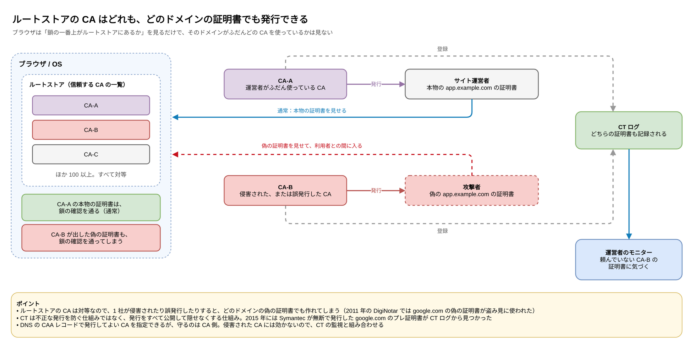
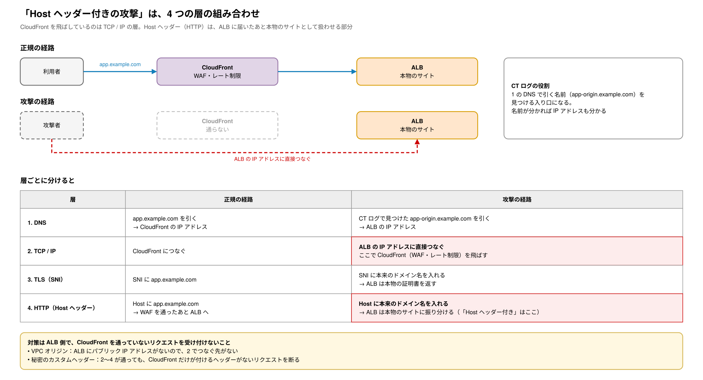
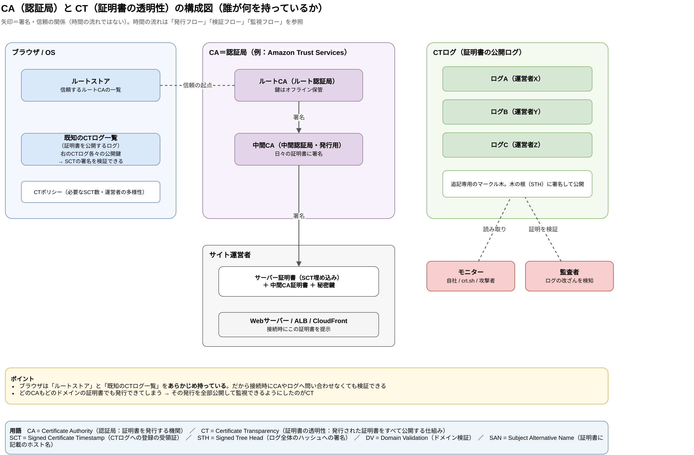
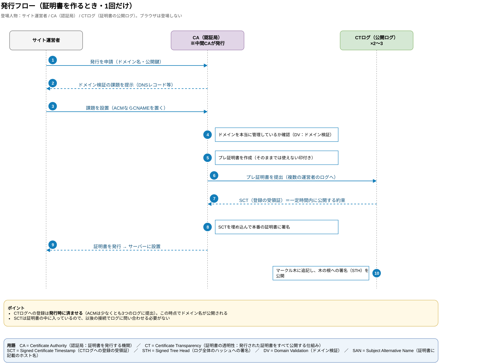
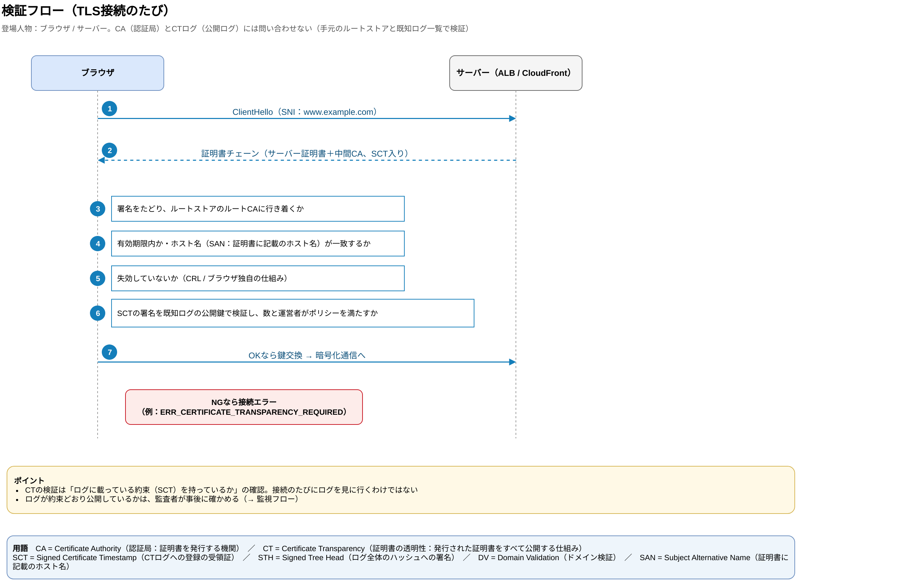
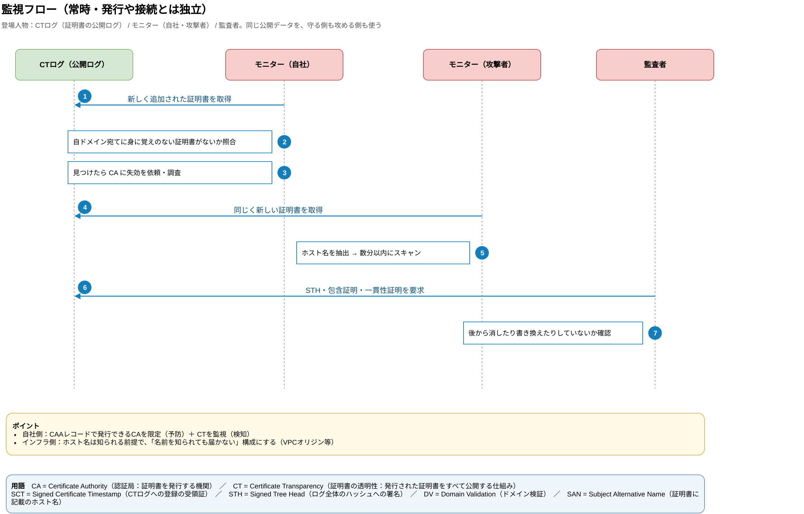
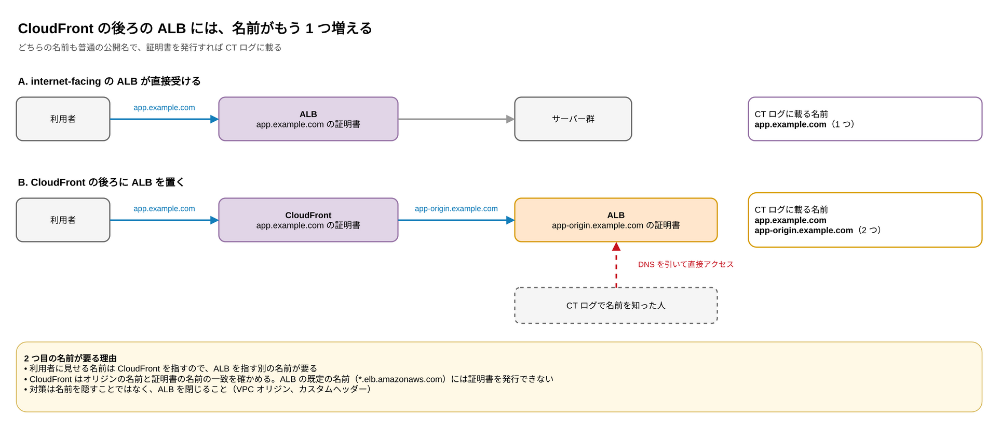

:::message
この記事は、Claude と一緒に公式ドキュメントや RFC を調べ、構成図を作りながら整理した内容をまとめたものです。各記述の根拠は、記事中のリンク先で確認できます。
:::

## はじめに

「CT Log でホスト名が知られるから、Host ヘッダー付きの攻撃が増えた」という話を見かけて、そもそも CT Log とは何なのか、CA（認証局）とどうつながっているのかを整理しました。

AWS で Web リクエストを受ける構成の話は、別の記事にまとめています。この記事はその前提知識の深掘りです。

https://zenn.dev/anfangd/articles/aws-web-ingress-origin-protection

## TL;DR

- CT（Certificate Transparency）は、公的な CA が発行した証明書を、**誰でも監査できる追記専用の公開ログにすべて記録する仕組み**です
- Chrome や Apple のプラットフォームは CT を必須にしているため、**ACM の証明書も必ず記録され、オプトアウトできません**
- ログは誰でも検索でき、**攻撃者も偵察に使います**。公的な証明書を取った時点でホスト名は知られる前提で考えます
- 仕組みは「構成」と、「発行」「検証」「監視」の 3 つのフローに分けると理解しやすくなります。ブラウザは**接続時に CA にも CT ログにも問い合わせません**

:::message
**用語**
- **CA**（Certificate Authority）：認証局。TLS 証明書を発行する機関。ACM の裏側では Amazon Trust Services が CA です
- **CT**（Certificate Transparency）：証明書の透明性。発行された証明書をすべて公開ログに記録する仕組み
- **SCT**（Signed Certificate Timestamp）：CT ログへの登録の受領証。「一定時間内に必ず公開する」というログの署名付きの約束
- **STH**（Signed Tree Head）：ログ全体（マークル木の根）のハッシュに対するログの署名
- **DV**（Domain Validation）：ドメイン検証。申請者がドメインを管理しているかの確認
- **SAN**（Subject Alternative Name）：証明書に書かれた、その証明書が有効なホスト名
- **ルートストア**：OS やブラウザに最初から入っている、信頼する CA（ルート証明書）の一覧
:::

## CT とは

CT は、公的な CA が発行した TLS 証明書を、**誰でも監査できる追記専用のログ**に記録する仕組みです。誤発行や不正発行の証明書を検知することが目的で、RFC 6962 で定義されています（改訂版の RFC 9162 もありますが、現在のブラウザのポリシーは RFC 6962 方式のログが中心です）。

- [RFC 6962: Certificate Transparency](https://www.rfc-editor.org/rfc/rfc6962)

なぜこんな仕組みが必要なのかというと、ブラウザや OS のルートストアに入っている CA なら、**どのドメインの証明書でも発行できてしまう**からです。

ルートストアは、OS やブラウザに最初から入っている「信頼する CA の一覧」です。Apple、Microsoft、Mozilla、Google がそれぞれ管理していて、どれにも 100 を超えるルート証明書が入っています。ブラウザが確かめるのは「証明書の鎖をたどった一番上が、この一覧にあるか」だけです。そのドメインがふだんどの CA を使っているかは見ません。一覧の CA はすべて対等に扱われます。



ふだんは、運営者が使っている CA（図の CA-A）が発行した証明書をサーバーが見せ、ブラウザは鎖を確かめて接続します。ところが、ほかの CA（図の CA-B）が同じドメインの証明書を出しても、ブラウザは同じように通してしまいます。

そのため、どこか 1 社が侵害されたり誤発行したりすると、偽の証明書でも本物と区別がつかなくなります。実際に、2011 年にはオランダの CA である DigiNotar が侵害され、`google.com` の偽の証明書がイランの利用者の通信の盗み見に使われました。2015 年には、Symantec が Google に無断で `google.com` のプレ証明書を発行していたことが、CT ログから見つかっています。

- [An update on attempted man-in-the-middle attacks - Google Security Blog（2011）](https://security.googleblog.com/2011/08/update-on-attempted-man-in-middle.html)
- [Improved Digital Certificate Security - Google Security Blog（2015）](https://security.googleblog.com/2015/09/improved-digital-certificate-security.html)

そこで「発行された証明書をすべて公開し、誰でも監視できるようにする」ことで、不正な発行を見つけられるようにしました。CT は不正な発行を防ぐ仕組みではなく、隠せなくする仕組みです。

押さえておきたいポイントは次の 3 つです。

**1. ブラウザが CT を必須にしている**

Chrome と Apple のプラットフォーム（Safari を含む）は、CT のポリシーを満たさない公的な証明書を信頼しません。証明書には、CT ログに登録した証拠である SCT（Signed Certificate Timestamp）が複数必要です。

- [Chrome Certificate Transparency Policy](https://googlechrome.github.io/CertificateTransparency/ct_policy.html)
- [Apple's Certificate Transparency policy](https://support.apple.com/en-us/103214)

**2. ACM の公開証明書も必ず記録され、オプトアウトできない**

ACM の公開証明書は、自動的に CT ログに記録されます。ブラウザのポリシー上の要件なので、オプトアウトはできません。以前あった `CertificateTransparencyLoggingPreference` は非推奨になっています。記録されるのは**ドメイン名**で、秘密鍵は記録されません。

- [AWS Certificate Manager concepts - Certificate Transparency Logging](https://docs.aws.amazon.com/acm/latest/userguide/acm-concepts.html)

**3. ログは誰でも検索でき、攻撃者の偵察にも使われる**

`crt.sh` などの検索サービスを使えば、`origin.example.com` や `stg-admin.example.com` のように、証明書を取ったホスト名を誰でも一覧できます。本来は、自ドメインで身に覚えのない証明書が発行されていないかを監視するための仕組みです（ACM のドキュメントでも、この用途でログの監視を勧めています）。

一方で攻撃者もこれを偵察に使います。IMC 2018 の論文では、CT ログを監視するハニーポットを置いたところ、**証明書の発行から数分でスキャンの標的にされた**ことが観測されています。

- [The Rise of Certificate Transparency and Its Implications on the Internet Ecosystem (IMC 2018)](https://arxiv.org/abs/1809.08325)

つまり、**DNS を公開していなくても、公的な証明書を取った時点でホスト名は知られる** と考えておく必要があります。X で「CT Log が知られるようになってから Host ヘッダー付きの攻撃が増えた」という話が出ていたのも、このことを指しています。

ここでいう「Host ヘッダー付きの攻撃」は、CloudFront などの CDN を通らずに、オリジン（ALB など）へ直接リクエストを送る攻撃のことです。いくつかの層の話が重なっているので、層ごとに分けます。

1. **DNS**：CT Log で見つけたホスト名を DNS で引き、オリジンの IP アドレスを知ります
2. **TCP / IP**：CDN ではなく、そのオリジンの IP アドレスに直接つなぎます
3. **TLS**：HTTPS なら、TLS の接続を張ります。このとき SNI（TLS で接続先のホスト名を伝える欄）に本来のドメイン名を入れると、オリジンは本物の証明書を返します
4. **HTTP**：HTTP リクエストの Host ヘッダーに、本来のドメイン名を入れます。ALB や Web サーバーは 1 つの IP アドレスで複数のサイトを扱い、Host ヘッダーを見てどのサイトに振り分けるかを決めています。IP アドレスだけで送るとデフォルトの応答しか返りませんが、Host ヘッダーが合っていれば本物のサイトの応答が返ります



「Host ヘッダー付き」は 4 の部分を指しています。1〜3 で CDN を飛ばして直接つなぎ、4 で本物のサイトとして扱わせる、という組み合わせです。こうなると、CDN 側に置いた WAF やレート制限は一度も通りません。

curl なら、`--resolve` で 1 の名前解決だけを差し替えると、3 の SNI と 4 の Host ヘッダーには本来のドメイン名が入ったまま、2 の接続先だけがオリジンになります。

```bash
# www.example.com の名前解決だけを、オリジンの IP アドレスに差し替える
curl --resolve www.example.com:443:203.0.113.10 https://www.example.com/
```

## CA と CT の仕組み（図解）

CT Log の話は、「構成（誰が何を持っているか）」と「フロー（いつ何が流れるか）」を分けると理解しやすくなります。フローはさらに、**発行（1回だけ）**、**検証（TLS 接続のたび）**、**監視（常時）** の 3 つに分かれていて、それぞれ登場人物が違います。

### 構成図



- ブラウザや OS は、信頼する**ルートストア**と、**既知の CT ログ一覧**（各ログの公開鍵）を、あらかじめ持っています
- CA は、オフラインで保管するルート CA の下に**中間 CA** を置き、日々の証明書は中間 CA が署名します
- CT ログは複数の事業者が運営する追記専用のマークル木で、木の根への署名（STH）を公開します
- ルートストアに入っている CA なら、どのドメインの証明書でも発行できてしまいます。その発行をすべて公開して監視できるようにしたのが CT です

### 発行フロー（証明書を作るとき）



登場人物は、サイト運営者、CA、CT ログの 3 者です。ブラウザは出てきません。

1. CA はドメインの管理を確認（DV）したあと、そのままでは使えない印を付けた**プレ証明書**を作り、複数の運営者の CT ログに提出します
2. ログは、一定時間内に必ず公開するという署名付きの約束（**SCT**）を返します
3. CA は SCT を埋め込んでから、本番の証明書に署名して発行します。ACM の場合は、少なくとも 3 つのログに提出してから発行します

**ドメイン名が公開されるのは、このタイミング**です。

### 検証フロー（TLS 接続のたび）



登場人物はブラウザとサーバーだけで、**CA にも CT ログにも問い合わせません**。ブラウザは、手元のルートストアと既知ログ一覧を使って、次の点を確認します。

- チェーン：署名をたどってルートストアのルート CA に行き着くか
- 有効期限とホスト名（SAN：証明書に書かれたホスト名）
- 失効していないか
- SCT：ログの署名が正しいか。数と運営者の多様性がポリシーを満たすか
- 相手が秘密鍵を持っているか：ハンドシェイクの中で、サーバーが証明書と対になる秘密鍵で署名できるかを確かめます

最後の確認があるので、証明書そのものは公開されても困りません。CT ログに証明書がすべて載っていても、秘密鍵がなければなりすましはできません。逆に、ルートストアに入っている CA が偽の証明書を出してしまうと、攻撃者は自分で作った秘密鍵と組み合わせて、すべての確認を通ってしまいます。チェーンの確認では偽物を見分けられないので、CT で発行そのものを見張ります。

Chrome の場合、有効期間が 180 日以下の証明書では 2 個、それを超える証明書では 3 個、別々のログからの SCT が必要です。

### 監視フロー（常時）



ログに載った証明書を、モニターが常に読み取っています。

- **自社**：身に覚えのない証明書が発行されていないかを監視します（検知）。あわせて DNS の CAA レコードで、発行できる CA を限定します（予防）
- **攻撃者**：同じデータからホスト名を抜き出し、発行から数分でスキャンを始めます
- **監査者**：包含証明と一貫性証明を使い、ログが後から消したり書き換えたりしていないかを確認します

「公的な証明書を取った時点でホスト名は知られる」と言われるのは、この監視フローがあるからです。

## CloudFront の後ろの ALB には、名前がもう 1 つ増える

証明書には、昔から利用者がアクセスする名前（`example.com` や `app.example.com` など）が入っていました。サーバーに置いた Apache で TLS を終えていた頃も、ロードバランサーで終えていた頃も同じです。変わったのは、CT によって、発行した公開証明書がすべて公開されるようになったことです。

では、CT ログで「知られていないと思っていた名前」が見つかりやすいのはどんなときか。代表例が、CloudFront の後ろに ALB を置く構成です。



- internet-facing の ALB がパブリックサブネットで直接受けるときは、利用者に見せる名前がそのまま ALB を指します。名前は 1 つです
- CloudFront の後ろでは、利用者に見せる名前は CloudFront を指します。そのため、ALB を指す名前（`app-origin.example.com` など）がもう 1 つ要ります
  - CloudFront は、オリジンへ HTTPS でつなぐとき、オリジンの名前と証明書の名前が一致するかを確かめます
  - ALB の既定の名前（`*.elb.amazonaws.com`）には、自分で証明書を発行できません

この 2 つ目の名前も普通の公開名で、証明書を発行すれば CT ログに載ります。ただ、運用する側は「CloudFront からしか使わないから、誰にも伝わっていない」と思いがちです。実際は、誰でも CT ログで知ることができます。

CT ログで分かるのはほぼドメイン名だけですが、名前から DNS を引けば ALB にたどり着けます。ALB がインターネットから届く状態のままだと、CloudFront に置いた WAF などを通らずに ALB に届いてしまいます。なので、名前を隠すのではなく、ALB 側を閉じます。VPC オリジンで internal にするか、CloudFront が付けるカスタムヘッダーを持たないリクエストを断ります。

- [Requiring HTTPS for communication between CloudFront and your custom origin](https://docs.aws.amazon.com/AmazonCloudFront/latest/DeveloperGuide/using-https-cloudfront-to-custom-origin.html)

## 取れる対策

- **予防**：DNS に CAA レコードを置き、自ドメインの証明書を発行できる CA を限定します（ACM を使うなら Amazon 系の CA を許可します）
- **検知**：CT ログを監視し、身に覚えのない証明書が発行されていないかを確認します。ACM のドキュメントでも、ログの監視が勧められています
- **隠蔽（補助）**：オリジン用の証明書をワイルドカード（`*.example.com`）にすれば、ログに載るのは `*.example.com` だけで、個別のホスト名は出ません。ただし推測しにくくするだけです
- **本筋**：ホスト名は知られる前提で、「名前を知られても届かない」構成にします。AWS なら CloudFront の VPC オリジンや OAC です（詳しくは[こちらの記事](https://zenn.dev/anfangd/articles/aws-web-ingress-origin-protection)）

## 手を動かして確かめる

`example.com` を自分のドメインに置き換えて試してみてください。

```bash
# 1. 自分のドメインで、どのホスト名の証明書が CT ログに載っているか（crt.sh の JSON API）
curl -s 'https://crt.sh/?q=%25.example.com&output=json' | jq -r '.[].name_value' | sort -u

# 2. サーバー証明書に埋め込まれた SCT を見る（ログ ID・タイムスタンプ・署名が並ぶ）
openssl s_client -connect www.example.com:443 -servername www.example.com </dev/null 2>/dev/null \
  | openssl x509 -noout -text | grep -A 30 'CT Precertificate SCTs'

# 3. CAA レコード（どの CA に発行を許しているか）
#    サブドメインに無ければ親ドメインの CAA が適用される。どこにも無ければ制限なし
dig +short CAA example.com

# 4. ACM で発行済みの証明書（＝ CT ログで公開されているホスト名の一覧でもある）
aws acm list-certificates --region us-east-1 \
  --query 'CertificateSummaryList[].[DomainName,CertificateArn]' --output table
```

1 の結果に、公開していないつもりのホスト名（`origin.`、`stg-`、`admin.` など）が並んでいたら、それは誰でも見られる状態です。2 で SCT が複数並んでいれば、その証明書は発行時に複数のログに登録されています。

## 最近の動き

- CT ログの実装は、RFC 6962 方式から、静的ファイルで配信する「タイル型」（static-ct-api）へ移りつつあります。Chrome は 2026年4月15日に、「少なくとも 1 つは RFC 6962 方式のログの SCT を含める」という要件を撤廃しました。これで、タイル型ログの SCT だけでも Chrome の CT ポリシーを満たせます（[ct-policy](https://groups.google.com/a/chromium.org/g/ct-policy/c/IXPT4r1CPdE)）。ただし、ほかのブラウザの要件は Chrome と異なる場合があります
- Chrome は 2026年5月の Chrome 148 から、OCSP 経由で渡される SCT を CT ポリシーの判定に数えなくなりました（[ct-policy](https://groups.google.com/a/chromium.org/g/ct-policy/c/6ewCgspeyZE)）。SCT を渡す方法は、証明書に埋め込む方式と TLS ハンドシェイクで渡す方式の 2 つで、主流は証明書に埋め込む方式です

## おわりに

CT Log は、証明書を取るたびに裏側で記録が積み上がっていく仕組みです。普段わざわざ見に行く場所ではないので見逃しがちですが、ホスト名はそこから知られてしまいます。これからシステムを作るときは、名前を知られても届かない構成になっているかを気をつけて見ていこうと思います。

## 参考

- [RFC 6962: Certificate Transparency](https://www.rfc-editor.org/rfc/rfc6962)
- [AWS Certificate Manager concepts - Certificate Transparency Logging](https://docs.aws.amazon.com/acm/latest/userguide/acm-concepts.html)
- [ACM API Reference: CertificateOptions](https://docs.aws.amazon.com/acm/latest/APIReference/API_CertificateOptions.html)
- [Chrome Certificate Transparency Policy](https://googlechrome.github.io/CertificateTransparency/ct_policy.html)
- [Apple's Certificate Transparency policy](https://support.apple.com/en-us/103214)
- [The Rise of Certificate Transparency and Its Implications on the Internet Ecosystem (IMC 2018)](https://arxiv.org/abs/1809.08325)
