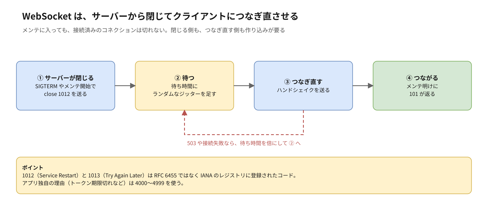

:::message
この記事は、Claude と一緒に RFC や AWS の公式ドキュメントを調べ、図を作りながら整理した内容をまとめたものです。各記述の根拠は、記事中のリンク先で確認できます。
:::

## はじめに

【ハジメが書く：書こうと思ったきっかけ。例：メンテナンスのステータスコードを調べていたら、リダイレクトや API、WebSocket でも「なんとなく」で返しているコードが多いと気づいた話など】

この記事では、リダイレクト、ページの削除、API、5xx、WebSocket で、ステータスコードを意味どおりに返すためのポイントをまとめます。メンテナンスや管理画面で「どの層で返すか」は、別の記事に分けました。

https://zenn.dev/anfangd/articles/http-status-code-where-to-return

## TL;DR

- リダイレクトは、恒久か一時か、メソッドを保つかで 301・302・307・308 を選ぶ
- 意図して消したページは 410。存在しない URL に 200 を返す「ソフト 404」を作らない
- API は 400・422・409・429 を分けると、クライアントが「直すべきか」「待てばいいか」を判断できる
- 同じ 503 でも、自分で返したのか ALB が返したのかで意味が違う。ログでは返した層を分けて見る
- WebSocket は、つながったあとは close code で理由を伝える。メンテでは接続済みのコネクションをサーバーから閉じる

## リダイレクトは、恒久か一時か、メソッドを保つかで選ぶ

| ステータス | 意味 | メソッド | 使う場面 |
| --- | --- | --- | --- |
| `301` | 恒久的に移動 | POST が GET に変わることがある | ドメイン移転、URL 変更。検索の評価が新 URL に移る |
| `308` | 恒久的に移動 | 保つ | API のエンドポイント移転など、POST を保ちたいとき |
| `302` | 一時的に移動 | POST が GET に変わることがある | ログイン後の戻り先など |
| `307` | 一時的に移動 | 保つ | 一時的な振り分けで POST を保ちたいとき |

301 と 302 は、歴史的な経緯でブラウザが POST を GET に変えて送り直すことがあります。メソッドを保ちたいなら、307 と 308 を使います。

HTTPS への移行は、301 か 308 に加えて `Strict-Transport-Security`（HSTS）を付けます。2 回目以降は、ブラウザが最初から HTTPS で接続します。

## 意図して消したページは 410、存在しない URL に 200 を返さない

ページを消すときは、404 と 410 を使い分けられます。

| ステータス | 意味 | 使う場面 |
| --- | --- | --- |
| `404 Not Found` | 見つからない。今後どうなるかは言わない | 存在しない URL 全般 |
| `410 Gone` | 意図して消した。もう戻らない | 終了したキャンペーンや、販売を終えた商品のページなど |

410 のほうが「もう戻らない」とはっきり伝わります。

気を付けたいのは**ソフト 404** です。存在しない URL でも 200 で「ページが見つかりません」を表示してしまう状態です。SPA の配信で、CloudFront のカスタムエラーページで 403 や 404 を `/index.html` と 200 に差し替えていると起きやすく、クローラーには存在しないページが大量にあるように見えます。SPA で正しく 404 を返すには、ルートの一覧を CloudFront Functions に持たせて、どれにも当たらない URL には 404 を返すなどの工夫が要ります。

## API は、4xx を細かく分けるとクライアントが楽になる

API のクライアントは、ステータスコードを見て「リクエストを直すべきか」「待てば通るか」を決めます。

| ステータス | 使う場面 | クライアントがすること |
| --- | --- | --- |
| `400 Bad Request` | JSON が壊れているなど、リクエストの形がおかしい | 実装を直す |
| `422 Unprocessable Content` | 形は正しいが、バリデーションに通らない | 入力をユーザーに直してもらう |
| `409 Conflict` | 楽観ロックの衝突、重複登録 | 最新の状態を取り直してやり直す |
| `429 Too Many Requests` | レート制限 | `Retry-After` の分だけ待ってリトライする |

成功のときも、`201 Created`（作成した。`Location` で作ったリソースの URL を返す）と `204 No Content`（成功したが返すボディがない）を使い分けると、クライアントが余計なリクエストをせずに済みます。

レート制限を AWS WAF のレートベースルールでかけている場合、既定のままだと 403 が返ります。429 に変えるときの注意は、別の記事の「WAF の既定の 403 を変えるなら」の節に書きました。

エラーのボディは、RFC 9457（Problem Details、`application/problem+json`）の形にそろえておくと、クライアントが共通の処理で扱えます。

```json
{
  "type": "https://example.com/problems/out-of-stock",
  "title": "在庫がありません",
  "status": 409,
  "detail": "商品 123 の在庫が 0 になりました"
}
```

## 5xx は、どの層が返したかで意味が変わる

同じ 503 でも、アプリがメンテナンスとして返したのか、ALB が返したのかで意味が違います。ALB が自分で返す 5xx は、おおむね次の意味です。

| ステータス | ALB が返す主な理由 |
| --- | --- |
| `502 Bad Gateway` | ターゲットとの接続や TLS に失敗した。ターゲットが不正な応答を返した、接続を途中で切った |
| `503 Service Unavailable` | ターゲットグループに登録済みのターゲットがない |
| `504 Gateway Timeout` | ターゲットが時間内に応答しなかった |

ALB のアクセスログでは、`elb_status_code`（ALB が返したもの）と `target_status_code`（ターゲットが返したもの）が分かれています。障害の切り分けでは、まずどちらが返したかを見ます。

運用で効くのは次の 2 つです。

- **ヘルスチェック用のエンドポイントを分ける**：`/healthz` のような軽いものを用意し、DB など依存先まで見るかは意図して決める。依存先まで見ていると、DB が止まった瞬間に全ターゲットが unhealthy になり、全体が 503 になる
- **監視は 5xx と 4xx を分ける**：5xx はサーバー側の問題なのでアラートの対象にする。4xx は急増したときだけ見る。攻撃や、クライアントのリリース不具合の兆候になる

## WebSocket は、つながったあとのことを別に考える

WebSocket は、最初のハンドシェイクだけが HTTP です。成功すると `101 Switching Protocols` が返り、そこから先は HTTP のステータスコードがありません。

### ハンドシェイクの失敗理由は、ブラウザの JS から読めない

ハンドシェイクの段階では、HTTP のステータスコードがそのまま使えます。メンテ中は 503、未認証は 401、権限なしは 403、レート制限は 429 です。

ただし、ブラウザの `WebSocket` API では、ハンドシェイクで返ったステータスコードを JS から読めません。どれで失敗しても `onerror` が呼ばれ、close code は 1006 になるだけです。理由をクライアントに伝えたいなら、いったん接続を受けてから close code を付けて閉じるか、接続の前に HTTP の API で状態を確かめさせます。

### 接続後は close code で理由を伝える

| close code | 意味 | 使う場面 |
| --- | --- | --- |
| `1000` | Normal Closure | 正常に終わった |
| `1001` | Going Away | サーバーの停止、ページ遷移 |
| `1008` | Policy Violation | 権限違反など |
| `1011` | Internal Error | サーバー内部のエラー |
| `1012` | Service Restart | 再起動するので、つなぎ直してほしい |
| `1013` | Try Again Later | 過負荷やメンテ中で、あとでつなぎ直してほしい |
| `4000`〜`4999` | アプリ独自 | トークン期限切れ（例：`4401`）など |

1012 と 1013 は RFC 6455 本体ではなく、IANA のレジストリに登録されたコードです。4000 番台は HTTP のコードに寄せた番号（`4401`、`4403` など）にしておくと、意味が伝わりやすくなります。

### メンテナンスに入っても、接続済みのコネクションは切れない

WAF や ALB でメンテナンスに切り替えても、それは新しいリクエストにしか効きません。すでにつながっている WebSocket はそのまま残ります。サーバーから閉じて、クライアントにつなぎ直させる必要があります。



- サーバーは、SIGTERM を受けたりメンテに入ったりしたら、全接続に 1001 か 1012 を送ってから終了する。ALB のターゲット登録解除の遅延（deregistration delay）が終わると残った接続は切られるので、アプリ側で先に閉じておく
- クライアントは、**指数バックオフにジッターを足して**つなぎ直す。全員が同じ間隔でつなぎ直すと、デプロイ直後の新しいタスクに接続が殺到して落ちる

### 認証は、ヘッダーを付けられない前提で考える

ブラウザの `WebSocket` API では、`Authorization` などのカスタムヘッダーを付けられません。主な選択肢は次の 3 つです。

| 方法 | 気を付けること |
| --- | --- |
| クエリパラメータにトークンを載せる | URL がアクセスログに残る。短命なワンタイムチケットにする |
| Cookie | 別のサイトから接続される（Cross-Site WebSocket Hijacking）。サーバーで `Origin` ヘッダーを必ず確かめる |
| 接続後の最初のメッセージで認証する | 数秒以内に認証が来なければ切る |

接続中にトークンの期限が切れたら、`4401` のような独自コードで閉じて、クライアントにトークンを取り直してからつなぎ直させます。

### AWS のタイムアウトに合わせて、ハートビートを送る

- ALB のアイドルタイムアウトは既定で 60 秒。ping/pong のハートビートを送るか、タイムアウトを延ばす
- API Gateway の WebSocket API は、接続の最長が 2 時間、アイドルタイムアウトが 10 分で、どちらも引き上げられない。長時間つなぐ用途は、つなぎ直す前提で作る

## 試した範囲と、まだ試していない範囲

この記事は、RFC と AWS の公式ドキュメントを読んで整理したもので、手元ではまだ試していません。次のことは、個人のアカウントで確かめてから追記する予定です。

- ALB で、ターゲットなし・接続拒否・タイムアウトを作り、502・503・504 がそれぞれ返るか。アクセスログの `elb_status_code` と `target_status_code` がどうなるか
- ブラウザで、ハンドシェイクを 401 や 503 で失敗させたとき、JS から見える close code が 1006 になるか
- サーバーから 1012 で閉じたとき、ジッター付きの再接続で接続が分散するか

【ハジメが書く：試した結果と感想（検証したら）】

## gRPC やメンテナンスの切り替えは、この記事では扱わない

- gRPC のステータスコード（HTTP のステータスとは別体系）
- メンテナンスの切り替えや管理画面のアクセス制御を、どの層で返すか（別の記事で扱っています）

## おわりに

【ハジメが書く：本音・次にやりたいこと】

## 関連する記事

メンテナンスや管理画面のステータスコードを、どの層で返すかは次の記事で扱っています。

- [そのステータスコード、どの層で返していますか？](https://zenn.dev/anfangd/articles/http-status-code-where-to-return)

## 参考

- [RFC 9110 - HTTP Semantics](https://www.rfc-editor.org/rfc/rfc9110)
- [RFC 6585 - Additional HTTP Status Codes（429）](https://www.rfc-editor.org/rfc/rfc6585)
- [RFC 9457 - Problem Details for HTTP APIs](https://www.rfc-editor.org/rfc/rfc9457)
- [RFC 6455 - The WebSocket Protocol](https://www.rfc-editor.org/rfc/rfc6455)
- [WebSocket Close Code Number Registry - IANA](https://www.iana.org/assignments/websocket/websocket.xhtml)
- [CloseEvent: code property - MDN](https://developer.mozilla.org/docs/Web/API/CloseEvent/code)
- [How do I troubleshoot 503 errors from my Application Load Balancer? - AWS re:Post](https://repost.aws/knowledge-center/alb-troubleshoot-503-errors)
- [Quotas for configuring and running a WebSocket in API Gateway](https://docs.aws.amazon.com/apigateway/latest/developerguide/apigateway-execution-service-websocket-limits-table.html)

<!-- 公開前に削除する
## 公開前の確認事項

- 「どの層で返していますか？」の記事と同時か、先に公開する。お互いにリンクしているので、片方だけ公開するとリンク切れになる
- ALB の 502・504 の理由は re:Post の記事と一般的な説明に基づく。502 と 504 の公式のトラブルシューティング記事も参考に足すか検討する
- ALB のアイドルタイムアウトの既定値（60 秒）を公式ドキュメントで確かめ、参考に足す
- 「301 と 302 で POST が GET に変わることがある」は RFC 9110 の記述。該当の節へのリンクを足すと親切
- 図は Python で .drawio.svg を生成したもの。draw.io で開いて編集できる
-->
