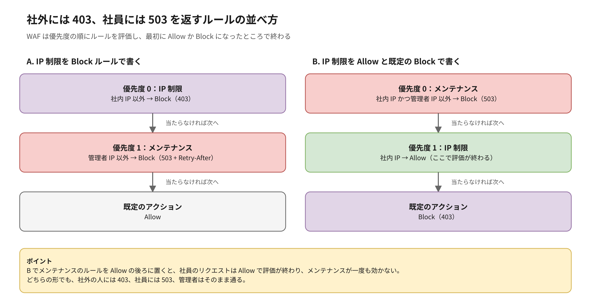
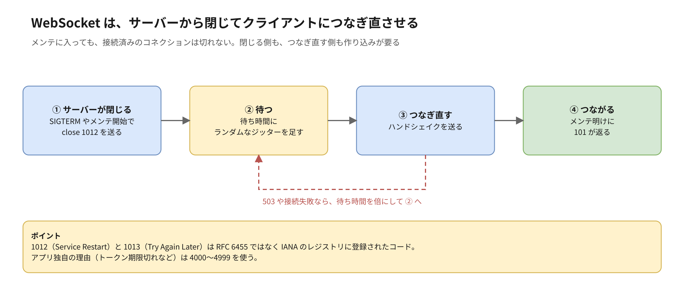

:::message
この記事は、Claude と一緒に RFC や AWS の公式ドキュメントを調べ、図を作りながら整理した内容をまとめたものです。各記述の根拠は、記事中のリンク先で確認できます。
:::

## はじめに

【ハジメが書く：書こうと思ったきっかけ。例：「メンテナンス中は何を返すのが普通？」と聞かれて答えたら、ステータスコードそのものより「どこで返すか」のほうが運用では効くと感じた話など。話し言葉や音声の文字起こしで OK】

この記事では、メンテナンス、管理画面、リダイレクト、API、5xx、WebSocket について、ステータスコードを**何にするか**と**どの層で返すか**をまとめます。

## TL;DR

- ステータスコードは、受け取る相手（ブラウザ、クローラー、監視、API クライアント、ロードバランサー）に何をしてほしいかで選ぶ
- メンテナンス中は `503` に `Retry-After` を付ける。`200` や `302` でメンテページを見せない
- 返す層は、手前ほどアプリが止まっていても確実に返せ、奥ほど細かく判断できる。メンテナンスの切り替えは、止める対象より手前の層に置く
- AWS なら WAF のカスタムレスポンスが扱いやすい。管理者の IP を条件から外せて、`Retry-After` も付けられる。ALB の固定レスポンスはヘッダーを付けられない
- WAF の既定の 403 を変えるのは、相手に別の動きをしてほしいときだけにする。攻撃の遮断に 503 を使うとリトライを招く。逆に 403 のままだと、CloudFront のカスタムエラーページで 200 に化けることがある
- ユーザー向けと管理者向けでホスト名やパスが分かれていると、「利用者向けだけ止めて、管理者は動作確認する」が条件 1 つで書ける
- 社内向けのサービスをメンテにするときは、社外には 403、社員には 503 を返す。WAF で社内 IP を Allow している構成では、メンテのルールを Allow より前に置かないと効かない
- 管理画面を 404 で隠すのが効くのは、利用者向けと同じホストにパスで同居しているときだけ。管理画面だけのホストは、隠すより外から届かない構成にする
- 迷ったら、受け取る相手に何をしてほしいかで決め、サービスごとに表にして理由を残す
- WebSocket は接続済みのコネクションがメンテを素通りする。サーバーから close code を付けて閉じ、クライアントはジッター付きでつなぎ直す

## ステータスコードは、受け取る相手に何をしてほしいかで選ぶ

ステータスコードを読むのは人間ではなく、プログラムです。

| 受け取る相手 | ステータスコードを見て何をするか |
| --- | --- |
| ブラウザ | リダイレクトに従う、キャッシュを使う、認証を求める |
| 検索エンジンのクローラー | インデックスに残す、消す、あとで来直す |
| 監視・アラート | 障害として通知するかを決める |
| API クライアント | リトライするか、ユーザーにエラーを見せるかを決める |
| ロードバランサーや CDN | ターゲットを外す、エラーをキャッシュする |

「メンテ中だから 200 でお知らせページを出す」は人間には伝わりますが、クローラーと監視には「正常」と伝わります。迷ったら「この相手に何をしてほしいか」から逆算します。

## ステータスコードを返せる層は、思っているより多い

AWS で CloudFront と ALB を使う構成だと、リクエストはおおむね次の順に通ります。どの層も、自分でレスポンスを返してそこで止められます。


| 層 | 返し方 | ヘッダーを付けられるか | 判断に使える条件 |
| --- | --- | --- | --- |
| AWS WAF | Block アクションのカスタムレスポンス | 付けられる | IP セット、ホスト、パス、メソッド、ヘッダーなど |
| CloudFront Functions | viewer request でレスポンスを生成 | 付けられる | コードで自由に書ける |
| ALB | リスナールールの `fixed-response` アクション | **付けられない**。ボディは 1,024 文字まで | ホスト、パス、ヘッダー、メソッド、送信元 IP |
| アプリ | 何でも | 付けられる | ユーザーの状態やデータまで見られる |

手前の層ほど、アプリやデータベースが止まっていても確実に返せます。奥の層ほど、「このユーザーは書き込み中か」のような細かい判断ができます。

注意が要るのは 2 つです。1 つは、ALB の固定レスポンスにはカスタムヘッダーを付けられないことです。メンテナンスで `Retry-After` を付けたいなら、ALB だけでは足りません。もう 1 つは、CloudFront の**カスタムエラーページ**は、オリジンが返したエラーを差し替える機能だということです。自分からメンテナンスに切り替える仕組みではありません。また、オリジンが 400 以上を返したときは、viewer response の CloudFront Functions が動きません。

## メンテナンス中は、503 と Retry-After を返す

メンテナンス中に返すのは `503 Service Unavailable` です。RFC 9110 で、一時的な過負荷や予定されたメンテナンスで処理できない状態として定義されています。`Retry-After` ヘッダーで、再開の目安を秒数か日時で伝えます。

```http
HTTP/1.1 503 Service Unavailable
Retry-After: 3600
Content-Type: text/html; charset=utf-8
Cache-Control: no-store
```

使わないほうがいいものもあります。

| 返し方 | 何が起きるか |
| --- | --- |
| `200` でメンテページ | クローラーには「このページの中身はメンテのお知らせ」と伝わる。監視も正常と判定する |
| `302` でメンテページへ | リダイレクト先が正規のページとして扱われることがある。戻すときに不要なリダイレクトが残りがち |
| `404` | クローラーに「このページは消えた」と伝わる |

Google は、緊急でサイトを 1〜2 日止めるなら 503 の情報ページを返すよう案内しています。長く続けるとインデックスから外れ始めるので、503 で止めるのは短い期間に限ります。

メンテナンスページそのものにも気を付けることがあります。

- `robots.txt` には 503 を返さない。Google によると、すべてのクロールが止まります
- 静的な HTML にする。止めているアプリや DB、外部の JS・フォントに依存させない
- API には HTML ではなく JSON を返す。アプリが「メンテ中」の画面を出せるように、理由と再開予定を入れておく

## メンテナンスは、止めるものより手前の層で切り替える

メンテナンスの切り替えは、止める対象より手前の層に置きます。アプリのメンテナンスをアプリ自身の設定で出していると、アプリが起動しない状態では何も返せません。

AWS で選ぶなら、私は次の順に考えます。

| 置き場所 | 向いているケース | 気になる点 |
| --- | --- | --- |
| WAF のカスタムレスポンス | CloudFront か ALB に WAF が付いている。まずはこれ | 切り替えはルールの追加・変更になる |
| CloudFront Functions | WAF がない。条件をコードで細かく書きたい | 関数の発行と関連付けが必要。判断ロジックがコードに埋もれる |
| ALB のリスナールール | CloudFront も WAF もない | `Retry-After` を付けられない |
| アプリの機能フラグ | 一部の機能だけ止める、読み取り専用にする | アプリが動いていることが前提 |
| DNS の切り替え | 基本は使わない | TTL が残るので、切り替えも戻しもすぐには効かない |

### 管理者は、Allow で通すのではなく Block の条件から外す

メンテナンス中でも、管理者は本番で動作確認をしたいはずです。WAF なら、メンテナンス用の Block ルールに「管理者の IP セットでない」という条件を足します。


ここで「管理者の IP なら Allow」というルールを先頭に置くと、WAF はその時点で評価を終えます。後ろにあるマネージドルールも素通りになり、管理者のリクエストだけ検査されない状態になります。Block の条件から外すだけにしておけば、管理者のリクエストも通常どおり検査されます。

Terraform で書くと、たとえば次のようになります。`maintenance` 変数で、ルールそのものを出し入れしています。

```hcl
variable "maintenance" {
  type    = bool
  default = false
}

resource "aws_wafv2_web_acl" "main" {
  name  = "main"
  scope = "CLOUDFRONT"

  default_action {
    allow {}
  }

  custom_response_body {
    key          = "maintenance"
    content      = file("${path.module}/maintenance.html")
    content_type = "TEXT_HTML"
  }

  dynamic "rule" {
    for_each = var.maintenance ? [1] : []
    content {
      name     = "maintenance"
      priority = 0

      action {
        block {
          custom_response {
            response_code            = 503
            custom_response_body_key = "maintenance"
            response_header {
              name  = "Retry-After"
              value = "3600"
            }
          }
        }
      }

      # 管理者の IP セット「以外」を Block する
      statement {
        not_statement {
          statement {
            ip_set_reference_statement {
              arn = aws_wafv2_ip_set.admin.arn
            }
          }
        }
      }

      visibility_config {
        cloudwatch_metrics_enabled = true
        metric_name                = "maintenance"
        sampled_requests_enabled   = true
      }
    }
  }

  # マネージドルールなど、通常のルールが続く

  visibility_config {
    cloudwatch_metrics_enabled = true
    metric_name                = "main"
    sampled_requests_enabled   = true
  }
}
```

ホストやパスで範囲を絞るときは、`not_statement` と並べて `and_statement` でホスト（`Host` ヘッダー）やパスの条件を足します。

### 社内向けのサービスでは、社外には 403、社員には 503 を返す

社員向けのサービスのように、もともと IP 制限で社外からのアクセスを 403 にしているサービスはありますか？ そういうサービスをメンテナンスにするときは、相手によって返すものを分けます。

| 誰からのアクセスか | メンテナンス中に返すもの |
| --- | --- |
| 社外（許可されていない IP） | 403 |
| 社員（許可された IP） | 503 と `Retry-After` |
| 管理者 | そのまま通す |

社外の人に 503 を返すと、「このサービスは存在していて、今はメンテ中」と教えることになります。それに、メンテが明けてもその人には 403 が返るので、「待てば通る」という 503 の意味と食い違います。

WAF で書くときは、IP 制限をどう書いているかでルールの並べ方が変わります。



- **A. IP 制限を Block ルールで書いている**：IP 制限を先、メンテナンスを後に並べます。逆に並べると、社外の人にも 503 が返ります
- **B. 社内 IP を Allow し、既定のアクションを Block にしている**：こちらは注意が要ります。Allow の時点で評価が終わるので、メンテナンスのルールを Allow の後ろに置くと一度も評価されません。メンテナンスのルールを Allow より前に置き、条件を「社内 IP かつ管理者の IP でない」にします。社外の人はこの条件に当たらず、既定の 403 になります

社内向けのサービスは B の書き方が多いので、メンテナンスのルールを足すときは、Allow のルールより前に入っているかを確かめます。

WAF がない構成で ALB を使う場合は、リスナールールを 2 本にします。優先度の高いほうに「送信元 IP が管理者なら forward」、次に「それ以外は fixed-response で 503」を置きます。ただし、前の節のとおり `Retry-After` は付けられません。

## WAF の既定の 403 を変えるなら、理由と影響を先に決める

WAF の Block は、何も設定しなければ `403 Forbidden` を返します。カスタムレスポンスを使えば 2xx から 5xx まで決められたコードに変えられますが、変えると受け取る側の動きも変わります。

### 変える理由があるのは、相手に別の動きをしてほしいときだけ

| 場面 | 変える先 | 相手にしてほしいこと |
| --- | --- | --- |
| メンテナンス | `503` と `Retry-After` | クローラーにはインデックスを残してもらう。監視には「一時的」と伝える |
| レート制限 | `429` と `Retry-After` | クライアントに、間隔を空ければ通ると伝える |
| 管理画面を隠す | `404` | ボットに、管理画面があること自体を教えない |
| 地域制限などで案内ページを見せる | `302` と `Location` | 403 の画面ではなく、理由を説明するページに移ってもらう |

逆に、マネージドルールなどで攻撃をはじく Block は、403 のままにしておきます。

### 503 と 429 は「待てば通る」という合図になる

多くの HTTP クライアントや SDK は、5xx や 429 を受けると自動でリトライします。攻撃や不正なリクエストをはじくルールで 503 を返すと、ボットやクライアントに「もう一度来て」と伝えることになり、リクエストがかえって増えます。503 と 429 は、本当に待てば通る場面だけに使います。

### 2xx は返さない

WAF は 200 も返せますが、ブロックしたのに 200 を返すと、クローラーにはブロック画面が正規の中身として、監視には正常として伝わります。メンテページを 200 で出すのと同じ問題が起きます。

### ステータスコードだけでは、WAF が返したのか区別できなくなる

CloudFront や ALB のアクセスログには、WAF で設定したコードがそのまま残ります。「403 なら WAF」という前提のダッシュボードやアラームは、コードを変えると数え方がずれます。WAF が返した 503 で、5xx のアラームが鳴ることもあります。

区別するには、WAF のログの `terminatingRuleId` で、どのルールが返したかを見ます。メンテナンスのように見られて困らない場面なら、カスタムレスポンスに `x-maintenance: true` のような独自ヘッダーを付けておくと、ログやブラウザの開発者ツールでもすぐ見分けられます。

### 404 で隠すと、正規の利用者も迷う

VPN を切ったまま管理画面を開いた管理者にも 404 が返ります。URL を間違えたと思って探し回ったり、問い合わせを受けた側が本当にページがないのかブロックなのか切り分けられなかったりします。404 で隠すのは管理画面のパスに絞り、管理者には「社内ネットワーク以外からは 404 になる」と伝えておきます。

### 既定の 403 のままだと、CloudFront のカスタムエラーページに置き換わる

WAF がブロックしたときのレスポンスは、次の順で決まります。

1. WAF の Block にカスタムレスポンスがあれば、それを返す。CloudFront 側の設定は効かない
2. なければ、CloudFront のカスタムエラーページなど、保護しているリソース側の設定が効く
3. どちらもなければ、WAF の既定の 403 を返す

SPA でよくある「403 と 404 を `/index.html` と 200 に差し替える」カスタムエラーページを設定していると、2 番目が効きます。WAF がブロックしたリクエストまで `index.html` と 200 になり、ブロックされたことが外から見えなくなります。SPA の配信で WAF を使うなら、Block するルールそれぞれに 403 のカスタムレスポンスを明示しておくと、この差し替えを避けられます。

逆に、カスタムレスポンスを設定したルールでは、CloudFront のカスタムエラーページは効きません。メンテページの HTML は、CloudFront ではなく WAF のカスタムレスポンスのボディに持たせます。なお、`content-type` はヘッダーとしては指定できないので、ボディの種類（`TEXT_HTML`、`APPLICATION_JSON` など）で決めます。

## ユーザー向けと管理者向けでエンドポイントを分けておくと、止め方を選べる

あなたのシステムでは、利用者向けと管理者向けの入口はどう分かれていますか？ ホスト名（`www.example.com` と `admin.example.com`）やパス（`/admin`）で分かれていれば、メンテナンスの範囲を条件 1 つで選べます。同じ URL で権限だけが違う作りだと、手前の層からは区別できず、アプリで切り替えるしかなくなります。

実運用でよくあるのは、次のようなケースです。

| やりたいこと | 切り替える層 | 条件 | 返すもの |
| --- | --- | --- | --- |
| 全体を止めるが、管理者は動作確認したい | WAF | すべてのホストかつ管理者の IP でない | 503 と `Retry-After`、メンテページ |
| 利用者向けだけ止め、管理画面は動かす | WAF | `Host` が `www` または `api` | 503 |
| 管理画面だけ止める（データ移行中など） | WAF か ALB | `Host` が `admin` | 503 |
| モバイルアプリの API だけ止める | WAF | `Host` が `api`、またはパスが `/api/` | 503 と JSON ボディ |
| 書き込みだけ止める（読み取り専用モード） | WAF かアプリ | メソッドが `POST`・`PUT`・`DELETE` | 書き込みは 503、読み取りは通常どおり |
| 決済など一部の機能だけ止める | アプリ | 機能フラグ | その API だけ 503 |

管理画面を利用者向けと同じ CloudFront や ALB に載せているなら、この機会に入口を分けるかどうかも考えどころです。分かれていれば、管理画面にだけ IP 制限や別の認証をかけるのも簡単になります。

## 管理画面を 403 で断るか 404 で隠すかは、置き方で決める

管理者以外が管理画面にアクセスしてきたとき、返す候補は 3 つです。

| ステータス | 意味 |
| --- | --- |
| `401 Unauthorized` | まだ認証していない。`WWW-Authenticate` で認証を求める。Basic 認証で守るときはこれ |
| `403 Forbidden` | 認証は済んでいるが権限がない。IP 制限ではじく場合も普通はこれ。WAF の既定の Block も 403 |
| `404 Not Found` | 何もないふりをする。管理画面があること自体を教えない |

401 は認証の方式で決まるので、迷うのは 403 と 404 です。「存在を知られたくないなら 404」と考えがちですが、404 で隠せるかどうかは、管理画面をどこに置いているかで変わります。

| 管理画面の置き方 | 返すもの | 理由 |
| --- | --- | --- |
| 利用者向けと同じホストに、パスで同居（`www.example.com/admin`） | 404 | `/admin` や `/wp-admin` を総当たりするボットに、ほかの存在しないパスと区別させない |
| 管理画面だけのホストがある（`admin.example.com`） | 403 | 名前は CT ログや DNS でもう知られている。隠せるものが少なく、正規の管理者が迷うコストのほうが大きい |
| ログイン済みの利用者が、管理機能の URL を開いた | 403 | 権限がないと伝えたほうが、利用者も問い合わせを受ける側も迷わない |

### 404 で隠すなら、本物の 404 とそろえる

WAF のカスタムレスポンスで返す 404 の本文やヘッダーが、アプリが返す 404 ページと違っていると、「ここだけ 404 の見た目が違う」と分かってしまいます。隠したいなら、本文はアプリの 404 ページと同じ HTML にし、`Content-Type` やキャッシュのヘッダーもそろえます。

### 管理画面だけのホストは、隠すより届かない構成にする

公開の証明書を個別の名前で発行すると、その名前は CT ログに載ります。ワイルドカード証明書なら CT ログに載るのは `*.example.com` だけですが、DNS の問い合わせ記録などから名前が知られることはあります。管理画面だけのホストを作ったなら、名前は知られている前提で考えます。

https://zenn.dev/anfangd/articles/ct-log-hostname-exposure-ca-ct

この場合は、404 で隠すより、インターネットから届かない構成（VPN、AWS Verified Access、内部 ALB など）にするほうが効きます。どの置き方でも、404 で隠すのはアクセス制御の代わりにはならず、総当たりのボットを減らすおまけ程度です。

あわせて、管理画面には `X-Robots-Tag: noindex` を付けて、万一クロールされてもインデックスされないようにしておきます。

## リダイレクトと削除は、恒久か一時か、メソッドを保つかで選ぶ

| ステータス | 意味 | メソッド | 使う場面 |
| --- | --- | --- | --- |
| `301` | 恒久的に移動 | POST が GET に変わることがある | ドメイン移転、URL 変更。検索の評価が新 URL に移る |
| `308` | 恒久的に移動 | 保つ | API のエンドポイント移転など、POST を保ちたいとき |
| `302` | 一時的に移動 | POST が GET に変わることがある | ログイン後の戻り先など |
| `307` | 一時的に移動 | 保つ | 一時的な振り分けで POST を保ちたいとき |
| `410` | 恒久的に削除 | ― | 意図して消したページ。404 より明確に「もう戻らない」と伝わる |

HTTPS への移行は 301 か 308 に加えて `Strict-Transport-Security`（HSTS）を付けます。2 回目以降はブラウザが最初から HTTPS で接続します。

もう 1 つ、SPA でよく起きるのが**ソフト 404** です。存在しない URL でも 200 で「ページが見つかりません」を表示してしまう状態です。CloudFront のカスタムエラーページで 403 や 404 を `index.html` と 200 に差し替えていると起きやすく、クローラーには存在しないページが大量にあるように見えます。

## API は、4xx を細かく分けるとクライアントが楽になる

| ステータス | 使う場面 |
| --- | --- |
| `400 Bad Request` | JSON が壊れているなど、リクエストの形がおかしい |
| `422 Unprocessable Content` | 形は正しいが、バリデーションに通らない |
| `409 Conflict` | 楽観ロックの衝突、重複登録 |
| `429 Too Many Requests` | レート制限。`Retry-After` を付ける |
| `201 Created` | 作成した。`Location` で作ったリソースの URL を返す |
| `204 No Content` | 成功したが返すボディがない |

WAF のレートベースルールは、既定のままだと 403 を返します。API なら、カスタムレスポンスで 429 と `Retry-After` に変えておくと、クライアントが「拒否された」のか「待てばいい」のかを区別できます（変えるときの注意は「WAF の既定の 403 を変えるなら」の節で書きました）。

エラーのボディは、RFC 9457（Problem Details、`application/problem+json`）の形にそろえておくと、クライアントが共通の処理で扱えます。

## 5xx は、どの層が返したかで意味が変わる

同じ 503 でも、自分でメンテとして返したのか、ALB が返したのかで意味が違います。ALB が自分で返す 5xx は、おおむね次の意味です。

| ステータス | ALB が返す主な理由 |
| --- | --- |
| `502 Bad Gateway` | ターゲットとの接続や TLS に失敗した。ターゲットが不正な応答を返した、接続を途中で切った |
| `503 Service Unavailable` | ターゲットグループに登録済みのターゲットがない |
| `504 Gateway Timeout` | ターゲットが時間内に応答しなかった |

ALB のアクセスログでは、`elb_status_code`（ALB が返したもの）と `target_status_code`（ターゲットが返したもの）が分かれています。障害の切り分けでは、まずどちらが返したかを見ます。

運用で効くのは次の 2 つです。

- **ヘルスチェック用のエンドポイントを分ける**：`/healthz` のような軽いものを用意し、DB など依存先まで見るかは意図して決める。依存先まで見ていると、DB が止まった瞬間に全ターゲットが unhealthy になり、全体が 503 になる
- **監視は 5xx と 4xx を分ける**：5xx はサーバー側の問題なのでアラートの対象にする。4xx は急増したときだけ見る。攻撃や、クライアントのリリース不具合の兆候になる

## WebSocket は、つながったあとのことを別に考える

WebSocket は、最初のハンドシェイクだけが HTTP です。成功すると `101 Switching Protocols` が返り、そこから先は HTTP のステータスコードがありません。

### ハンドシェイクの失敗理由は、ブラウザの JS から読めない

ハンドシェイクの段階では、ここまでの話がそのまま使えます。メンテ中は 503、未認証は 401、権限なしは 403、レート制限は 429 です。

ただし、ブラウザの `WebSocket` API では、ハンドシェイクで返ったステータスコードを JS から読めません。どれで失敗しても `onerror` が呼ばれ、close code は 1006 になるだけです。理由をクライアントに伝えたいなら、いったん接続を受けてから close code を付けて閉じるか、接続の前に HTTP の API で状態を確かめさせます。

### 接続後は close code で理由を伝える

| close code | 意味 | 使う場面 |
| --- | --- | --- |
| `1000` | Normal Closure | 正常に終わった |
| `1001` | Going Away | サーバーの停止、ページ遷移 |
| `1008` | Policy Violation | 権限違反など |
| `1011` | Internal Error | サーバー内部のエラー |
| `1012` | Service Restart | 再起動するので、つなぎ直してほしい |
| `1013` | Try Again Later | 過負荷やメンテ中で、あとでつなぎ直してほしい |
| `4000`〜`4999` | アプリ独自 | トークン期限切れ（例：`4401`）など |

1012 と 1013 は RFC 6455 本体ではなく、IANA のレジストリに登録されたコードです。4000 番台は HTTP のコードに寄せた番号（`4401`、`4403` など）にしておくと、意味が伝わりやすくなります。

### メンテナンスに入っても、接続済みのコネクションは切れない

WAF や ALB でメンテナンスに切り替えても、それは新しいリクエストにしか効きません。すでにつながっている WebSocket はそのまま残ります。サーバーから閉じて、クライアントにつなぎ直させる必要があります。



- サーバーは、SIGTERM を受けたりメンテに入ったりしたら、全接続に 1001 か 1012 を送ってから終了する。ALB のターゲット登録解除の遅延（deregistration delay）が終わると残った接続は切られるので、アプリ側で先に閉じておく
- クライアントは、**指数バックオフにジッターを足して**つなぎ直す。全員が同じ間隔でつなぎ直すと、デプロイ直後の新しいタスクに接続が殺到して落ちる

### 認証は、ヘッダーを付けられない前提で考える

ブラウザの `WebSocket` API では、`Authorization` などのカスタムヘッダーを付けられません。主な選択肢は次の 3 つです。

| 方法 | 気を付けること |
| --- | --- |
| クエリパラメータにトークンを載せる | URL がアクセスログに残る。短命なワンタイムチケットにする |
| Cookie | 別のサイトから接続される（Cross-Site WebSocket Hijacking）。サーバーで `Origin` ヘッダーを必ず確かめる |
| 接続後の最初のメッセージで認証する | 数秒以内に認証が来なければ切る |

接続中にトークンの期限が切れたら、`4401` のような独自コードで閉じて、クライアントにトークンを取り直してからつなぎ直させます。

### AWS のタイムアウトに合わせて、ハートビートを送る

- ALB のアイドルタイムアウトは既定で 60 秒。ping/pong のハートビートを送るか、タイムアウトを延ばす
- API Gateway の WebSocket API は、接続の最長が 2 時間、アイドルタイムアウトが 10 分で、どちらも引き上げられない。長時間つなぐ用途は、つなぎ直す前提で作る

## メンテ明けにも、詰まりやすいところがある

- **CloudFront がエラーをキャッシュしている**：CloudFront はオリジンのエラーレスポンスを既定で 10 秒キャッシュします。オリジン側で 503 を返していた場合、戻したあともしばらく 503 が見えることがあります。メンテで長めの `Cache-Control` を付けていると、その分だけ長く残ります
- **メンテのフラグを戻し忘れる**：WAF のルールを外し忘れると、503 のままです。戻したあとに管理者以外の環境から確認する手順を、メンテの手順書に入れておきます
- **監視が鳴りっぱなしになる**：メンテ中の 503 でアラートが鳴らないよう、メンテの時間帯はアラームを止めるか、メンテ由来の 503（WAF のルール名で区別できる）を除外します
- **つなぎ直しが殺到する**：WebSocket だけでなく、モバイルアプリの API リトライも同じです。メンテ明けの数分は、スケールを多めにしておきます

## ステータスコードは、サービスごとに表で決めて理由を残す

WAF、ALB、アプリと返す層が分かれていると、それぞれのチームが別々にステータスコードを決めがちです。WAF の既定値のまま、どの場面でも 403 にそろっている、ということはありませんか？

検索エンジンに載らない社員向けや法人向けのサービスなら、403 のままでも困らないことはあります。ただ、理由がないまま 403 にそろえていると、新しいアプリや外部連携のように、ステータスコードの意味どおりに動くクライアントが増えたときに初めて問題になります。障害対応でも、403 がメンテなのか、誤検知なのか、攻撃のブロックなのか、コードだけでは判断できなくなります。

そこで、サービスごとに「場面・返すもの・返す層・理由」を表にしておきます。次は、社員向けのサービスを例にした書き方です。

| 場面 | 返すもの | 返す層 | 理由 |
| --- | --- | --- | --- |
| 社外の IP からのアクセス | 403 | WAF | 社員以外は通さない |
| メンテナンス中（社員） | 503 と `Retry-After` | WAF | 待てば通ると伝える |
| メンテナンス中（社外） | 403 | WAF | 存在とメンテの予定を社外に教えない |
| 管理画面（権限のない社員） | 403 | アプリ | 権限がないと伝え、問い合わせを減らす |
| レート制限 | 429 と `Retry-After` | WAF | 間隔を空ければ通ると伝える |
| マネージドルールでの遮断 | 403 | WAF | リトライさせない |
| 削除した画面 | 404 | アプリ | 社内向けなので、410 で区別する必要がない |

ポイントは、仕様どおりでない選び方をするときこそ理由を書くことです。たとえば「メンテナンス中も社員に 403 を返す。検索に載らず、403 で動きを変えるクライアントもないため」と書いてあれば、それは設計した結果の 403 です。前提が変わったとき（モバイルアプリを出す、外部に API を公開する）に、どの行を見直せばいいかも分かります。

置き場所は、WAF のルールを管理している Terraform の近く（README や、ルールの説明のコメント）にしておくと、ルールを変える人の目に入ります。

## 試した範囲と、まだ試していない範囲

この記事は、RFC と AWS の公式ドキュメントを読んで整理したもので、手元のアカウントではまだ試していません。次のことは、個人のアカウントで確かめてから追記する予定です。

- WAF のカスタムレスポンスで、503 と `Retry-After` が CloudFront 経由でそのまま返るか
- 記事中の Terraform で、`maintenance` を切り替えたときに想定どおり 503 になり、管理者の IP からは通常どおり通るか
- WAF が返した 503 が、CloudFront の Error Caching Minimum TTL の影響を受けるか
- 403 を `/index.html` と 200 に差し替えるカスタムエラーページがあるとき、WAF の既定の 403 が 200 に変わり、カスタムレスポンスを付けると 403 のまま返るか
- 社内 IP を Allow する構成で、メンテのルールを Allow の前に置くと社員に 503、社外に 403 が返り、後ろに置くとメンテが効かないか

【ハジメが書く：試した結果と感想（検証したら）】

## gRPC、ブルーグリーンデプロイ、機能フラグの実装はこの記事では扱わない

- gRPC のステータスコード（HTTP のステータスとは別体系）
- 止めずにリリースするための、ブルーグリーンやカナリアのデプロイ
- 機能フラグの実装方法

## おわりに

【ハジメが書く：本音・次にやりたいこと】

<!-- おわりにの素材（チャットでハジメが話したこと。言い回しは本人が決める）
- 社員向けや 2B・2E のサービスはインデックスされるわけでもないので、403 でも困るわけではない
- ただ、設計の考えなしにそれをやると、本来のステータスコードの意味が薄れる
- 可能であれば、ステータスコードは正しく設計したほうがいい。迷うことがあれば、ユースケースに応じて設計する
-->

## 関連する記事

WAF をどこに置くか、オリジンをどう閉じるかは、前に書いた記事で扱っています。

- [AWS WAF、どこに置いてどう組んでいますか？ エッジとリージョンの使い分けと注意点](https://zenn.dev/anfangd/articles/aws-waf-placement)
- [AWSでWebリクエストを受ける9パターンと「オリジンを裸にしない」設定プラクティス](https://zenn.dev/anfangd/articles/aws-web-ingress-origin-protection)

## 参考

- [RFC 9110 - HTTP Semantics](https://www.rfc-editor.org/rfc/rfc9110)
- [RFC 6585 - Additional HTTP Status Codes（429）](https://www.rfc-editor.org/rfc/rfc6585)
- [RFC 9457 - Problem Details for HTTP APIs](https://www.rfc-editor.org/rfc/rfc9457)
- [RFC 6455 - The WebSocket Protocol](https://www.rfc-editor.org/rfc/rfc6455)
- [WebSocket Close Code Number Registry - IANA](https://www.iana.org/assignments/websocket/websocket.xhtml)
- [CloseEvent: code property - MDN](https://developer.mozilla.org/docs/Web/API/CloseEvent/code)
- [ウェブサイトを一時停止または無効にする - Google 検索セントラル](https://developers.google.com/search/docs/crawling-indexing/pause-online-business?hl=ja)
- [Sending custom responses for Block actions - AWS WAF](https://docs.aws.amazon.com/waf/latest/developerguide/customizing-the-response-for-blocked-requests.html)
- [Supported status codes for custom responses - AWS WAF](https://docs.aws.amazon.com/waf/latest/developerguide/customizing-the-response-status-codes.html)
- [Action types for listener rules - Elastic Load Balancing](https://docs.aws.amazon.com/elasticloadbalancing/latest/application/rule-action-types.html)
- [AWS::ElasticLoadBalancingV2::ListenerRule FixedResponseConfig - AWS CloudFormation](https://docs.aws.amazon.com/AWSCloudFormation/latest/UserGuide/aws-properties-elasticloadbalancingv2-listenerrule-fixedresponseconfig.html)
- [How do I send custom HTTP responses from my Application Load Balancer? - AWS re:Post](https://repost.aws/knowledge-center/elb-send-custom-http-responses-from-alb)
- [CloudFront Functions event structure - Amazon CloudFront](https://docs.aws.amazon.com/AmazonCloudFront/latest/DeveloperGuide/functions-event-structure.html)
- [Control how long CloudFront caches errors - Amazon CloudFront](https://docs.aws.amazon.com/AmazonCloudFront/latest/DeveloperGuide/custom-error-pages-expiration.html)
- [How do I troubleshoot 503 errors from my Application Load Balancer? - AWS re:Post](https://repost.aws/knowledge-center/alb-troubleshoot-503-errors)
- [Quotas for configuring and running a WebSocket in API Gateway](https://docs.aws.amazon.com/apigateway/latest/developerguide/apigateway-execution-service-websocket-limits-table.html)

<!-- 公開前に削除する
## 公開前の確認事項

- 手を動かした検証がまだない。上の「まだ試していない範囲」の 3 つを個人アカウントで確かめると記事の芯になる
- WAF（CloudFront に関連付け）が CloudFront Functions より先に評価される、という図の順番を公式ドキュメントで確かめる
- Terraform の例は terraform validate していない。aws プロバイダーのバージョンを決めて validate する
- 図は Python で .drawio.svg を生成したもの。draw.io で開いて見た目を整えてから PNG を書き出し直してもよい
- 社内の事例は書いていない（ケースはすべて一般化した「あるある」）
- 「WAF の既定値のまま、どの場面でも 403 にそろっている」「社員向けのサービスを例にした表」は一般化した書き方にしてある。会社の話として読まれないか、公開前に読み直す
-->
