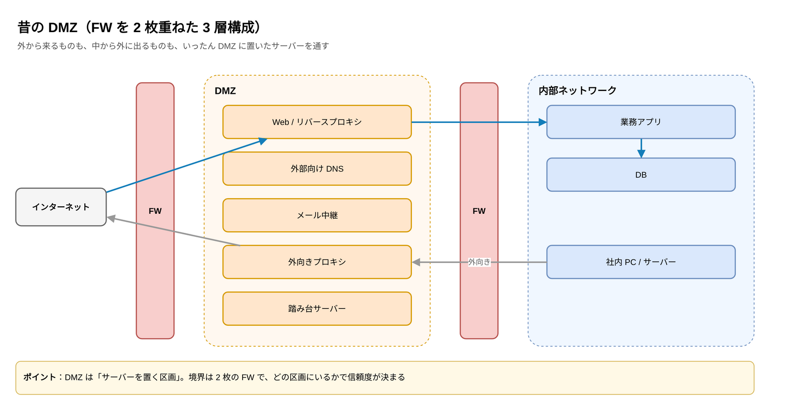
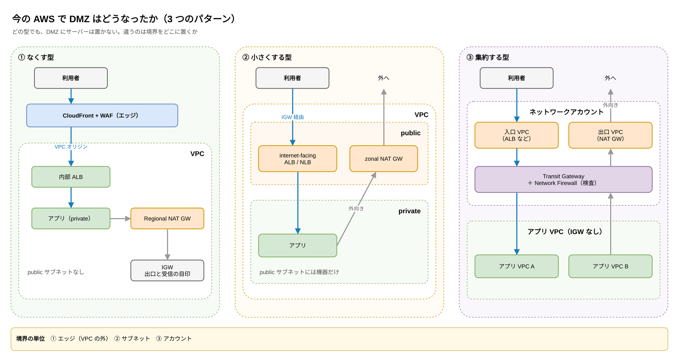
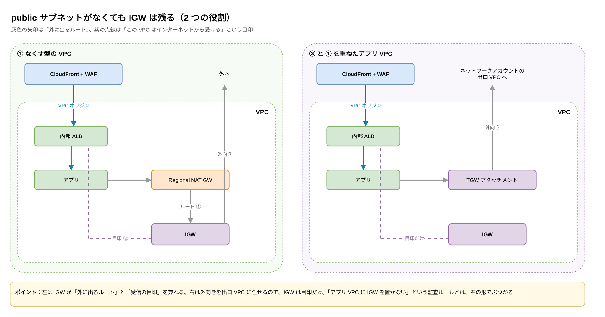
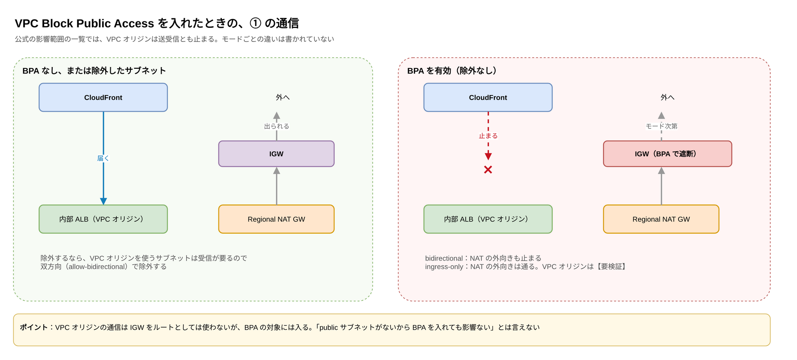

:::message
この記事は、Claude と一緒に AWS 公式ドキュメントを調べ、構成図を作りながら整理した内容をまとめたものです。各サービスの仕様は、記事中のリンク先の公式ドキュメントで確認できます。
:::

## はじめに

【ハジメが書く：基本情報技術者試験で DMZ を習ったこと、今の AWS の構成と比べてみようと思ったきっかけ】

## TL;DR

- 昔の DMZ は「サーバーを置く区画」でした。今の AWS では、DMZ にサーバーを置く構成はほぼなくなっています
- 残っている形は 3 つです。**① なくす型**（エッジ＋VPC オリジン＋Regional NAT GW）、**② 小さくする型**（public サブネットにマネージドな入口と出口だけ置く）、**③ 集約する型**（入口、出口、検査の VPC をアカウントごと分ける）
- 変わったのは「境界をどこに置くか」です。① はエッジ、② はサブネット、③ はアカウントが境界になります
- ① でも IGW はなくなりません。Regional NAT GW の出口であり、VPC オリジンや Global Accelerator にとっては「この VPC はインターネットから受ける」という目印でもあります

## 昔の DMZ は、サーバーを置く区画だった

基本情報技術者試験などで習う DMZ は、FW を 2 枚重ね、その間の区画に外と接するサーバーを置く構成です。

DMZ には、外から来る通信を受けるサーバー（Web、DNS、メール）と、中から外に出るためのサーバー（外向きプロキシ）、管理用の踏み台が同居していました。どの区画にいるかで、どこまで信頼するかが決まる考え方です。

## DMZ にいたサーバーは、ほとんど VPC の外に出た

まず、DMZ に置いていた役割ごとに、今の AWS で何が担当しているかを並べます。

| 昔の DMZ の役割 | 今の主な担当 | VPC の中にサーバーが要るか |
| --- | --- | --- |
| Web とリバースプロキシ | CloudFront + WAF（＋VPC オリジン） | 要らない（エッジ） |
| 外部向け DNS | Route 53 の公開ホストゾーン | 要らない |
| メール送信の中継 | Amazon SES | 要らない |
| 踏み台サーバー | Session Manager、EC2 Instance Connect Endpoint | 要らない（IAM で制御） |
| 外向きプロキシ | NAT GW、Network Firewall、Route 53 Resolver DNS Firewall | NAT GW は要る（Regional なら public サブネット不要） |
| HTTP 以外の公開（SFTP、UDP など） | internet-facing NLB、Global Accelerator、Transfer Family | 場合による |

Web、DNS、メール、踏み台は、VPC の外のマネージドサービスか、IAM で制御する仕組みに移りました。最後まで VPC の中に何かが残るのは、外向きの通信と HTTP 以外の公開です。この 2 つが、次の 3 パターンの分かれ目になります。

もう 1 つ残るものがあります。IGW です。これは後の節で扱います。

## 今の構成は、境界をどこに置くかで 3 つに分かれる

### ① なくす型では、エッジと IAM が境界になる

VPC に public サブネットを 1 つも作らない構成です。

- **入口**：CloudFront と WAF で受け、[VPC オリジン](https://docs.aws.amazon.com/AmazonCloudFront/latest/DeveloperGuide/private-content-vpc-origins.html)でプライベートサブネットの内部 ALB に届けます。VPC オリジンは [2024 年 11 月に登場](https://aws.amazon.com/about-aws/whats-new/2024/11/amazon-cloudfront-vpc-origins/)しました。それまでは、VPC の中のオリジンを使うなら public サブネットに置き、アクセス制御を自分で作る必要がありました。2026 年 10 月には[デュアルスタックにも対応](https://aws.amazon.com/about-aws/whats-new/2026/10/cloudfront-vpc-origin-dualstack/)し、IPv6 のためにオリジンを public に出す必要もなくなりました
- **出口**：[Regional NAT GW](https://docs.aws.amazon.com/vpc/latest/userguide/nat-gateways-regional.html) を使います。2025 年 11 月に出た機能で、NAT GW をサブネットではなく VPC に作るので、置き場所としての public サブネットが要りません
- **管理**：Session Manager を使います。インバウンドのポートを開ける必要はありません。ただし SSM への外向きの経路（NAT GW か VPC エンドポイント）は要ります

昔の DMZ のリバースプロキシの役割は、CloudFront が VPC の外で担っています。境界は「VPC の外のエッジ」と「IAM」です。

Regional NAT GW の[ドキュメント](https://docs.aws.amazon.com/vpc/latest/userguide/nat-gateways-regional.html)も、public サブネットが要らなくなることで、private にしたいリソースを public に通じるサブネットに置いてしまう設定ミスが起きにくくなる、と利点に挙げています。public サブネットは、置いた瞬間に「何かを置けてしまう場所」になるので、作らずに済むなら作らない方が管理が楽です。

気をつけることもあります。

- Regional NAT GW が新しい AZ に広がるまで時間がかかります。[発表ブログ](https://aws.amazon.com/blogs/networking-and-content-delivery/introducing-amazon-vpc-regional-nat-gateway/)では平均 15〜20 分、最大 60 分です。その間の通信は、既存の AZ の NAT が AZ をまたいで処理すると[ドキュメント](https://docs.aws.amazon.com/vpc/latest/userguide/nat-gateways-regional.html)に書かれています
- サブネットに紐づかないので、サブネット単位の設定は効きません

### ① の先には、アプリ用の VPC を持たない形もある

① は、アプリを VPC の中に置く前提です。2026 年 10 月に出た Lambda Web Functions を CloudFront の裏に置くと、Web アプリを動かすための VPC も、外に出るための NAT GW も持たずに済みます。外向きの通信は、既定では VPC を通らずに直接インターネットへ出るからです（[ドキュメント](https://docs.aws.amazon.com/lambda/latest/dg/web-functions-networking.html)）。

ただし、VPC の中のデータベースなどに届けたいなら、egress network connector で VPC につなぐ必要があります。egress network connector を使えるのは `HomeRegion` タイプのエンドポイントだけで、複数リージョンに振り分けるエンドポイントでは使えません（[ドキュメント](https://docs.aws.amazon.com/lambda/latest/dg/web-functions-networking.html)）。複数リージョンに分散しつつ VPC の中のデータを使いたいなら、つなぎ方を別に考える必要があります。

もう 1 つ気をつけたいのは、connector を付けると外向きの通信が VPC を通ることです。インターネットに出るには、connector のサブネットから NAT GW へのルートが必要になります。NAT GW を持たずに済むのは、connector を使わない場合だけです。なお、connector で変わるのは出ていく側だけで、受ける側のエンドポイントはどちらの場合も VPC の外にあり、インターネットから届きます。

アクセスの多くが海外から来るサイトで、VPC オリジンの構成からこの形に移った事例が、JAWS festa 2026 で発表されています（関連する記事を参照）。CloudFront からの守り方は、[9 パターン記事](https://zenn.dev/anfangd/articles/aws-web-ingress-origin-protection)の ⑨ にまとめました。

### ② 小さくする型では、public サブネットに機器だけを置く

public サブネットは残すものの、置くのはマネージドな入口と出口の機器だけで、EC2 は置かない構成です。

- **zonal NAT GW**：今までの NAT GW です。AZ ごとに public サブネットに置きます
- **internet-facing の ALB と NLB**：internet-facing の LB はノードが public IP を持ち（[ELB のドキュメント](https://docs.aws.amazon.com/elasticloadbalancing/latest/userguide/how-elastic-load-balancing-works.html)）、IGW へのルートがあるサブネットに置きます。CloudFront を使えない HTTP の公開や、SFTP、MQTT、UDP などの公開がここに当たります

昔の DMZ から、サーバーを抜いて機器だけを残した形です。境界はサブネットのままです。

HTTP 以外の公開でも、② を避ける道はあります。[Global Accelerator](https://docs.aws.amazon.com/global-accelerator/latest/dg/secure-vpc-connections.html) は、内部 ALB や NLB、プライベートサブネットの EC2 を直接エンドポイントにできます。LB や EC2 に public IP は要らず、サブネットに IGW へのルートも要りません。SFTP なら Transfer Family に任せる手もあります。

② になりやすいのは、むしろ意図していない場合です。EKS の Ingress コントローラーや ECS の機能に ALB の作成を任せていると、気づかないうちに public サブネットに入口ができていることがあります。たとえば ECS Express Mode は、public サブネットを渡すと internet-facing の ALB を作ります（[ドキュメント](https://docs.aws.amazon.com/AmazonECS/latest/developerguide/express-service-work.html)）。

### ③ 集約する型では、アカウントが境界になる

マルチアカウント構成で、入口、出口、検査を担う VPC をネットワーク用のアカウントに集め、Transit Gateway で各アカウントの VPC とつなぐ構成です。

- **入口 VPC**：ALB などで受け、Transit Gateway 経由で各アプリ VPC に届けます
- **出口 VPC**：NAT GW を集約し、各アプリ VPC には IGW を置きません
- **検査**：真ん中に Network Firewall や GWLB を置き、出入りの通信と VPC 間の通信を検査します

[AWS のブログ](https://aws.amazon.com/blogs/networking-and-content-delivery/choosing-the-right-inspection-architecture-for-aws-network-firewall/)によると、Network Firewall には 2025 年に、専用の検査 VPC を作らずに Transit Gateway へ直接つなぐ形などが加わり、検査 VPC を自分で作る以外の選択肢が増えています。

FW を真ん中に置いて全部の出入りをそこで見る、という考え方は昔の DMZ とほぼ同じです。違いは、それが 1 つのネットワークの区画ではなく、アカウントの単位で切り出されていることです。

### 新しく作るなら ① を基本にし、足りないところを ② と ③ で補う

3 つは排他ではなく、組み合わせて使います。

- 新しく作る Web アプリは ① を基本にする
- HTTP 以外の公開や、Regional NAT GW を使えない事情があるところだけ ② にする
- 組織全体で出入りをまとめて検査したい場合は、③ を土台にして、その上で各アプリを ① の形にする

ただし ③ と ① を重ねると、VPC オリジンのためにアプリ VPC にも IGW が戻ってきます。「アプリ VPC には IGW を置かない」を監査のルールにしている組織では、VPC オリジンを使う VPC をどう例外にするかを先に決める必要があります。

【ハジメが書く：個人的にはどれを基本にするか、その理由】

## public サブネットをなくしても、IGW は残る

① の構成を作ると、「public サブネットはないのに IGW は要る」という状態になります。

[VPC オリジン](https://docs.aws.amazon.com/AmazonCloudFront/latest/DeveloperGuide/private-content-vpc-origins.html)も [Global Accelerator](https://docs.aws.amazon.com/global-accelerator/latest/dg/secure-vpc-connections.html) も、プライベートサブネットのリソースに届けるのに、VPC に IGW がアタッチされていることを求めます。どちらのドキュメントも、IGW は「この VPC がインターネットからの通信を受けることを示すため」に必要で、ルートテーブルに IGW へのルートを書く必要はない、と説明しています。

つまり IGW には 2 つの役割があります。1 つは外に出るためのルートの行き先で、① では Regional NAT GW のルートテーブルが IGW を向いています。もう 1 つは「この VPC はインターネットから受ける」という目印で、VPC オリジンや Global Accelerator はこちらの意味で IGW を求めます。外向きの通信を ③ の出口 VPC に任せ、VPC オリジンだけで受けるアプリ VPC なら、IGW は目印の役割だけを持つことになります。

この扱いは新しいものではありません。Global Accelerator は 2020 年の[解説ブログ](https://aws.amazon.com/blogs/networking-and-content-delivery/accessing-private-application-load-balancers-and-instances-through-aws-global-accelerator/)で、IGW のアタッチを必須にした理由を説明しています。インターネットの通信が意図せず private サブネットに流れ込むのを防ぐためと、IGW の有無で境界を確認してきた組織が、その確認と監査を続けられるようにするためです。

逆に言うと、「public サブネットがない＝外と接していない」とは限りません。① の VPC も、IGW がある以上はインターネットからの入口を持っています。

## VPC Block Public Access を入れると、VPC オリジンも止まる

「public サブネットを作らない」を強制したいなら、[VPC Block Public Access（BPA）](https://docs.aws.amazon.com/vpc/latest/userguide/security-vpc-bpa.html)が候補になります。IGW を通るインターネットの通信を、アカウントやリージョン単位でまとめて止める機能です。

ただし、[影響範囲の一覧](https://docs.aws.amazon.com/vpc/latest/userguide/security-vpc-bpa-basics.html)には、CloudFront の VPC オリジンは送受信とも止まり、Global Accelerator は VPC への受信が止まると書かれています。一覧にはモードごとの違いは書かれていません。【要確認：ingress-only モードで VPC オリジンが止まるか、除外で戻るかを個人アカウントで検証して追記】

VPC オリジンの通信は IGW をルートとしては使いませんが、BPA の対象には入ります。① の構成は public サブネットがないだけで、IGW をアタッチしてインターネットから受ける VPC であることに変わりはありません。そのため BPA を有効にするなら、VPC オリジンを使う VPC やサブネットを除外する必要があります。「public サブネットがないから BPA を入れても影響ない」と考えると、サービスが止まります。

## 試した範囲と、まだ試していない範囲

この記事は公式ドキュメントとブログを読んで整理したもので、手元のアカウントではまだ試していません。次の 3 つは、個人のアカウントで確かめてから追記する予定です。

- IGW をデタッチすると、VPC オリジンが届かなくなるか
- BPA を ingress-only で有効にすると VPC オリジンが止まるか、除外で戻るか
- Regional NAT GW が新しい AZ に広がる間、その AZ の通信が AZ をまたいで出ていくか

【ハジメが書く：試した結果と感想（検証したら）】

## IPv6、Cloud WAN、料金はこの記事では扱わない

- IPv6（egress-only IGW を使えば、外向きの IPv6 に NAT も public サブネットも要りません）
- Cloud WAN を使った集約型の詳細
- 各パターンの料金比較

## おわりに

【ハジメが書く：本音・次にやりたいこと】

## 関連する記事

IGW が必要な理由や、BPA と VPC オリジンの関係は、前に書いた記事でも扱っています。この記事は、それを DMZ の役割の行き先という切り口で整理し直し、出口側も Regional NAT GW で public サブネットが要らなくなった点を足したものです。

- [AWSでWebリクエストを受ける9パターンと「オリジンを裸にしない」設定プラクティス](https://zenn.dev/anfangd/articles/aws-web-ingress-origin-protection)

「public サブネットをなくす」構成そのものは、次の記事でも詳しく紹介されています。

- [Amazon VPC からパブリックサブネットを無くしたい!（サーバーワークス）](https://blog.serverworks.co.jp/no-public-subnet)
- [パブリックサブネットレスなVPCにECS Express Mode環境を構築してみた（DevelopersIO）](https://dev.classmethod.jp/articles/ecs-express-mode-public-subnet-less/)
- [パブリックサブネットを持たない Web配信基盤の現在地（鈴木 亮さん、JAWS festa 2026）](https://www.docswell.com/s/suzryo/KDMX88-2026-11-07-160134)

## 参考

- [Restrict access with VPC origins - Amazon CloudFront](https://docs.aws.amazon.com/AmazonCloudFront/latest/DeveloperGuide/private-content-vpc-origins.html)
- [Amazon CloudFront announces VPC origins](https://aws.amazon.com/about-aws/whats-new/2024/11/amazon-cloudfront-vpc-origins/)
- [Regional NAT gateways for automatic multi-AZ expansion - Amazon VPC](https://docs.aws.amazon.com/vpc/latest/userguide/nat-gateways-regional.html)
- [Introducing Amazon VPC Regional NAT Gateway](https://aws.amazon.com/blogs/networking-and-content-delivery/introducing-amazon-vpc-regional-nat-gateway/)
- [Secure VPC connections in AWS Global Accelerator](https://docs.aws.amazon.com/global-accelerator/latest/dg/secure-vpc-connections.html)
- [How Elastic Load Balancing works](https://docs.aws.amazon.com/elasticloadbalancing/latest/userguide/how-elastic-load-balancing-works.html)
- [Choosing the right inspection architecture for AWS Network Firewall](https://aws.amazon.com/blogs/networking-and-content-delivery/choosing-the-right-inspection-architecture-for-aws-network-firewall/)
- [VPC BPA basics - Amazon VPC](https://docs.aws.amazon.com/vpc/latest/userguide/security-vpc-bpa-basics.html)

<!-- 公開前に削除する
## 公開前の確認事項

- 手を動かした検証がまだない。個人アカウントで ① を組み、次を確かめると記事の芯になる
  - IGW をデタッチすると VPC オリジンが届かなくなるか
  - VPC BPA を ingress-only で有効にすると VPC オリジンが止まるか、除外で戻るか
  - Regional NAT GW の拡張中に、新しい AZ の通信が AZ をまたいで出るか（Flow Logs で確認）
- サーバーワークスの記事のリンク先が実在するか確認する（レビュー時に取得できなかった）
- 【はじめに】には、9 パターン記事のあとで、なぜ DMZ の切り口で書き直すのかを入れると続編として読める
- 「② になりやすいのは EKS/ECS の Ingress コントローラー」は一般論。具体例を足すか検討
-->
